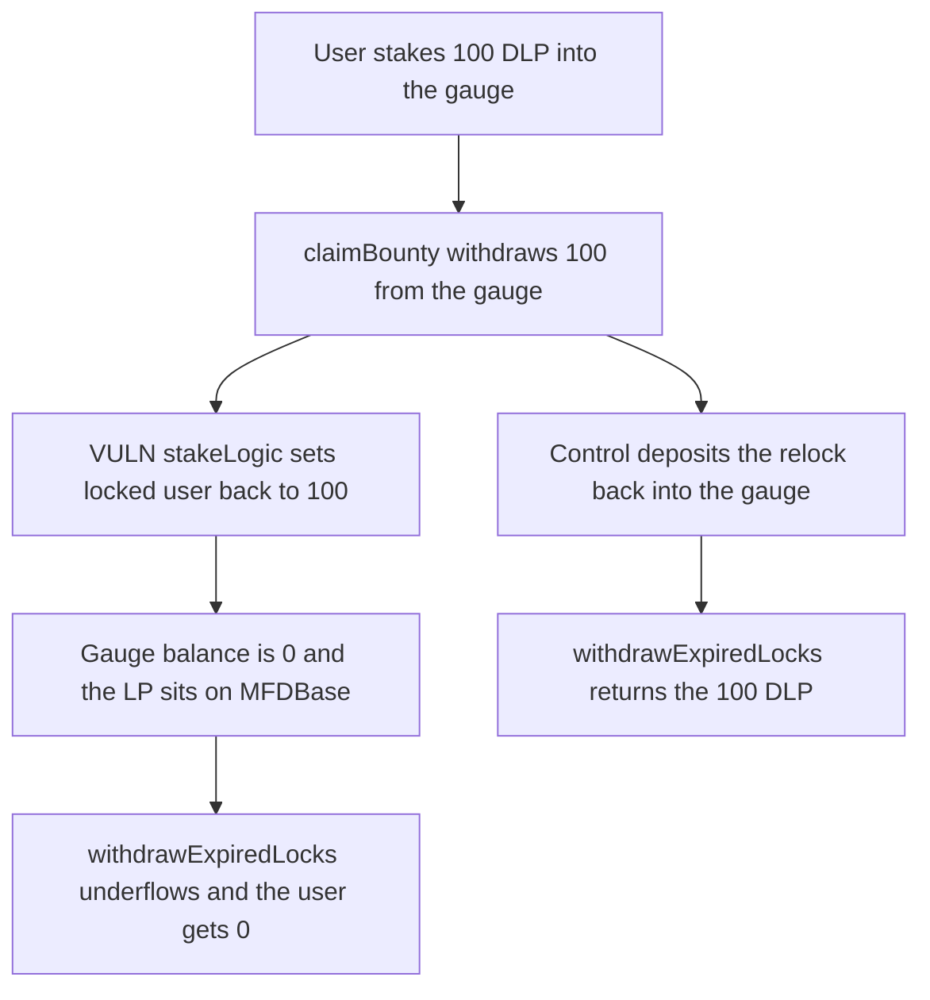

# Defi App relock unstakes the gauge and the 100 LP tokens cannot be withdrawn

> **Vulnerability classes:** vuln/dos/frozen-funds · vuln/logic/incorrect-order-of-operations

<!-- non-defihacklabs -->
<!-- source-auditvault: https://github.com/Auditware/AuditVault/blob/main/findings/53445-relocking-through-mfdbaseclaimbounty-leads-to-accounting-err.md -->
<!-- date: 2025-02 -->

## Key info

| Field | Value |
|---|---|
| **Loss** | 100 DLP stuck on MFDBase. `withdrawExpiredLocks` reverts and the staker receives 0 |
| **Vulnerable contract** | `MFDBase.stakeLogic` called from `claimBounty` |
| **Attacker EOA** | `0x1111111111111111111111111111111111111111` |
| **Attack contract** | `Exploit` at `0x15452ec016c4dc8c549e7fe6ff4b26324ea8b7a4` |
| **Attack tx** | `Exploit.run()` |
| **Chain / block / date** | Ethereum model · block 0 · 2025-02 |
| **Compiler** | solc 0.8.27, cancun, via IR |
| **Bug class** | Relock restores `locked[user]` after the gauge withdraw and never deposits again |

## TL;DR

`claimBounty` always pulls the lock out of the gauge. When auto-relock is on, `stakeLogic` writes `locked[user] = amount` and does not call the gauge deposit hook. The gauge balance is 0, the user accounting still says 100, and the next withdraw underflows. The 100 DLP sits on the staker contract.

## Background

Cantina's February 2025 Defi App review, reported by KlosMitSoss. Staking deposits into a gauge in `_afterStakeHook`. Withdrawals unstake in `_beforeWithdrawExpiredLocks`. `claimBounty` ran that unstake even when the amount was going to be relocked through `stakeLogic`, and `stakeLogic` does not go back through the stake hook.

## The vulnerable code

```solidity
function stakeLogic(uint256 amount, address user) public {
    // @> VULN: relock restores userBalances here and never deposits the unstaked LP back into the gauge
    locked[user] = amount;
}
```

`claimBounty` has already executed `gauge.withdraw(amount)`. The LP tokens are on MFDBase. `stakeLogic` only repairs the user lock.

`MFDBaseFixed.claimBounty` calls `_afterStakeHook` after the relock, which deposits the same amount back into the gauge. `withdrawExpiredLocks` then succeeds and returns the 100 DLP.

## Root cause

The withdraw hook and the relock path are not paired. Unstake is unconditional. Restake updates the balance mapping and skips the gauge. A later withdraw assumes the gauge still holds `locked[user]`.

## Preconditions

- The user has staked 100 DLP, so the gauge balance of the staker equals `locked[user]`.
- Auto-relock is enabled (`autoRelockDisabled` is false). The user calls `setAutoRelock(true)` in this run.
- `claimBounty` is invoked for that user. The bounty manager is the intended caller. The bug is the accounting, not who is allowed to call.

## Attack walkthrough

1. The user approves and stakes 100 DLP. The gauge holds 100 and `locked[user]` is 100.
2. Auto-relock is turned on.
3. `claimBounty` withdraws 100 from the gauge, then `stakeLogic` sets `locked[user]` back to 100.
4. `withdrawExpiredLocks` calls `gauge.withdraw(100)` and reverts on the empty gauge balance.
5. MFDBase still holds 100 DLP. The user holds 0.
6. The fixed path deposits back into the gauge. The same withdraw returns 100 DLP to the user.

## Diagrams



## Impact

The staker cannot withdraw. 100 DLP is frozen on MFDBase while `locked[user]` still reports 100. The fixed order returns the full 100 to the user and leaves both the gauge and the lock at 0.

## Remediation

Call `_afterStakeHook` after `stakeLogic` when the bounty is relocked, or skip `_beforeWithdrawExpiredLocks` when the funds are not actually leaving. Defi App fixed this in commit 9ad6caf8.

## How to reproduce

```bash
cd 53445-relocking-through-mfdbaseclaimbounty-leads-to-accounting-err_exp
forge test -vv
```

`test_exploit_relock_locks_lp_tokens` asserts the withdraw reverts, the gauge is empty, and 100 DLP remains on the staker. `test_control_restake_lets_user_withdraw` asserts the user receives 100 DLP back. Captured output is `output.txt`.

## Sources

- AuditVault finding: https://github.com/Auditware/AuditVault/blob/main/findings/53445-relocking-through-mfdbaseclaimbounty-leads-to-accounting-err.md
- Cantina report: https://cdn.cantina.xyz/reports/cantina_competition_defi_app_february2025.pdf
