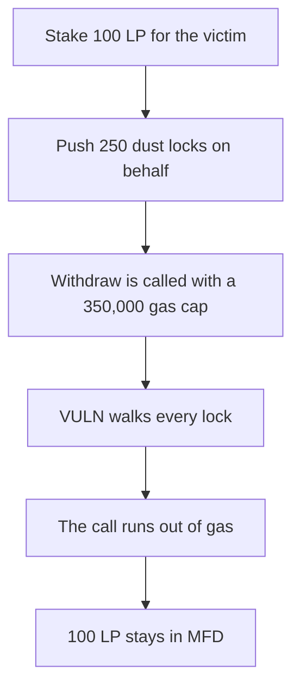

# DefiApp: on-behalf stake pushes dust locks until the victim's withdraw runs out of gas

> **Vulnerability classes:** vuln/dos/unbounded-loop · vuln/dos/frozen-funds

<!-- non-defihacklabs -->
<!-- source-auditvault: https://github.com/Auditware/AuditVault/blob/main/findings/53446-malicious-user-can-flood-a-user-s-staked-locks-array-and-pre.md -->
<!-- date: 2025-02 -->

## Key info

| Field | Value |
|---|---|
| **Loss** | 100 LP plus 250 dust units stuck in MFD |
| **Vulnerable contract** | `MFD.stake` / `handleWithdrawOrRelockLogic` |
| **Attacker EOA** | `0x5344600000000000000000000000000000000001` |
| **Attack contract** | `Exploit` |
| **Attack tx** | `Exploit.run()` |
| **Chain / block / date** | Ethereum model · block 0 · 2025-02 |
| **Compiler** | solc 0.8.27, cancun, via IR |
| **Bug class** | `withdrawExpiredLocks` walks `userLocks.length` with no cap |

## TL;DR

`stake` pushes a `StakedLock` for any address. `withdrawExpiredLocks` then walks the whole array. After one real 100 LP lock and 250 one-wei locks, that walk costs more than a 350,000 gas cap that still fits a single lock. The victim's call reverts and the tokens stay in MFD. Capping the array at one lock lets the same cap return the 100 LP.

## Background

Cantina's February 2025 Defi App competition, reported by pineneedles. `MFDBase.stake` stakes on behalf of another user, and every withdraw path passes `userLocks[msg.sender].length` into `MFDLogic.handleWithdrawOrRelockLogic`. The team capped the array in commit `e040e481`.

## The vulnerable code

```solidity
userLocks[onBehalf].push(StakedLock({amount: amount, unlockTime: 1}));
return handleWithdrawOrRelockLogic(msg.sender, false, userLocks[msg.sender].length);
// @> VULN: limit is userLocks.length, so the dust entries are walked before any token is sent
for (uint256 i = 0; i < limit; i++) {
    StakedLock memory lock = userLocks[user][i];
}
```

## Root cause

The on-behalf push has no length limit, and the withdraw uses that length as the loop bound.

## Preconditions

- `stake(onBehalf, amount)` is permissionless.
- Locks are already expired. `unlockTime` is 1 and the block time is later.
- The victim withdraws with a gas cap that covers one lock and not 251.

## Attack walkthrough

1. Stake 100 LP for the victim. The push is uncapped.
2. Push 250 one-wei locks onto the same array.
3. The victim calls `withdrawExpiredLocks` with a 350,000 gas stipend.
4. The handler starts at index 0 and reads every lock plus a fresh slot. The call runs out of gas before the transfer.
5. MFD still holds 100 LP plus 250 wei. The victim's balance is 0.
6. A one-lock withdraw under the same cap succeeds. The fixed contract reverts the second `stake`.

## Diagrams


