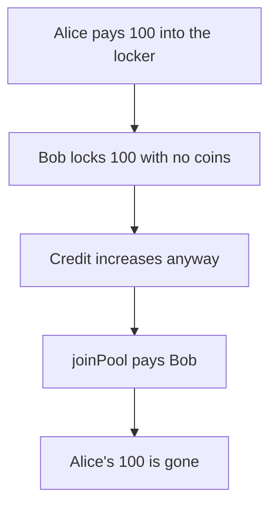

# Persistence: empty funds list locks 100 of Alice's LST

> **Vulnerability classes:** vuln/logic/missing-check

<!-- non-defihacklabs -->
<!-- source-auditvault: https://github.com/Auditware/AuditVault/blob/main/findings/53505-prst-5-user-can-lock-and-stake-arbitrary-amount-of-tokens-wi.md -->
<!-- date: 2024-01 -->

## Key info

| | |
|---|---|
| **Protocol** | Persistence |
| **Finding** | Hexens PRST-5, AuditVault 53505 |
| **Vulnerable code** | `Locker.lockLstAsset` |
| **Harm** | Bob locks 100 with an empty funds list and joinPool pays him Alice's 100 LST. The fixed locker reverts and her 100 stays. |
| **Chain** | local synthetic |

## TL;DR

The amount check runs only when `funds` contains the denom. An empty list skips it, then the lock balance still increases. `joinPool` pays that credit from the tokens Alice deposited.

## The vulnerable code

```solidity
        // @> VULN: lock credit increases even when funds contained no matching coin
        locked_amount = locked_amount + asset.amount;
```

## Root cause

Nothing requires that the funds loop actually matched the denom before the credit is stored.

## Preconditions

Alice has locked 100 ux and the contract holds those tokens. Bob can call lock with an empty coin list.

## Attack walkthrough

1. Alice locks 100 and pays 100 LST. See [output.txt](output.txt).
2. The credit line runs for her paying call.
3. Bob locks 100 with an empty funds array. No tokens move.
4. Bob's lock record is 100.
5. `joinPool` transfers 100 to Bob.
6. The locker balance is 0 and Alice's credit is still 100. The fixed path reverts the unpaid lock.

## Diagrams



## Impact

Alice loses 100 LST. Bob paid nothing. The fixed locker reverts unless a matching coin was pulled.

## Remediation

Require that a coin of the locked denom was received for the full amount before increasing the lock balance.

## How to reproduce

```bash
cd 53505-prst-5-user-can-lock-and-stake-arbitrary-amount-of-tokens-wi_exp
forge test -vv
```
