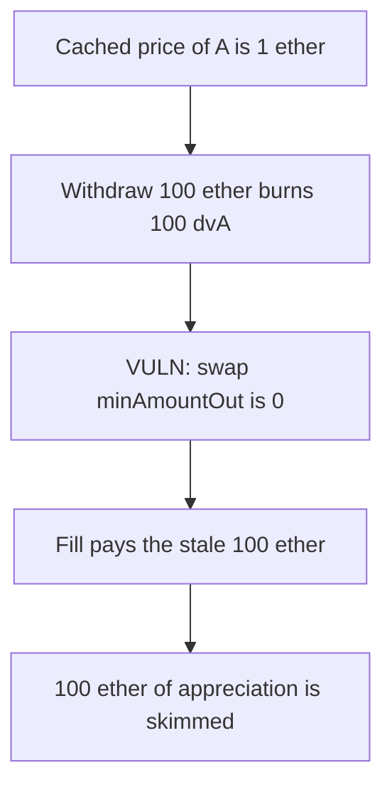

# Tokemak: a 100 ether price move is skimmed on withdraw

> **Vulnerability classes:** vuln/defi · vuln/oracle · vuln/logic

> **Reproduction:** a self-contained Foundry PoC that compiles and runs offline
> with only `forge-std` - no fork and no RPC.
> PoC: [test/53521-toke-28-positive-price-movements-of-vault-assets-can-be-dire_exp.sol](test/53521-toke-28-positive-price-movements-of-vault-assets-can-be-dire_exp.sol).

<!-- non-defihacklabs -->
<!-- source-auditvault: https://github.com/Auditware/AuditVault/blob/main/findings/53521-toke-28-positive-price-movements-of-vault-assets-can-be-dire.md -->
<!-- date: 2024-07 -->

## Key info

| Field | Value |
|---|---|
| **Loss** | 100 ether of unsynced asset-A appreciation (50 A priced at 2 ether) |
| **Protocol** | Tokemak Autopool |
| **Bug class** | Stale cached debt plus minAmountOut of 0 |
| **Source** | [AuditVault finding](https://github.com/Auditware/AuditVault/blob/main/findings/53521-toke-28-positive-price-movements-of-vault-assets-can-be-dire.md) |
| **Report** | [Hexens Tokemak, TOKE-28](https://github.com/solodit/solodit_content/blob/main/reports/Hexens/2024-07-22-Tokemak.md) |
| **Chain / block / date** | Ethereum model · block 0 · 2024-07 |
| **Compiler** | solc 0.8.27, cancun, via IR |

## TL;DR

Asset A has doubled to 2 ether, but `updateDebtReport` has not run, so the Autopool still prices 100 dvA shares at 100 ether. Withdrawing 100 ether burns all of those shares. The destination swap is called with `minAmountOut = 0`, so a sandwiched fill can return only the stale 100 ether. The other 100 ether is skimmed. Passing `minAmountOut` of the fair 200 ether reverts and nothing is taken.

## The vulnerable code

```solidity
uint256 price = dest.cachedPrice(); // still 1 ether; updateDebtReport was not called
uint256 dvShares = assets * 1 ether / price;
// @> VULN: minAmountOut is hardcoded to 0, so the stale cached fill is accepted
got = dest.withdrawBaseAsset(dvShares, 0);
```

## Root cause

Withdrawal sizing uses the cached debt price, and the destination swap does not enforce a minimum out. After a positive price move the pool liquidates dvA as if it were still worth 1 ether, and the swap is allowed to fill at that stale price. The difference between the true 2 ether price and the cached 1 ether price leaves the pool.

## Preconditions

- The caller holds 100 Autopool shares and withdraws 100 ether of assets. No admin role is required.
- The destination vault holds 100 dvA. Cached price is 1 ether. True price is 2 ether, so the position is worth 200 ether.
- `updateDebtReport` has not been called.
- The swap's `minAmountOut` is 0.

## Attack walkthrough

1. Read cached price 1 ether and burn 100 dvA for a 100 ether withdrawal.
2. Call the destination swap with minAmountOut 0.
3. Value the same shares at the true price: 200 ether.
4. Accept a fill of 100 ether because 100 >= 0.
5. Send the 100 ether difference out as skim.
6. Forward only the stale 100 ether to the withdrawer.

## Diagrams



## Impact

100 ether that should have remained as surplus (or accrued to shareholders at the synced 1.1 share rate) is taken on a permissionless withdraw. The control reverts when minAmountOut is the fair 200 ether, and the vault still holds all 200 ether.

## Remediation

Do not call the destination swap with minAmountOut 0. Set it from the synced asset price, or update the debt report before sizing the withdrawal.

## How to reproduce

```bash
cd 53521-toke-28-positive-price-movements-of-vault-assets-can-be-dire_exp
forge test -vv
```

`run()` is the harm path. The control test uses the corrected comparison or guard and does not produce the loss number.
