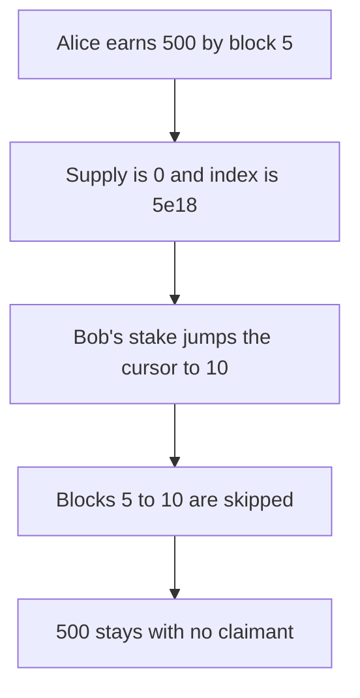

# Tokemak: empty reward window strands 500

> **Vulnerability classes:** vuln/logic/reward-calculation

<!-- non-defihacklabs -->
<!-- source-auditvault: https://github.com/Auditware/AuditVault/blob/main/findings/53522-toke-4-incorrect-updating-of-lastupdateblock-could-result-in.md -->
<!-- date: 2024-07 -->

## Key info

| | |
|---|---|
| **Protocol** | Tokemak |
| **Finding** | Hexens TOKE-4, AuditVault 53522 |
| **Vulnerable code** | `Rewarder._updateReward` |
| **Harm** | Of 1500 rewards funded, Alice and Bob are paid 500 each and 500 stays in the rewarder with no claimant. The fixed rewarder queues that 500 and pays it. |
| **Chain** | local synthetic |

## TL;DR

`lastUpdateBlock` is updated whenever `rewardPerTokenStored` is nonzero. After Alice exits, the stored index is still `5e18` while supply is 0. Bob's stake at block 10 jumps the cursor over blocks 5 to 10. Those 500 rewards are never assigned.

## The vulnerable code

```solidity
        // @> VULN: lastUpdateBlock moves whenever rewardPerTokenStored > 0, even if totalSupply() is 0
        if (rewardPerTokenStored > 0) {
```

## Root cause

A zero supply does not make the stored reward-per-token zero, but the update still treats a nonzero index as a reason to move the cursor.

## Preconditions

The reward rate is 100 per block, the period ends at block 15, and the clock is a contract variable advanced inside the same transaction.

## Attack walkthrough

1. Fund 1500 and stake Alice 100 at block 0. See [output.txt](output.txt).
2. Alice withdraws at block 5 and is owed 500. The stored index is `5e18`.
3. Bob stakes 100 at block 10. Supply is 0 and the cursor jumps to 10.
4. Bob claims 500 at block 15. Alice is paid 500.
5. The rewarder still holds 500.
6. `queuedRewards` is 0, so nothing can sweep it. The fixed path queues 500 and pays it.

## Diagrams



## Impact

500 of the 1500 funded rewards cannot be claimed. The fixed branch adds that window to `queuedRewards` and the sweep pays 500.

## Remediation

When `totalSupply` is 0, add `(lastBlock - lastUpdate) * rewardRate` to the queued rewards and still snapshot the user's paid index.

## How to reproduce

```bash
cd 53522-toke-4-incorrect-updating-of-lastupdateblock-could-result-in_exp
forge test -vv
```
