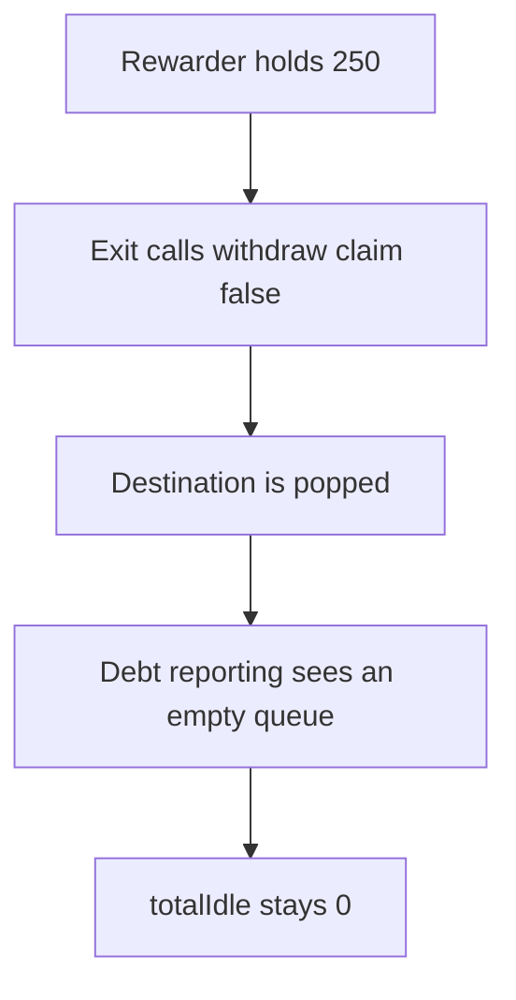

# Tokemak: removing an empty destination drops 250 rewards

> **Vulnerability classes:** vuln/logic/reward-calculation · vuln/logic/incorrect-order-of-operations

<!-- non-defihacklabs -->
<!-- source-auditvault: https://github.com/Auditware/AuditVault/blob/main/findings/53523-toke-6-loss-of-reward-from-destinationvaultmainrewarder-if-t.md -->
<!-- date: 2024-07 -->

## Key info

| | |
|---|---|
| **Protocol** | Tokemak |
| **Finding** | Hexens TOKE-6, AuditVault 53523 |
| **Vulnerable code** | `AutoPool._beforeTokenTransfer` |
| **Harm** | A full exit leaves 250 of accrued rewards in the main rewarder and totalIdle stays 0. The fixed path claims first and totalIdle is 250. |
| **Chain** | local synthetic |

## TL;DR

The exit calls `rewarder.withdraw` with `claim` false, then pops the destination from `debtReportQueue`. The next `updateDebtReporting` does not see it, so the 250 is never added to `totalIdle`.

## The vulnerable code

```solidity
            // @> VULN: claim is false, so accrued reward is not transferred to the auto pool
            rewarder.withdraw(from, amount, false);
```

## Root cause

The queue removal assumes an empty destination has nothing left to report. The rewarder still holds rewards because the exit did not claim them.

## Preconditions

The destination is on the debt queue with 250 of rewards already accounted to the auto pool.

## Attack walkthrough

1. Load the destination and fund the rewarder with 250. See [output.txt](output.txt).
2. `flashRebalanceOut` sets the balance to 0.
3. The hook withdraws the stake with `claim` false.
4. The destination is popped from all three queues.
5. `updateDebtReporting` returns because the queue is empty.
6. `totalIdle` is 0 and the rewarder still holds 250. The fixed path claims first.

## Diagrams



## Impact

The auto pool's idle balance misses 250. The fixed order claims before the pop, and totalIdle becomes 250.

## Remediation

Claim the rewarder balance and add it to totalIdle before removing the destination from the queues.

## How to reproduce

```bash
cd 53523-toke-6-loss-of-reward-from-destinationvaultmainrewarder-if-t_exp
forge test -vv
```
