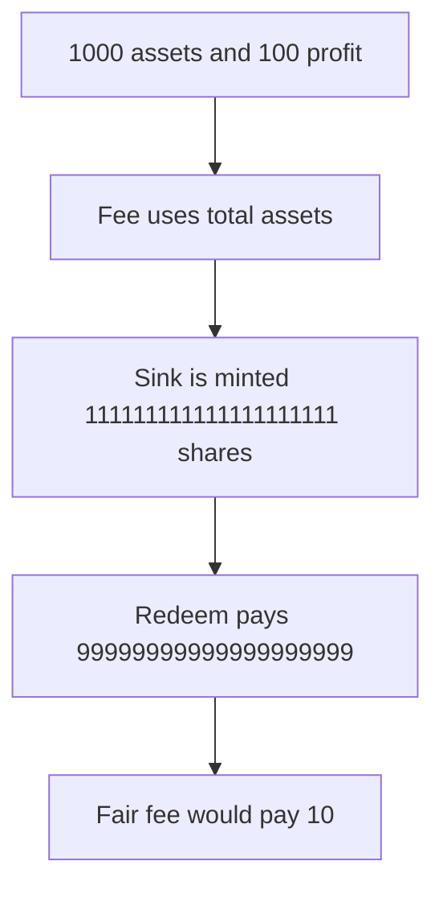

# Tokemak: streaming fee on total assets pays the sink 99999999999999999999

> **Vulnerability classes:** vuln/logic/fee-calculation · vuln/defi/fee-manipulation

<!-- non-defihacklabs -->
<!-- source-auditvault: https://github.com/Auditware/AuditVault/blob/main/findings/53524-toke-14-incorrect-streaming-fee-share-calculation-hexens-non.md -->
<!-- date: 2024-07 -->

## Key info

| | |
|---|---|
| **Protocol** | Tokemak |
| **Finding** | Hexens TOKE-14, AuditVault 53524 |
| **Vulnerable code** | `FeeVault._mintStreamingFee` |
| **Harm** | A 10 percent fee on 1000 assets, of which only 100 is profit, mints shares that redeem for 99999999999999999999. The profit-based fee redeems for 10. |
| **Chain** | local synthetic |

## TL;DR

`_calculateSharesToMintFeeCollection` prices the streaming fee from `totalAssets`. The sink is minted `111111111111111111111` shares and redeems `99999999999999999999` assets. A fee on the 100 of profit pays 10.

## The vulnerable code

```solidity
        // @> VULN: fee assets are totalAssets times the fee bps, not the profit
        uint256 feeAssets = assets * feeBps / FEE_DIVISOR;
```

## Root cause

The share formula uses the whole asset balance. The streaming fee is supposed to apply to profit only.

## Preconditions

The vault has 1000 assets and 1000 shares. Profit inside the total is 100. The fee is 1000 basis points.

## Attack walkthrough

1. Load 1000 assets and 1000 shares. See [output.txt](output.txt).
2. Charge the streaming fee.
3. The vulnerable branch mints `111111111111111111111` shares.
4. Those shares redeem for `99999999999999999999` assets.
5. The sink's token balance is that amount.
6. The fixed branch, which uses profit times the fee, pays 10.

## Diagrams



## Impact

LPs give up about 90 more assets than the 10 the profit fee would take. The fixed mulDiv on profit pays exactly 10.

## Remediation

Mint `profit * feeBps * supply / (totalAssets * FEE_DIVISOR - profit * feeBps)`, rounding up.

## How to reproduce

```bash
cd 53524-toke-14-incorrect-streaming-fee-share-calculation-hexens-non_exp
forge test -vv
```
