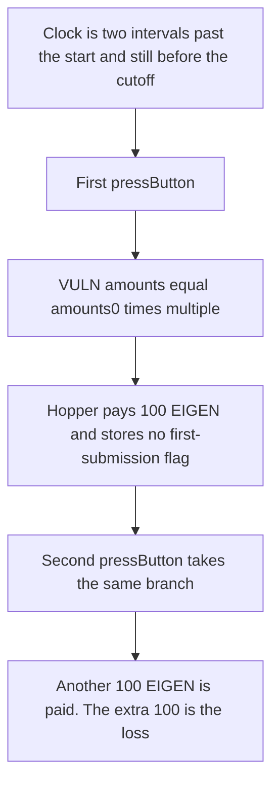

# EigenLayer: the first-submission catch-up is paid on every press

> **Vulnerability classes:** `vuln/logic/reward-calculation` · `vuln/logic/missing-check`

<!-- non-defihacklabs -->
<!-- source-auditvault: https://github.com/Auditware/AuditVault/blob/main/findings/53581-first-submission-can-be-triggered-multiple-times-sigmaprime.md -->
<!-- date: 2025-03 -->

## Key info

| Field | Value |
|---|---|
| **Loss** | Two presses pay 200 EIGEN. One catch-up is 100. The extra 100 is the second payment |
| **Vulnerable contract** | `RewardAllStakersActionGenerator.generateHopperActions` |
| **Attacker EOA** | `0x1111111111111111111111111111111111111111` |
| **Attack contract** | `Exploit` |
| **Attack tx** | `Exploit.run()` |
| **Chain / block / date** | Ethereum model · timestamp 100 · 2025-03 |
| **Compiler** | solc 0.8.27, cancun, via IR |

## TL;DR

`generateHopperActions` is a view. While `block.timestamp <= firstSubmissionTriggerCutoff` it sets `amountsToUse = amounts * multiple` and does not remember that this already happened. `TokenHopper.pressButton` uses that amount on every press. In this configuration the cooldown is 0, one interval is 1 second, and the clock sits two intervals after the start and still inside the cutoff, so `multiple` is 2. Each press pays 100 EIGEN. Two presses pay 200. A hopper that records `firstDone` reverts the second press and pays 100 once.

## The vulnerable code

```solidity
if (block.timestamp <= firstSubmissionTriggerCutoff) { // @> VULN: every press before the cutoff applies the catch-up multiple
    uint32 multiple = (uint32(block.timestamp) - firstSubmissionStartTimestamp) / uint32(CALCULATION_INTERVAL_SECONDS);
    amountsToUse0 = amounts0 * multiple;
    firstBranch = true;
}
```

That is the report's branch. The live constants are one week and a deployment-time cutoff. Here one interval is 1 second so the same branch is observable in a single block: the constructor sets the start to `block.timestamp - 2` and the cutoff to a year later. The replay pins `block.timestamp` at 100, which is also the forge test's `vm.warp(100)` before deploy. The cooldown is 0, the configuration the report says can admit more than one press before the cutoff.

## Root cause

The generator does not take an `isFirstSubmission` flag and the hopper does not store whether `pressButton` has already produced the catch-up. The cutoff timestamp is the only gate, and it stays open across presses.

## Preconditions

- `block.timestamp` is 100. The start is 98. `CALCULATION_INTERVAL_SECONDS` is 1. `multiple` is 2.
- `cooldown` is 0, so the second press in the same timestamp passes `timestamp >= lastPress + cooldown`.
- The hopper holds at least 200 EIGEN. One interval's `amounts0` is 50 EIGEN, so one catch-up is 100.

## Attack walkthrough

1. The hopper is funded with 400 EIGEN.
2. The first `pressButton` takes the cutoff branch and pays 100 EIGEN.
3. Nothing records that the first submission happened.
4. The second `pressButton` takes the same branch and pays another 100.
5. `paid` is 200 and `presses` is 2.
6. The extra 100 is sent to the sink. The first 100 stays as the legitimate catch-up.

## Diagrams



## Impact

Stakers receive the catch-up multiple once per press instead of once per hopper. In this run that is 100 EIGEN too much. On the live weekly schedule the same bug pays `weeksElapsed * weeklyAmount` on every press that lands before the cutoff. EigenLayer closed it by requiring the hopper start to sit at most one week before the cutoff, so only one press fits, and by commit `9cf6f41`.

## Remediation

Remember the first submission. The control hopper sets `firstDone` on the cutoff branch and the second `pressButton` reverts with `already submitted`. Only 100 EIGEN is paid.

## How to reproduce

```bash
cd 53581-first-submission-can-be-triggered-multiple-times-sigmaprime_exp
forge test -vv
```

`test_exploit_first_submission_multiple_is_paid_twice` asserts two presses, 200 EIGEN paid, and a 100 EIGEN sink balance. `test_control_second_press_before_cutoff_reverts` asserts the flagged hopper pays 100 and reverts the second press. Both tests warp to timestamp 100 before deploy.

## Sources

- AuditVault finding: https://github.com/Auditware/AuditVault/blob/main/findings/53581-first-submission-can-be-triggered-multiple-times-sigmaprime.md
- Sigma Prime report: https://github.com/sigp/public-audits/blob/master/reports/eigenlayer/Sigma_Prime_EigenLabs_EigenLayer_EIGEN_Rewards_Security_Assessment_Report_v2.0.pdf
- The finding quotes the cutoff check and `amountsToUse[0] = amounts[0] * multiple`. The reduction keeps that expression. The public report file was committed on 2025-03-18.
