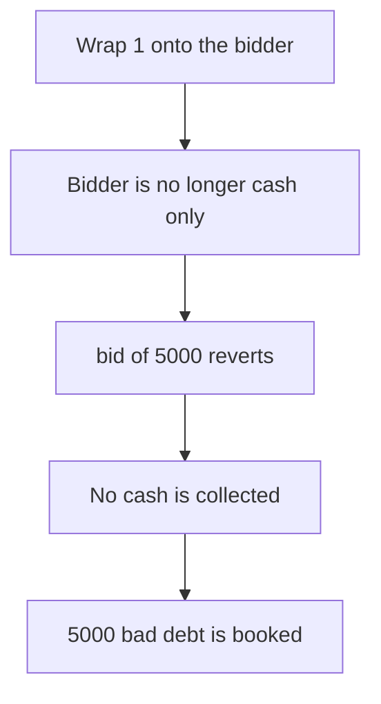

# Derive: wrapped deposit blocks a 5000 bid

> **Vulnerability classes:** vuln/logic/missing-check · vuln/dos/frozen-funds

<!-- non-defihacklabs -->
<!-- source-auditvault: https://github.com/Auditware/AuditVault/blob/main/findings/53724-bids-can-be-blocked-by-depositing-tokens-to-liquidator-sigma.md -->
<!-- date: 2023-12 -->

## Key info

| | |
|---|---|
| **Protocol** | Derive |
| **Finding** | Sigma Prime, AuditVault 53724 |
| **Vulnerable code** | `WrappedERC20.deposit` |
| **Harm** | Wrapping 1 token onto the bidder makes the 5000 bid revert. The unbid auction books 5000 of bad debt. The fixed deposit requires approval and the bid collects 5000. |
| **Chain** | local synthetic |

## TL;DR

`deposit` credits a wrapped balance to any recipient. `_ensureBidderCashBalance` then reverts because the bidder is no longer cash-only. The 5000 cash bid does not collect, and settlement books 5000 of shortfall.

## The vulnerable code

```solidity
    // @> VULN: this wrapped balance is credited to any recipient, with no approval
    mapping(address => uint256) public balanceOf;
```

## Root cause

Options transfers were gated on recipient approval. Wrapped ERC20 deposits were not, so anyone can plant a non-cash balance on a bidder.

## Preconditions

The bidder has 5000 cash approved and is about to bid. The attacker can wrap 1 unit of underlying onto that same account.

## Attack walkthrough

1. Wrap 1 of underlying onto the bidder. See [output.txt](output.txt).
2. `balanceOf` the bidder becomes 1.
3. The bidder calls `bid` for 5000.
4. `_ensureBidderCashBalance` reverts.
5. `cashCollected` stays 0.
6. `settleUnbid` books 5000. The fixed deposit reverts without approval, and the bid collects 5000.

## Diagrams



## Impact

The shortfall of 5000 is not covered by the bid. The fixed wrapper rejects the unapproved deposit and the bid pulls 5000 cash.

## Remediation

Require the recipient to have approved wrapped deposits before crediting `balanceOf`.

## How to reproduce

```bash
cd 53724-bids-can-be-blocked-by-depositing-tokens-to-liquidator-sigma_exp
forge test -vv
```
