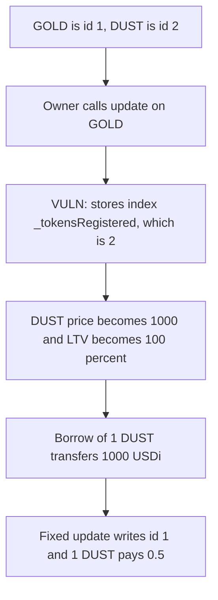

# Interest Protocol — updateRegisteredErc20 prices DUST and pays out 1000 USDi

> **Vulnerability classes:** vuln/logic/state-update · vuln/oracle/wrong-feed

<!-- non-defihacklabs -->
<!-- source-auditvault: https://github.com/Auditware/AuditVault/blob/main/findings/53742-updateregisterederc20modifies-the-wrong-token-sigmaprime-non.md -->
<!-- date: 2023-05 -->

## Key info

| | |
|---|---|
| **Protocol** | Interest Protocol |
| **Finding** | Sigma Prime, AuditVault 53742 |
| **Vulnerable code** | `Vault.updateRegisteredErc20` |
| **Harm** | A borrow of 1 DUST transfers 1000 USDi; the call named GOLD |
| **Chain** | local synthetic |

## TL;DR

`updateRegisteredErc20(token_address, LTV, oracle_address, liquidationIncentive)` is supposed to retarget the collateral named by `token_address`. Both stores use `_tokensRegistered`, the id of the last token passed to `registerErc20`, which is copied from that function. GOLD is id 1. DUST is id 2 and was registered second, so `_tokensRegistered` is 2. An update that names GOLD writes the new oracle and the new LTV onto DUST. Borrowing 1 DUST at the new price of 1000e18 and LTV 100% transfers 1000 USDi. GOLD's oracle and LTV do not change.

## The vulnerable code

```solidity
function updateRegisteredErc20(
    address token_address,
    uint256 LTV,
    address oracle_address,
    uint256 liquidationIncentive
) external override onlyOwner {
    // SigP: Note _tokensRegistered is used below, instead of token_address passed in as a parameter to this function.
    // @> VULN: both writes use the last registered id, so GOLD's update lands on DUST.
    _tokenId_oracleAddress[_tokensRegistered] = oracle_address;
    _tokenId_tokenLTV[_tokensRegistered] = LTV;
}
```

`borrow` then does `amount * price / 1e18 * ltv / 10000` and `transfer`s that many loan tokens. With amount `1e18`, price `1000e18`, and LTV `10000`, the transfer is `1000e18`.

```diff
- _tokenId_oracleAddress[_tokensRegistered] = oracle_address;
- _tokenId_tokenLTV[_tokensRegistered] = LTV;
+ uint256 id = tokenIdOf[token_address];
+ _tokenId_oracleAddress[id] = oracle_address;
+ _tokenId_tokenLTV[id] = LTV;
```

## Root cause

`registerErc20` bumps `_tokensRegistered` and writes the new row at that id. `updateRegisteredErc20` was copied from it and still indexes with `_tokensRegistered`. The address argument is ignored. Whichever token was registered last receives every later update.

## Preconditions

At least two collateral tokens are registered, and the one the owner means to update is not the last one. The vault holds the loan tokens a borrower will be paid. The caller of `updateRegisteredErc20` is the owner. The borrower does not need that role.

## Attack walkthrough

1. GOLD is registered at id 1 with price 500e18 and LTV 50%.
2. DUST is registered at id 2 with price 1e18 and LTV 50%. `_tokensRegistered` is 2.
3. The vault is minted 1000 USDi.
4. The owner calls `updateRegisteredErc20(GOLD, 10000, richOracle, 0)`. `richOracle` reports 1000e18.
5. The oracle mapping at id 2 becomes `richOracle`. The LTV at id 2 becomes 10000. Id 1 is unchanged.
6. `borrow(DUST, 1e18)` transfers 1000 USDi to the caller.

The control resolves `tokenIdOf[GOLD]`, which is 1, and writes that id. DUST stays at price 1e18 and LTV 50%. The same borrow transfers 0.5 USDi. 999.5 USDi stays in the vault.

## Diagrams



## Impact

The loan token paid on a DUST borrow is 1000 USDi instead of 0.5 USDi. The collateral the owner tried to retarget, GOLD, still has its old oracle and its old LTV. The report's consequence is the same shape: vaults priced off the wrong oracle are liquidated, and the collateral moves for a fraction of its value. This run shows the transfer itself, 1000 USDi, leaving the vault for a 1 DUST borrow.

## Remediation

Look up the id with the token address argument and use that id for both the oracle and the LTV. Do not read `_tokensRegistered` in the update path.

## How to reproduce

```bash
cd 53742-updateregisterederc20modifies-the-wrong-token-sigmaprime-non_exp
forge test -vv
```

## Sources

- AuditVault finding: https://github.com/Auditware/AuditVault/blob/main/findings/53742-updateregisterederc20modifies-the-wrong-token-sigmaprime-non.md
- Sigma Prime report: https://github.com/sigp/public-audits/blob/master/reports/interest-protocol/review.pdf
- Report PDF creation date 2023-05-31. The quoted lines are `updateRegisteredErc20` in the Interest Protocol vault reviewed in that PDF. Sigma Prime marked the issue resolved in commit `b447c19`.
