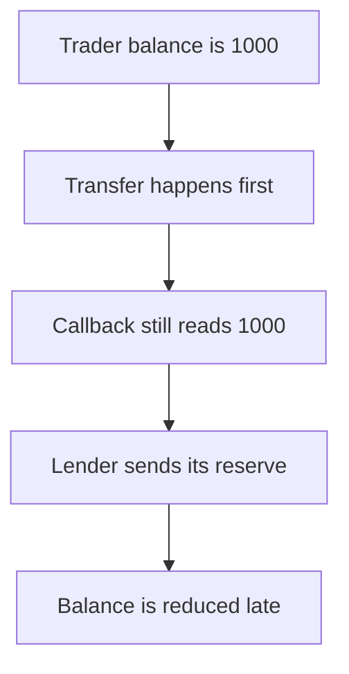

# XPress: stale trader balance lends the 1000 reserve

> **Vulnerability classes:** vuln/reentrancy/cross-function · vuln/logic/incorrect-order-of-operations

<!-- non-defihacklabs -->
<!-- source-auditvault: https://github.com/Auditware/AuditVault/blob/main/findings/53805-potential-read-only-reentrancy-mixbytes-none-xpress-protocol.md -->
<!-- date: 2025-05 -->

## Key info

| | |
|---|---|
| **Protocol** | XPress |
| **Finding** | MixBytes, AuditVault 53805 |
| **Vulnerable code** | `LOB.withdraw` |
| **Harm** | The trader withdraws 1000 and, while the stored balance is still 1000, the lender sends its 1000 reserve. The trader holds 2000. The fixed order leaves the lender with 1000. |
| **Chain** | local synthetic |

## TL;DR

`withdraw` transfers the token before it decreases `traderBalance`. The callback reads `getTraderBalance` and still sees 1000. The lender sends that amount from its own reserve.

## The vulnerable code

```solidity
        // @> VULN: traderBalance is reduced only after the token transfer returns
        traderBalance[msg.sender] -= amount;
```

## Root cause

The view used by the lender is updated after the external transfer, so a callback observes the pre-debit balance.

## Preconditions

The trader's stored balance and the LOB's cash are both 1000. The lender holds a separate 1000 reserve and trusts `getTraderBalance`.

## Attack walkthrough

1. Credit the trader 1000 and fund the lender with 1000. See [output.txt](output.txt).
2. `withdraw` transfers 1000 before the storage write.
3. The callback reads a balance of 1000.
4. The lender sends 1000.
5. `traderBalance` is then set to 0.
6. The trader holds 2000 and the lender holds 0. The fixed path updates first, so the lender sends nothing.

## Diagrams



## Impact

The lender loses 1000. The trader receives their own 1000 plus that reserve. Updating the balance before the transfer makes the view return 0.

## Remediation

Decrease `traderBalance` before the token transfer.

## How to reproduce

```bash
cd 53805-potential-read-only-reentrancy-mixbytes-none-xpress-protocol_exp
forge test -vv
```
