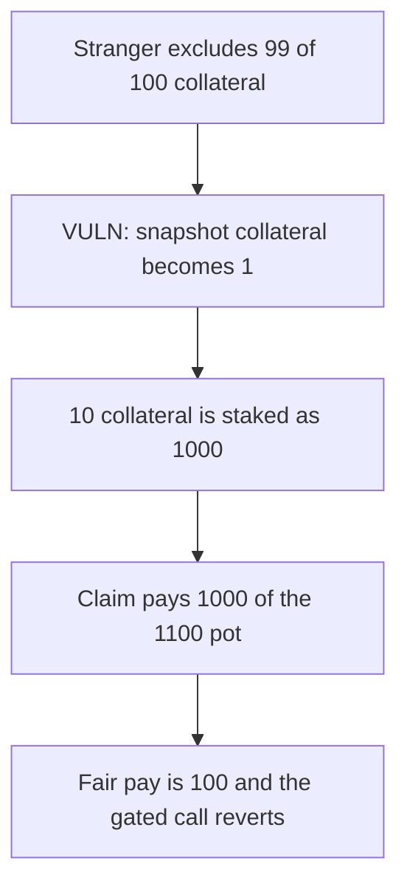

# Apollon TroveManager — anyone can exclude collateral and inflate a stake

> **Vulnerability classes:** vuln/access-control/missing-auth · vuln/logic/state-update

<!-- non-defihacklabs -->
<!-- source-auditvault: https://github.com/Auditware/AuditVault/blob/main/findings/53840-h-01-updatesystemsnapshots-excludecollremainder-lacks-access.md -->
<!-- date: 2025-03 -->

## Key info

| | |
|---|---|
| **Protocol** | Apollon TroveManager |
| **Finding** | Recon Audits, Alex The Entreprenerd, AuditVault 53840 |
| **Vulnerable code** | `updateSystemSnapshots_excludeCollRemainder` |
| **Harm** | Stranger is paid 1000. A fair stake of 10 on the same pot is paid 100. Extra 900. |
| **Chain** | local synthetic |

## TL;DR

`updateSystemSnapshots_excludeCollRemainder` has no caller check. It is supposed to be used only from liquidation, to drop gas-compensation collateral out of the stake snapshot. A stranger passes a remainder of 99 against 100 collateral. The snapshot collapses to 1. Opening a trove with 10 collateral then mints a stake of `10 * 100 / 1 = 1000` instead of 10. That stake takes 1000 of a 1100 reward pot. The fair share is 100. A manager that requires `LiquidationOperations` reverts the stranger's call, and the same 10 collateral is staked at 10.

## The vulnerable code

```solidity
function updateSystemSnapshots_excludeCollRemainder(CollRem[] calldata remainders) external {
    // no caller check
    // @> VULN: any caller can drop collateral out of the stake snapshot
    totalCollateralSnapshot = activeCollateral - excluded;
    totalStakesSnapshot = totalStakes;
}
```

The mitigation in the finding is to require the caller to be `LiquidationOperations`.

## Root cause

The snapshot write is external and ungated. Stake for a new trove is `coll * totalStakesSnapshot / totalCollateralSnapshot`. Shrinking the denominator inflates every stake opened afterwards, and the inflated stake is what the reward claim multiplies.

## Preconditions

The system already has 100 stake and 100 collateral. The caller is not a liquidator. A reward pot is later funded with 1100. No existing trove has to be liquidated.

## Attack walkthrough

1. The stranger excludes 99 collateral. Snapshot collateral becomes 1. Snapshot stakes stay 100.
2. `openTrove(10)` records stake 1000. Total stakes become 1100.
3. `claim` pays `1000 * 1100 / 1100 = 1000`.
4. A fair 10 stake on a 110 system would be paid `10 * 1100 / 110 = 100`.
5. The gated manager reverts the same exclude. `openTrove(10)` there returns stake 10.

## Diagrams



## Impact

Any address can change the collateral snapshot and then open a trove whose stake takes other depositors' rewards. This run extracts 900 more than the fair 100. The gated manager does not let the stranger exclude collateral, so the stake stays 10.

## Remediation

Require `msg.sender == liquidationOperations` before writing the snapshot.

## How to reproduce

```bash
cd 53840-h-01-updatesystemsnapshots-excludecollremainder-lacks-access_exp
forge test -vv
```

## Sources

- AuditVault finding: https://github.com/Auditware/AuditVault/blob/main/findings/53840-h-01-updatesystemsnapshots-excludecollremainder-lacks-access.md
- Recon report: https://github.com/solodit/solodit_content/blob/main/reports/Recon%20Audits/2025-03-22-Apollon_Report.md
- Review notes: https://github.com/GalloDaSballo/Apollon-Review
