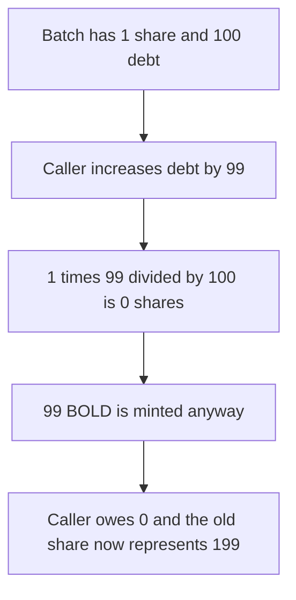

# Bold batch shares truncate, so 99 debt is minted as 0 shares

> **Vulnerability classes:** vuln/arithmetic/rounding · vuln/logic/accounting

<!-- non-defihacklabs -->
<!-- source-auditvault: https://github.com/Auditware/AuditVault/blob/main/findings/53947-h-01-bold-batch-shares-math-can-be-rebased-by-combining-roun.md -->
<!-- date: 2025-03 -->

## Key info

| Field | Value |
|---|---|
| **Loss** | 99 BOLD minted for 0 shares. The existing share is rebased from 100 debt to 199 |
| **Vulnerable contract** | `BatchShares.increaseDebt` |
| **Attacker EOA** | `0x1111111111111111111111111111111111111111` |
| **Attack contract** | `Exploit` |
| **Attack tx** | `Exploit.run()` |
| **Chain / block / date** | Ethereum model · block 0 · 2025-03 |
| **Compiler** | solc 0.8.27, cancun, via IR |
| **Bug class** | Truncating debt-share division |

## TL;DR

A batch has 1 share and 100 debt. Increasing debt by 99 computes `1 * 99 / 100 = 0` new shares, then still mints 99 BOLD. The caller owes 0. The original share's recorded debt becomes 199. Rounding the share delta up mints 1 share, the caller owes 99, and the original share is not rebased upward. No time warp is required.

## Background

Alex The Entreprenerd's Recon review of Liquity Bold (2025-03-23, H-01) shows `_updateBatchShares` truncating `batchDebtSharesDelta = currentBatchDebtShares * debtIncrease / batchDebt`, while a trove's debt is `batchDebt * shares / totalShares`. The published sequence also compounds interest across many blocks. This reduction keeps the division that forges the shares and demonstrates it in one transaction: 0 shares and 99 assets.

## The vulnerable code

```solidity
uint256 currentBatchDebtShares = totalDebtShares;
uint256 _batchDebt = batchDebt;
// @> VULN: batchDebtSharesDelta truncates, so this debt increase mints zero shares
sharesDelta = currentBatchDebtShares * debtIncrease / _batchDebt;
```

The recorded-debt formula that then rebases the old share is `batchDebt * shares / totalDebtShares`.

Rounding the delta up stops the rebase:

```diff
-        sharesDelta = currentBatchDebtShares * debtIncrease / _batchDebt;
+        sharesDelta = (currentBatchDebtShares * debtIncrease + _batchDebt - 1) / _batchDebt;
```

## Root cause

Share minting rounds toward zero. When the debt increase is smaller than the debt already represented by one share, the quotient is 0 but the batch debt and the BOLD mint still include the increase. The new debt is socialized onto the shares that already exist.

## Preconditions

- `totalDebtShares` is 1 and `batchDebt` is 100. One holder owns that share.
- The caller increases debt by 99, which is below the 100 debt-per-share.

## Attack walkthrough

1. The existing share's recorded debt is 100.
2. The caller increases debt by 99.
3. `1 * 99 / 100` is 0, so no shares are credited and the share supply stays 1.
4. Batch debt becomes 199 and 99 BOLD is minted to the caller.
5. The caller's recorded debt is 0. The original share's recorded debt is 199.
6. The 99 BOLD is transferred to the attacker.

## Diagrams



## Impact

The attacker receives 99 BOLD and 0 shares, and owes 0. The existing shareholder's debt is rebased from 100 to 199. On the rounded-up path the same 99 increase mints 1 share, the caller owes 99, total shares become 2, and the original share is not rebased upward.

## PoC

```bash
cd 53947-h-01-bold-batch-shares-math-can-be-rebased-by-combining-roun_exp
forge test -vv
```

`test_exploit_zero_shares_and_99_assets` asserts 0 shares, 99 assets, 0 debt for the caller, and 199 debt on the original share. `test_control_rounds_shares_up_and_does_not_rebase` asserts 1 share is minted, the caller owes 99, and the original share is not rebased upward.

## Sources

- AuditVault finding: https://github.com/Auditware/AuditVault/blob/main/findings/53947-h-01-bold-batch-shares-math-can-be-rebased-by-combining-roun.md
- Recon report (Bold, 2025-03-23): https://github.com/solodit/solodit_content/blob/main/reports/Recon%20Audits/2025-03-23-bold-report.md
- Upstream: https://github.com/liquity/bold/blob/a34960222df5061fa7c0213df5d20626adf3ecc4/contracts/src/TroveManager.sol
