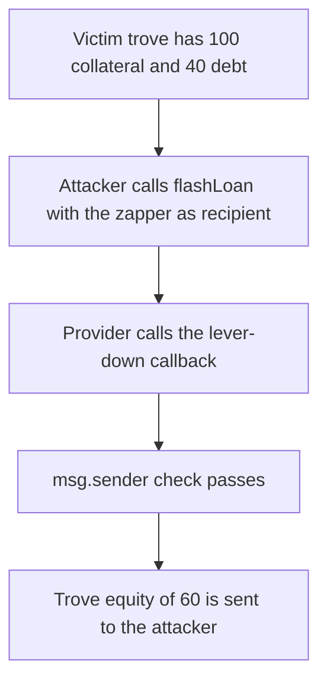

# A flash loan can unwind someone else's Bold trove through the zapper

> **Vulnerability classes:** vuln/defi/flash-loan · vuln/access-control/missing-auth

<!-- non-defihacklabs -->
<!-- source-auditvault: https://github.com/Auditware/AuditVault/blob/main/findings/53948-h-02-the-flashloan-protection-for-zappers-is-insufficient-we.md -->
<!-- date: 2025-03 -->

## Key info

| Field | Value |
|---|---|
| **Loss** | 60 COLL of trove equity sent to the attacker. The trove had 100 collateral and 40 debt |
| **Vulnerable contract** | `Zapper.receiveFlashLoanOnLeverDownTrove` |
| **Attacker EOA** | `0x1111111111111111111111111111111111111111` |
| **Attack contract** | `Exploit` |
| **Attack tx** | `Exploit.run()` |
| **Chain / block / date** | Ethereum model · block 0 · 2025-03 |
| **Compiler** | solc 0.8.27, cancun, via IR |
| **Bug class** | Flash-loan callback trusts only the provider |

## TL;DR

`receiveFlashLoanOnLeverDownTrove` requires `msg.sender == flashLoanProvider` and then unwinds whatever trove the payload names, paying the equity to whatever receiver the payload names. Anyone can call the provider and point it at the zapper. A trove with 100 collateral and 40 debt pays 60 COLL to the attacker. The fixed zapper also requires an operation id that only its own `leverDown` sets, so the same call reverts and the collateral stays at 100.

## Background

Alex The Entreprenerd's Recon review of Liquity Bold (2025-03-23, H-02) shows the Balancer flash loan delivering tokens to any recipient and calling that recipient back. The zapper's lever-down callback only checks that the caller is the flash-loan provider. It does not check that the zapper itself started the loan. The provider will call whatever recipient the attacker passed.

## The vulnerable code

```solidity
function receiveFlashLoanOnLeverDownTrove(LeverDownTroveParams memory _params, uint256 _effectiveFlashLoanAmount)
    external
{
    require(msg.sender == address(flashLoanProvider), "LZ: Caller not FlashLoan provider");
    // @> VULN: any flash loan can name the trove and the receiver; the zapper did not start this call
    pulled = trove.take(_params.troveOwner, _params.receiver);
}
```

The report's fix binds the callback to an operation the zapper started:

```diff
     require(msg.sender == address(flashLoanProvider), "LZ: Caller not FlashLoan provider");
+    require(operationId == 1, "callback was started by this contract");
     pulled = trove.take(_params.troveOwner, _params.receiver);
```

## Root cause

The provider check proves the call came from the flash-loan contract. It does not prove the zapper requested that loan. `flashLoan` is permissionless and the recipient is an argument, so the attacker can make the provider satisfy the check while supplying the victim and the receiver.

## Preconditions

- A trove holds 100 COLL against 40 of debt. Equity is 60.
- The zapper is allowed to take that trove when its callback runs.
- The flash-loan provider will call any recipient the attacker names.

## Attack walkthrough

1. The attacker calls `flashLoan(zapper, 40, abi.encode(victim, attacker))`.
2. The provider calls `receiveFlashLoanOnLeverDownTrove` on the zapper.
3. `msg.sender` is the provider, so the require passes.
4. `trove.take` clears the victim's 100 collateral and 40 debt.
5. Equity of 60 COLL is transferred to the attacker.

## Diagrams



## Impact

The attacker receives 60 COLL and the victim's collateral is 0. The victim did not request the unwind. The fixed zapper reverts `callback was started by this contract` on the same payload, leaves collateral at 100, and pays 0.

## PoC

```bash
cd 53948-h-02-the-flashloan-protection-for-zappers-is-insufficient-we_exp
forge test -vv
```

`test_exploit_unsolicited_flash_loan_extracts_equity` asserts 60 was taken, the caller received 60, and the victim collateral is 0. `test_control_operation_id_blocks_the_flash_loan` asserts the fixed zapper reverts and the collateral stays 100.

## Sources

- AuditVault finding: https://github.com/Auditware/AuditVault/blob/main/findings/53948-h-02-the-flashloan-protection-for-zappers-is-insufficient-we.md
- Recon report (Bold, 2025-03-23): https://github.com/solodit/solodit_content/blob/main/reports/Recon%20Audits/2025-03-23-bold-report.md
- Upstream: https://github.com/liquity/bold/blob/57c2f13fe78f914cab3d9736f73b4e0ffc58e022/contracts/src/Zappers/LeverageWETHZapper.sol
