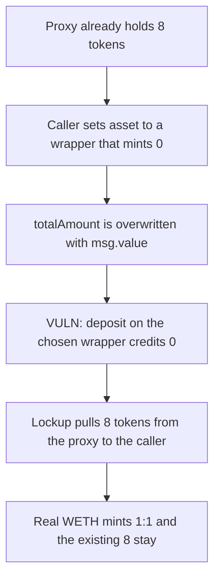

# Sablier — a caller-chosen wrapped native drains tokens already in the proxy

> **Vulnerability classes:** vuln/input-validation/missing · vuln/logic/wrong-condition · vuln/dependency/unsafe-external-call

<!-- non-defihacklabs -->
<!-- source-auditvault: https://github.com/Auditware/AuditVault/blob/main/findings/54668-wrapped-native-asset-address-can-be-freely-chosen-and-is-ass.md -->
<!-- date: 2023-07 -->

## Key info

| | |
|---|---|
| **Protocol** | Sablier V2 (SablierV2ProxyTarget) |
| **Finding** | Cantina / Zach Obront, AuditVault 54668 |
| **Vulnerable code** | `wrapAndCreateWithDurations` — `deposit{value: msg.value}()` on `createParams.asset` |
| **Harm** | 8 tokens that were already in the proxy are sent to the caller. The chosen wrapper mints 0. |
| **Chain** | local synthetic |

## TL;DR

`wrapAndCreateWithDurations` overwrites `totalAmount` with `msg.value` and wraps ETH by calling `deposit` on the asset address the caller supplies. It never checks how many tokens that call actually credited. A wrapper that mints nothing still lets the lockup pull `msg.value` of that token from the proxy. The proxy's existing 8 tokens are sent to the caller, and the 8 ETH is swept back to them. The same call against real WETH mints 8 WETH and leaves the pre-existing 8 WETH in the proxy.

## The vulnerable code

```solidity
function wrapAndCreateWithDurations(address lockupLinear, CreateWithDurations memory createParams)
    external
    payable
    returns (uint256 streamId)
{
    createParams.totalAmount = uint128(msg.value);
    // Wrap the native asset payment in ERC-20 form.
    // @> VULN: caller-chosen wrapped native; the tokens actually credited are never checked against msg.value.
    IWrappedNativeAsset(createParams.asset).deposit{value: msg.value}();
    _approve(lockupLinear, createParams.asset, createParams.totalAmount);
    streamId = lockupLinear.createWithDurations(createParams);
}
```

The published fix measures the token balance before and after `deposit` and reverts unless the credit equals `msg.value` (`_safeWrap`).

## Root cause

The asset is an argument, not a pinned WETH. `totalAmount` is taken from `msg.value` rather than from the change in `balanceOf`. `createWithDurations` then `transferFrom`s that amount out of the proxy. Any shortfall versus the tokens `deposit` minted is taken from the balance the proxy already held.

## Preconditions

The proxy already holds 8 tokens of an ERC-20 that implements `deposit()` but mints nothing. The caller is an envoy allowed to `execute` the target. They send 8 ETH with the call. No other privilege is required.

## Attack walkthrough

1. The proxy's balance of the chosen token is 0, then the victim's 8 tokens are transferred in.
2. The caller sets the wrapper's sweeper to themselves and delegatecalls `wrapAndCreateWithDurations` with that token as `asset` and `msg.value` of 8 ETH.
3. `totalAmount` becomes 8 ETH. `deposit` runs on the chosen wrapper, records a credit of 0, and returns the 8 ETH to the caller.
4. The lockup pulls 8 tokens from the proxy and sends them to the caller. The proxy ends at 0.

The control uses the same `wrapAndCreateWithDurations` with real WETH. `deposit` mints 8 WETH to the proxy, the lockup pulls those 8, and the 8 that were already there stay.

## Diagrams



## Impact

The caller receives 8 tokens that belonged in the proxy and gets their 8 ETH back. The proxy's balance of that token falls from 8 to 0. With real WETH the pre-existing balance is unchanged.

## Remediation

Pin the wrapped native, or reject the call unless the token balance increased by `msg.value` before approving the lockup and creating the stream.

## Sources

- AuditVault finding: https://github.com/Auditware/AuditVault/blob/main/findings/54668-wrapped-native-asset-address-can-be-freely-chosen-and-is-ass.md
- Cantina report (Sablier, July 2023, Zach Obront): https://cdn.cantina.xyz/reports/cantina_sablier_jul2023.pdf
- Vulnerable function: `sablier-labs/v2-periphery` `src/SablierV2ProxyTarget.sol` `wrapAndCreateWithDurations` (pre-fix body quoted in the finding). The published tree's `_safeWrap` is the fix: https://github.com/sablier-labs/v2-periphery/blob/1123aee8ac0c50e8359ae3fb4f9b327fd9eeeb9d/src/SablierV2ProxyTarget.sol
