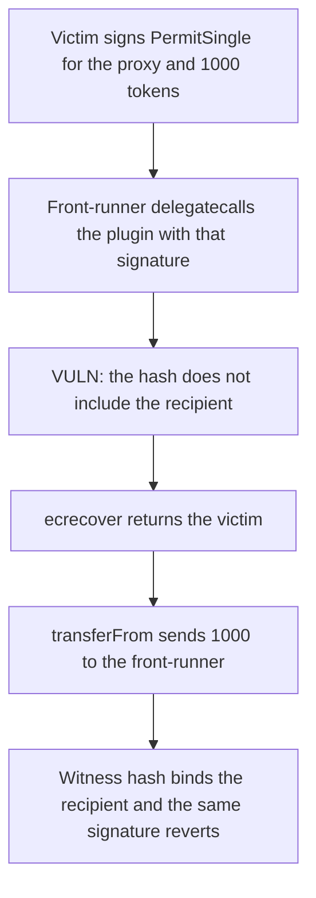

# Sablier — a Permit2 signature that does not name the recipient is front-run for 1000 tokens

> **Vulnerability classes:** vuln/auth/signature-validation · vuln/logic/missing-validation

<!-- non-defihacklabs -->
<!-- source-auditvault: https://github.com/Auditware/AuditVault/blob/main/findings/54669-any-plugins-using-permit2-can-steal-funds-with-frontrunning.md -->
<!-- date: 2023-07 -->

## Key info

| | |
|---|---|
| **Protocol** | Sablier V2 (Permit2 inside a proxy plugin) |
| **Finding** | Cantina / Zach Obront, AuditVault 54669 |
| **Vulnerable code** | `permit` then `transferFrom` on a PermitSingle that does not bind the recipient |
| **Harm** | 1000 tokens move from the signer to the front-runner |
| **Chain** | local synthetic |

## TL;DR

The victim signs a Permit2 allowance for the proxy: token, amount 1000, spender = proxy. The signature does not name the recipient or the plugin. Anyone who can make the proxy delegatecall a plugin replays that signature and `transferFrom`s the 1000 to themselves. The same signature fails `permitWitness`, which binds the recipient, and the victim keeps the 1000.

## The vulnerable code

```solidity
function take(address recipient, bytes calldata signature) external {
    Permit2.PermitSingle memory permitSingle = Permit2.PermitSingle({
        token: address(token),
        amount: uint160(AMOUNT),
        expiration: type(uint48).max,
        nonce: 0,
        spender: address(this)
    });
    // @> VULN: the signature names the proxy, the token, and the amount, not the recipient.
    permit2.permit(victim, permitSingle, DEADLINE, signature);
    permit2.transferFrom(victim, recipient, uint160(AMOUNT), address(token));
}
```

`address(this)` is the proxy because `take` runs by delegatecall. The signed spender matches. `recipient` is chosen by the caller and is not in the hash.

## Root cause

`PermitSingle` commits the token, the amount, the nonce, the deadline, and the spender. It does not commit the action the allowance will be used for. A plugin that calls `permit` and then `transferFrom` can send the tokens anywhere. The recommended fix is `permitWitnessTransferFrom`, with the recipient (and the call) inside the signed witness.

## Preconditions

The victim holds 1000 tokens and has approved Permit2. They signed the PermitSingle for spender = proxy, nonce 0, amount 1000. The signature is known to the front-runner. The front-runner can make the proxy execute the plugin. No other privilege is required. The signature was precomputed for chain id 1 and this Permit2 address.

## Attack walkthrough

1. The victim's balance is set to 1000 and Permit2's allowance is the standing max approval.
2. The proxy delegatecalls the plugin with the signature and the front-runner as recipient.
3. `permit` hashes the PermitSingle without the recipient. `ecrecover` returns the victim, so the allowance is opened.
4. `transferFrom` sends 1000 from the victim to the front-runner. The victim ends at 0.

The control calls `permitWitness` with the same signature and the front-runner as recipient. The witness hash includes the recipient, the signer does not recover, and the 1000 stays with the victim.

## Diagrams



## Impact

The front-runner receives 1000 tokens. The victim's balance goes from 1000 to 0. Binding the recipient in the signature stops the pull and the victim keeps the 1000.

## Remediation

Use `permitWitnessTransferFrom` and require the proxy to check that the witness contains the target and the recipient before forwarding the call. Do not accept a bare `permit` signature inside a plugin.

## Sources

- AuditVault finding: https://github.com/Auditware/AuditVault/blob/main/findings/54669-any-plugins-using-permit2-can-steal-funds-with-frontrunning.md
- Cantina report (Sablier, July 2023, Zach Obront): https://cdn.cantina.xyz/reports/cantina_sablier_jul2023.pdf
- Blamed pattern: `SablierV2ProxyTarget` Permit2 `permit` + `transferFrom` (finding quotes `SablierV2ProxyTarget.sol` around the permit2 transfer). Permit2 typed data follows Uniswap's `PermitSingle`: https://github.com/Uniswap/permit2
