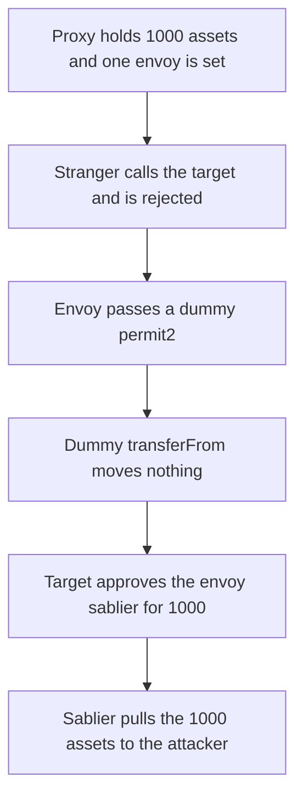

# Sablier — an envoy of `SablierV2ProxyTarget` drains the proxy with a dummy permit2

> **Vulnerability classes:** vuln/input-validation/missing · vuln/dependency/unsafe-external-call · vuln/access-control/broken-logic

> **Reproduction:** a self-contained Foundry PoC that compiles and runs with only `forge-std` — no fork, no RPC. Full trace: [output.txt](output.txt). PoC: [test/54671-any-envoy-with-access-to-sablierv2proxytarget-can-steal-all_exp.sol](test/54671-any-envoy-with-access-to-sablierv2proxytarget-can-steal-all_exp.sol).

<!-- non-defihacklabs -->
<!-- source-auditvault: https://github.com/Auditware/AuditVault/blob/main/findings/54671-any-envoy-with-access-to-sablierv2proxytarget-can-steal-all.md -->
<!-- date: 2023-07 -->

**AuditVault taxonomy:** `lang/solidity` · `platform/cantina` · `severity/high` · `sector/streaming` · genome: `missing-modifier` · `direct-drain` · `flashloan-callback-auth`

---

## Key info

| | |
|---|---|
| **Impact** | **HIGH** — an envoy who is not the owner and holds no token allowance takes the proxy's entire **1000e18** balance. A caller who was not set as envoy cannot |
| **Protocol** | Sablier V2 — `SablierV2ProxyTarget._transferAndApprove` |
| **Vulnerable code** | `permit2Params.permit2.transferFrom(...)` followed by `_approve(sablierContract, asset, amount)` |
| **Bug class** | The permit2 contract is a caller argument. A dummy no-ops the pull, then the target approves the envoy's sablier for the proxy's own tokens |
| **Finding** | Cantina — Sablier, July 2023 · #54671 · reporter **Zach Obront** |
| **Report** | [cantina_sablier_jul2023.pdf](https://cdn.cantina.xyz/reports/cantina_sablier_jul2023.pdf) |
| **Source** | [AuditVault](https://github.com/Auditware/AuditVault/blob/main/findings/54671-any-envoy-with-access-to-sablierv2proxytarget-can-steal-all.md) |
| **Status** | Audit finding, fixed in Sablier PR 102 by pinning permit2. Reproduced as a local synthetic |
| **Compiler** | solc 0.8.27, cancun, via_ir |

An envoy is a target-scoped caller. The owner authorizes them to create a stream. The design assumes the stream can only move tokens the owner signed for in permit2. The envoy is not a custodian of the proxy balance. This PoC is not an admin rug: the attacker is not the owner, `isEnvoy(stranger)` is false, and the stranger's call reverts.

On-chain the proxy `delegatecall`s the target, so `address(this)` is the proxy. The synthetic runs the same body on the contract that holds the tokens, which is what that delegatecall does.

---

## TL;DR

1. The proxy holds `1000e18` assets. One address is `isEnvoy`. The owner is a different address. The attacker is neither the owner nor approved on the token.
2. A stranger calls `createStream` with a dummy permit2. The envoy check reverts. `strangerOpened` is false. The balance stays `1000e18`.
3. The envoy calls `createStream` with the same dummy. `permit` and `transferFrom` return without moving tokens.
4. `_approve` then lets the dummy sablier spend the proxy's `1000e18`. `create` transfers that amount to the attacker.
5. **Harm:** attacker balance `1000000000000000000000`, proxy balance `0`.
6. **Control:** the fixed target requires the canonical permit2. The dummy is rejected and the `1000e18` stays on the fixed proxy, with no allowance left behind.

---

## The vulnerable code

Quoted from the review. The `@>` line is the caller-supplied `transferFrom`.

```solidity
function _transferAndApprove(
    address sablierContract,
    IERC20 asset,
    uint160 amount,
    Permit2Params calldata permit2Params
) internal {
    // Retrieve the proxy owner.
    address owner_ = owner;
    // Permit the proxy to spend funds from the proxy owner.
    permit2Params.permit2.permit({
        owner: owner_,
        permitSingle: permit2Params.permitSingle,
        signature: permit2Params.signature
    });
    // Transfer funds from the proxy owner to the proxy.
    // @> VULN: permit2 is whichever contract the envoy passed, so this pull can no-op
    permit2Params.permit2.transferFrom({ from: owner_, to: address(this), amount: amount, token: address(asset) });
    // Approve the Sablier contract to spend funds.
    _approve(sablierContract, asset, amount);
}
```

The call is gated, but the gate is the envoy bit, not custody:

```solidity
require(msg.sender == owner || isEnvoy[msg.sender], "envoy");
```

The fix Sablier shipped is to stop taking the permit2 address from the caller. The control in this PoC does that:

```diff
+ require(address(permit2Params.permit2) == canonicalPermit2, "permit2");
  permit2Params.permit2.transferFrom({ from: owner_, to: address(this), amount: amount, token: address(asset) });
```

The canonical permit2 reverts unless the owner actually signed. The dummy never gets to `_approve`.

---

## Root cause

`Permit2Params.permit2` is untrusted input on a path that ends in `asset.approve(sablierContract, amount)` where `asset` is the proxy's token and `address(this)` is the proxy. The dummy's `transferFrom` does not have to move the owner's tokens. The approval that follows spends whatever the proxy already holds. The envoy permission was only supposed to wrap an owner-signed permit into a stream.

## Preconditions

- The proxy holds tokens. Here, `1000e18`.
- The caller is an envoy of this target, set by the owner. The caller is not the owner.
- The envoy can deploy a permit2 and a sablier. Both are a few lines. No owner signature is required.
- A non-envoy cannot reach the body. The PoC calls that path and it reverts.

## Attack walkthrough

Numbers from [output.txt](output.txt):

1. Proxy balance before: `1000000000000000000000`.
2. Stranger opened: `0`.
3. Attacker received: `1000000000000000000000`.
4. Proxy balance after: `0`.

The received amount equals the proxy's starting balance. The fixed-target control mints the same `1000e18` onto a target that pins permit2. The envoy's dummy is rejected, the balance stays `1000e18`, and `allowance(proxy, sablier)` stays `0`.

## Diagrams



## Impact

The proxy's whole token balance moves to the envoy's recipient. In the PoC that is `1000e18`, and the proxy is left at `0`. The owner did not sign a permit and did not approve the envoy on the token. Repeating this against every token the proxy holds is the same call with a different `asset` and `amount`. A caller without the envoy bit cannot do it; the bit is what the owner thought was safe to grant.

## Remediation

Do not take the permit2 address from the caller. Pin it to the canonical permit2, or check it against an allowlist, before `permit`, `transferFrom`, and `_approve`. That is the fix Sablier applied in PR 102.

## Sources

- AuditVault finding: https://github.com/Auditware/AuditVault/blob/main/findings/54671-any-envoy-with-access-to-sablierv2proxytarget-can-steal-all.md
- Cantina report (July 2023): https://cdn.cantina.xyz/reports/cantina_sablier_jul2023.pdf
- The `_transferAndApprove` body is the snippet in that review (`SablierV2ProxyTarget.sol` L643-L666 as cited by Cantina). Sablier marked it fixed in PR 102. The later Arbitrum deployment of `SablierV2ProxyTarget` at `0xB7185AcAF42C4966fFA3c81486d9ED9633aa4c13` calls a constant `PERMIT2` instead of `permit2Params.permit2`. The periphery repo is https://github.com/sablier-labs/v2-periphery ; the pre-fix file is not on the archived `main` branch.
