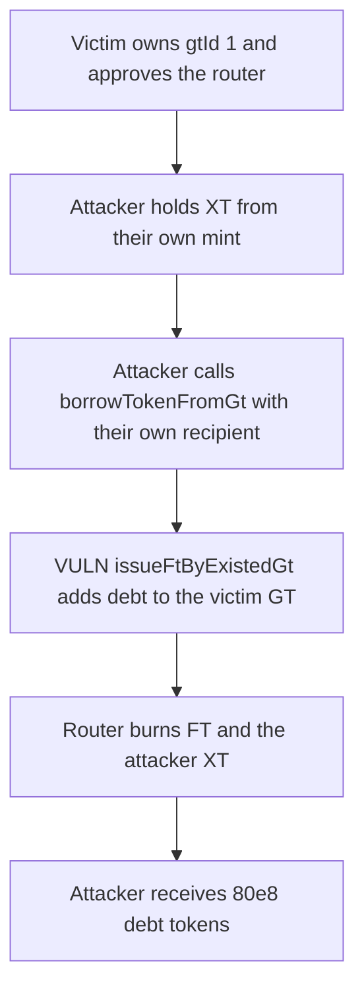

# Term Structure: borrowTokenFromGt spends a victim GT id

> **Vulnerability classes:** `vuln/logic/missing-check`

<!-- non-defihacklabs -->
<!-- source-auditvault: https://github.com/Auditware/AuditVault/blob/main/findings/54894-an-attacker-can-steal-debt-tokens-by-using-the-user-s-gtid-c.md -->
<!-- date: 2025-02 -->

## Key info

| Field | Value |
|---|---|
| **Loss** | Attacker receives 80e8 debt tokens. The victim's GT owes that debt |
| **Vulnerable contract** | `Router.borrowTokenFromGt` |
| **Attacker EOA** | `0x1111111111111111111111111111111111111111` |
| **Attack contract** | `Exploit` |
| **Attack tx** | `Exploit.run()` |
| **Chain / block / date** | Ethereum model · local · 2025-02 |
| **Compiler** | solc 0.8.27, cancun |
| **Bug class** | Missing `ownerOf(gtId) == msg.sender` check |

## TL;DR

A user approves the router for an existing GT id so the router can call `issueFtByExistedGt`. `borrowTokenFromGt` never checks that `msg.sender` owns that id. An attacker who holds XT front-runs the call, names themselves as recipient, and receives 80e8 debt tokens while the victim's position takes the debt.

## Background

Cantina's February 2025 Term Structure review, reported by Nyksx. The proof logs the attacker's debt balance moving from 0 to 8000000000. The fix, in pull requests 4 and 5, checks GT ownership.

## The vulnerable code

```solidity
(ERC20 ft, ERC20 xt,,,) = market.tokens();
uint128 debtAmt = uint128((borrowAmt * DECIMAL_BASE) / (DECIMAL_BASE - issueFtFeeRatio));
uint256 ftOutAmt = market.issueFtByExistedGt(address(this), debtAmt, gtId); // @> VULN: victim gtId, no owner check
```

```diff
+ require(gt.ownerOf(gtId) == msg.sender);
  uint256 ftOutAmt = market.issueFtByExistedGt(address(this), debtAmt, gtId);
```

## Root cause

The market checks that the router is approved for the GT. It does not see the original caller. The router, which does see the caller, never compares that caller with `ownerOf`.

## Preconditions

- The victim owns a GT and has approved the router for that id.
- The attacker holds enough XT to pair with the issued FT. Here that is 80e8, obtained by locking 100e8 of their own debt.
- `issueFtFeeRatio` is 0, so `debtAmt` equals `borrowAmt`.

## Attack walkthrough

1. The attacker mints 100e8 debt, spends it in `market.mint`, and receives XT. Their debt balance is back to 0.
2. The victim opens gtId 1 and approves the router.
3. The attacker calls `borrowTokenFromGt(attacker, market, 1, 80e8)`.
4. The router issues FT against the victim's GT. The victim's debt becomes 80e8.
5. The router pulls 80e8 XT from the attacker and burns FT plus XT.
6. The market mints 80e8 debt tokens to the attacker.

## Diagrams



## Impact

The attacker ends the call holding 80e8 debt tokens. gtId 1 is still owned by the victim and now records 80e8 of debt. The attacker did not post the victim's collateral.

## Remediation

Require `gt.ownerOf(gtId) == msg.sender` at the start of `borrowTokenFromGt`.

## How to reproduce

```bash
cd 54894-an-attacker-can-steal-debt-tokens-by-using-the-user-s-gtid-c_exp
forge test -vv
```

`test_exploit_attacker_receives_80e8_debt_against_victim_gt` asserts the attacker debt balance, the victim debt, and the unchanged owner. Captured output is `output.txt`.

## Sources

- AuditVault finding: https://github.com/Auditware/AuditVault/blob/main/findings/54894-an-attacker-can-steal-debt-tokens-by-using-the-user-s-gtid-c.md
- Cantina report: https://cdn.cantina.xyz/reports/cantina_competition_term_structure_february2025.pdf
