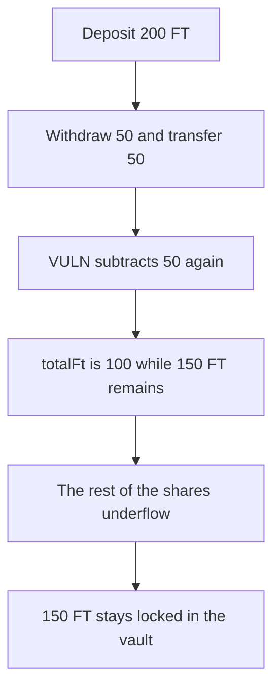

# Term Structure: withdrawAssets subtracts the withdrawal twice and locks the rest

> **Vulnerability classes:** vuln/logic/state-update · vuln/dos/frozen-funds

<!-- non-defihacklabs -->
<!-- source-auditvault: https://github.com/Auditware/AuditVault/blob/main/findings/54895-the-totalft-and-accretingprincipal-are-updated-incorrectly-i.md -->
<!-- date: 2025-02 -->

## Key info

| Field | Value |
|---|---|
| **Loss** | 150 FT stuck after a 200 FT deposit and a 50 FT withdrawal |
| **Vulnerable contract** | `Vault.withdrawAssets` |
| **Attacker EOA** | `0x5489500000000000000000000000000000000001` |
| **Attack contract** | `Exploit` |
| **Attack tx** | `Exploit.run()` |
| **Chain / block / date** | Ethereum model · block 0 · 2025-02 |
| **Compiler** | solc 0.8.27, cancun, via IR |
| **Bug class** | `_totalFt` and `_accretingPrincipal` are decremented twice when cash covers the withdrawal |

## TL;DR

When the vault already holds the assets, `withdrawAssets` subtracts `amount` and then subtracts `amount` again at the bottom of the function. A 50 FT withdrawal cuts `totalFt` by 100 while only 50 tokens leave. The remaining shares then price a withdrawal that underflows on the second subtraction, so 150 FT cannot be withdrawn. The fixed function subtracts once and returns the full 200.

## Background

Cantina's February 2025 Term Structure competition, reported by Nyksx. The contest log showed a 1e8 withdrawal moving `totalFt` by 2e8. The team removed the trailing decrements in PRs 4 and 5.

## The vulnerable code

```solidity
if (assetBalance >= amount) {
    token.safeTransfer(recipient, amount);
    _totalFt -= amount;
    _accretingPrincipal -= amount;
}
// @> VULN: the withdrawal was already subtracted above, so totalFt falls by twice the tokens that left
_totalFt -= amount;
_accretingPrincipal -= amount;
```

## Root cause

The sufficient-balance branch updates the totals, and the lines that were meant for the other branch still run afterward.

## Preconditions

- The vault's token balance is at least the withdrawal. This run deposits 200 and withdraws 50.
- A later withdrawal uses the understated `totalFt` as the share price.

## Attack walkthrough

1. Deposit 200 FT. `totalFt` and the share supply are 200.
2. Withdraw 50 shares. The transfer sends 50. Both pairs of subtractions run, so `totalFt` is 100 and the cash left is 150.
3. Withdraw the remaining 150 shares. The payout is 100, and the second subtraction underflows.
4. The call reverts. 150 FT stays in the vault. The depositor holds 50.
5. The fixed vault subtracts once. Withdrawing 200 returns 200 and leaves `totalFt` at 0.

## Diagrams


