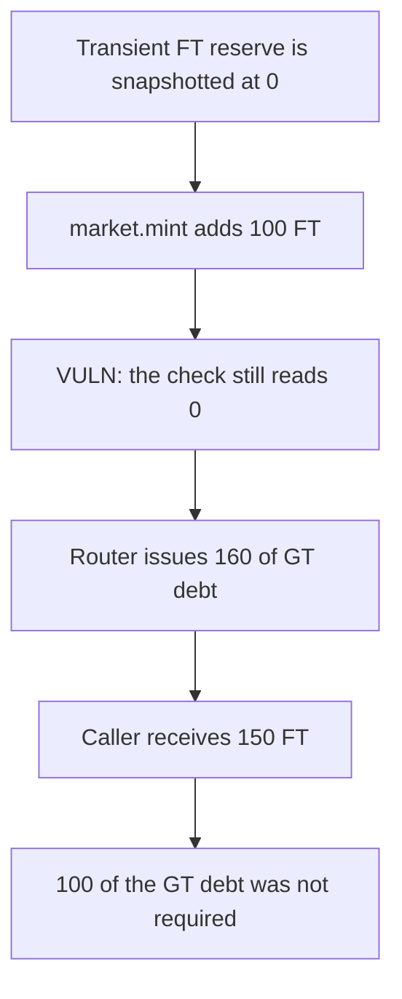

# Term Structure: a buy ignores the FT just minted and opens 100 extra of GT debt

> **Vulnerability classes:** vuln/logic/incorrect-order-of-operations · vuln/logic/state-update

<!-- non-defihacklabs -->
<!-- source-auditvault: https://github.com/Auditware/AuditVault/blob/main/findings/54896-incorrect-ft-reserve-used-in-buytoken-leads-to-incorrect-ft.md -->
<!-- date: 2025-02 -->

## Key info

| Field | Value |
|---|---|
| **Loss** | 160 FT of GT debt is opened. Only 60 was required, so 100 of the debt is unnecessary |
| **Vulnerable contract** | `Router._buyToken` |
| **Attacker EOA** | `0x0000000000000000000000000000000000548961` (the swap caller) |
| **Attack contract** | `Exploit` |
| **Attack tx** | `Exploit.run()` |
| **Chain / block / date** | Ethereum model · block 0 · 2025-02 |
| **Compiler** | solc 0.8.27, cancun, via IR |
| **Bug class** | The transient FT reserve is read after `market.mint` but still holds the pre-mint balance |

## TL;DR

`_buyToken` snapshots `ft.balanceOf` into transient storage, then `market.mint` adds `debtTokenAmtIn` of FT. The shortfall check still reads the snapshot. With a snapshot of 0, a 100 debt-token mint, a 50 token out, and a 10 fee, the router targets 160 and issues 160 of GT debt. The real balance after the mint is 100, so the fair issue is 60. The caller receives the 150 FT payout and owes 100 more GT debt than the post-mint balance required.

## Background

Cantina's February 2025 Term Structure review. `_buyToken` and `_buyExactToken` both compare `getTransientFtReserve()` with `netOut + feeAmt` after `market.mint`. The mint is what increases the real FT balance. The transient word is updated only inside `_issueFtToSelf`, and it is set to the target rather than `balanceOf`.

## The vulnerable code

```solidity
market.mint(address(this), debtTokenAmtIn);
if (address(ft) == address(ft)) {
    uint256 ftReserve = getTransientFtReserve();
    // @> VULN: ftReserve ignores the FT minted on the line above, so extra GT debt is issued
    if (ftReserve < netOut + feeAmt) _issueFtToSelf(ftReserve, netOut + feeAmt);
}
```

`_issueFtToSelf` uses a fee ratio of 0, so the issued amount is `target - staleReserve`.

## Root cause

The transient reserve is the balance from the start of the swap. `market.mint` increases the balance by `debtTokenAmtIn` and does not write the transient word. The later comparison therefore treats freshly minted FT as missing and borrows it again through `issueFt`.

## Preconditions

- The router starts the swap with 0 FT, so the snapshot is 0.
- The caller pays 100 debt tokens. `tokenAmtOut` is 50 and `feeAmt` is 10, so `netOut` is 150 and the target is 160.
- The issue fee ratio is 0.

## Attack walkthrough

1. `setTransientFtReserve` stores 0.
2. `market.mint` pulls 100 debt tokens and mints 100 FT to the router.
3. The check reads the transient 0, sees `0 < 160`, and calls `_issueFtToSelf`.
4. 160 GT debt tokens are minted to the caller. The transient word is then stored as 160, not the real balance.
5. The caller receives 150 FT.
6. The control compares the post-mint balance of 100 with 160 and issues 60. The caller still receives 150 FT.

## Diagrams


