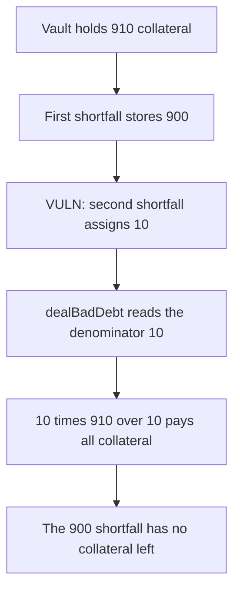

# Term Structure: assigning bad debt overwrites a 900 shortfall and 10 of debt sweeps 910 collateral

> **Vulnerability classes:** `vuln/logic/state-update` · `vuln/logic/incorrect-state-transition`

<!-- non-defihacklabs -->
<!-- source-auditvault: https://github.com/Auditware/AuditVault/blob/main/findings/54897-baddebtmappingcollateral-can-be-unintentionally-rewrite-cant.md -->
<!-- date: 2025-02 -->

## Key info

| Field | Value |
|---|---|
| **Loss** | 910 collateral paid out against 10 of recorded bad debt. The first 900 shortfall is erased |
| **Vulnerable contract** | `TermVault.redeemFromMarket` |
| **Attacker EOA** | `0x1111111111111111111111111111111111111111` |
| **Attack contract** | `Exploit` |
| **Attack tx** | `Exploit.run()` |
| **Chain / block / date** | Ethereum model · block 0 · 2025-02 |
| **Compiler** | solc 0.8.27, cancun, optimizer 200 |
| **Bug class** | `=` replaces `_badDebtMapping[collateral]` instead of `+=` |

## TL;DR

`_redeemFromMarket` stores `ftReserve - totalRedeem` with `=`. Two orders share one collateral. The first shortfall is 900. The second is 10 and replaces the 900. `dealBadDebt` pays `amount * collateralBalance / badDebtAmt`. Calling it for the remaining 10 pays `10 * 910 / 10`, which is the entire 910 collateral. Lenders of the first shortfall have nothing left.

## Background

Cantina's Term Structure competition, February 2025, reported by BengalCatBalu. Different markets can share a collateral token. A withdrawal fee often makes `totalRedeem < ftReserve`, so the bad-debt branch runs often. Term Structure fixed the write in PR 4 and PR 5. Cantina verified the fix.

## The vulnerable code

```solidity
if (totalRedeem < ftReserve) {
    address coll = address(collateral);
    badDebtMapping[coll] = ftReserve - totalRedeem; // @> VULN: replaces the previous shortfall instead of adding to it
}
```

```diff
- badDebtMapping[coll] = ftReserve - totalRedeem;
+ badDebtMapping[coll] += ftReserve - totalRedeem;
```

## Root cause

The mapping is keyed only by collateral, and the update is a replacement. A second order on the same collateral drops the earlier shortfall out of the denominator that `dealBadDebt` uses to split the seized balance.

## Preconditions

- Two redeems leave a shortfall on the same collateral. Here, 1000 redeemed for 100, then 100 redeemed for 90.
- The vault holds collateral for both shortfalls, 910.
- `dealBadDebt` is called for the overwritten amount, 10.

## Attack walkthrough

1. Vault holds 910 collateral.
2. First redeem records 900.
3. Second redeem writes 10 over the 900.
4. `dealBadDebt(attacker, collateral, 10)` transfers 910 collateral.

## Diagrams



## Impact

The caller receives 910 collateral. The vault balance is 0 and the mapping is 0. The 900 of bad debt from the first order is not paid. With `+=` the same 10 call would receive 10 collateral, and 900 would remain reserved for the first shortfall. The control assertion is `10 * 910 / 910 = 10`.

## Remediation

Use `+=` when storing the shortfall, which is the change Term Structure shipped.

## How to reproduce

```bash
cd 54897-baddebtmappingcollateral-can-be-unintentionally-rewrite-cant_exp
forge test -vv
```

`test_overwrite_lets_10_of_debt_sweep_910_collateral` asserts the attacker received 910 ether and the vault is empty. `test_control_plus_equals_pays_only_the_second_slice` asserts the fair payout is 10 ether.

## Sources

- AuditVault finding: https://github.com/Auditware/AuditVault/blob/main/findings/54897-baddebtmappingcollateral-can-be-unintentionally-rewrite-cant.md
- Report PDF: https://cdn.cantina.xyz/reports/cantina_competition_term_structure_february2025.pdf
- Reduced from the `_redeemFromMarket` and `dealBadDebt` quotes in that report
