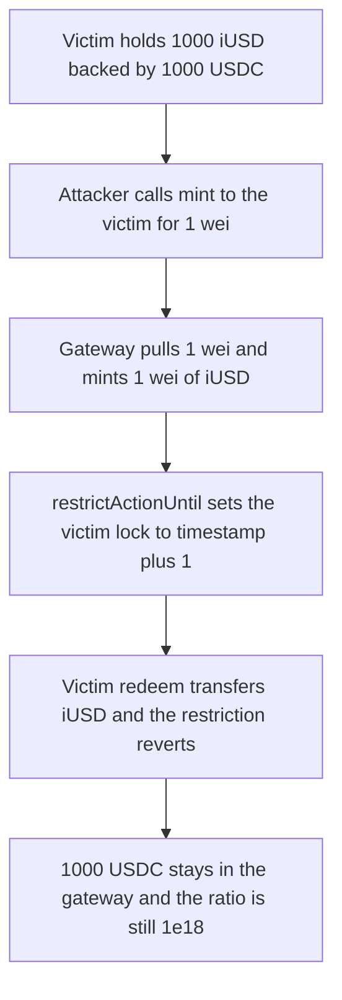

# InfiniFi — minting 1 wei of iUSD to a victim makes their redeem revert

> **Vulnerability classes:** vuln/dos/griefing · vuln/access-control/missing-auth · vuln/logic/incorrect-state-transition

> **Reproduction:** a self-contained Foundry PoC that compiles and runs with only `forge-std` — no fork, no RPC. Full trace: [output.txt](output.txt). PoC: [test/55049-griefing-vector-via-arbitrary-minting-of-iusd-tokens-spearbi_exp.sol](test/55049-griefing-vector-via-arbitrary-minting-of-iusd-tokens-spearbi_exp.sol).

<!-- non-defihacklabs -->
<!-- source-auditvault: https://github.com/Auditware/AuditVault/blob/main/findings/55049-griefing-vector-via-arbitrary-minting-of-iusd-tokens-spearbi.md -->
<!-- date: 2025-03 -->

**AuditVault taxonomy:** `lang/solidity` · `sector/governance` · `sector/staking` · `sector/token` · `platform/spearbit` · `has/github` · `severity/high` · genome: `dos-resistance` · `griefing` · `mev/frontrun`

---

## Key info

| | |
|---|---|
| **Impact** | **HIGH** — a 1 wei mint of backed iUSD to the victim makes `redeem(1000 iUSD)` revert. **1000e18 + 1 wei USDC** stays in the gateway. Collateral ratio stays **1e18** |
| **Protocol** | InfiniFi — `InfiniFiGateway.mint` / `ReceiptToken._update` |
| **Vulnerable code** | `iusd.restrictActionUntil(to, block.timestamp + RESTRICTION_DURATION)` inside permissionless `mint(to, amount)` |
| **Bug class** | Anyone can mint iUSD to any address, and that mint extends the recipient's transfer restriction. Redeem transfers iUSD, so it reverts |
| **Finding** | Spearbit — InfiniFi, March 2025 · #55049 · reporter **R0bert** |
| **Report** | [InfiniFi-Spearbit-Security-Review-March-2025.pdf](https://github.com/spearbit/portfolio/blob/master/pdfs/InfiniFi-Spearbit-Security-Review-March-2025.pdf) |
| **Source** | [AuditVault](https://github.com/Auditware/AuditVault/blob/main/findings/55049-griefing-vector-via-arbitrary-minting-of-iusd-tokens-spearbi.md) |
| **Status** | Audit finding. InfiniFi removed `ActionRestriction` from iUSD. Reproduced as a local synthetic |
| **Compiler** | solc 0.8.27, cancun, via_ir |

This is not an unbacked mint. `mint` pulls `amount` USDC before it mints `amount` iUSD, so the collateral ratio stays `1e18`. The harm the review describes, and the harm this PoC asserts, is the other user's redeem. `ReceiptToken.mint` and `restrictActionUntil` are `only` the minter. A direct call from anyone else reverts. `mintSelf` restricts the caller only, and the victim can still redeem.

The review's `restrictionDuration` is 1 second. The playground has one timestamp and no `warp`. The victim's original deposit is modeled as a position whose 1-second lock has already elapsed. The grief mint in this transaction sets a fresh lock of `block.timestamp + 1`, which is still in the future for the rest of the block, so the redeem in the same call reverts.

---

## TL;DR

1. The victim holds `1000e18` iUSD against `1000e18` USDC. Ratio `1000000000000000000` (`1e18`).
2. The attacker calls `mint(victim, 1)` and pays 1 wei of USDC. Victim iUSD becomes `1000000000000000000001`.
3. `restrictedUntil(victim)` becomes `block.timestamp + 1`. In the forge trace that value is `2`, because the default timestamp is `1`.
4. The victim's `redeem(1000e18)` transfers iUSD. `_checkActionRestriction` reverts. Victim USDC stays `0`. Gateway USDC stays `1000000000000000000001`.
5. Ratio after the dust mint is still `1e18`. The books look solvent. The exit does not work.
6. **Control:** `ReceiptToken.mint` from a non-minter reverts. `mintSelf(1)` locks the caller, not the victim. The victim then redeems `1000e18` and receives `1000e18` USDC.

---

## The vulnerable code

The gateway mint. The `@>` line is the restriction the review quotes as `restrictActionUntil(_to, block.timestamp + restrictionDuration)`.

```solidity
function _mintTo(address to, uint256 amount) internal returns (uint256) {
    usdc.transferFrom(msg.sender, address(this), amount);
    collateral += amount;
    iusd.mint(to, amount);
    // @> VULN: any caller mints iUSD to `to` and extends that address's transfer lock
    iusd.restrictActionUntil(to, block.timestamp + RESTRICTION_DURATION);
    return amount;
}
```

`mint(to, amount)` is external and calls `_mintTo`. `mintSelf` calls it with `msg.sender` only.

The transfer check, in the shape the review quotes:

```solidity
function _update(address _from, address _to, uint256 _value) internal {
    if (_from != address(0) && _to != address(0)) {
        // check action restrictions if the transfer is not a burn nor a mint
        _checkActionRestriction(_from);
    }
    balanceOf[_from] -= _value;
    balanceOf[_to] += _value;
}
```

```solidity
function _checkActionRestriction(address who) internal view {
    require(block.timestamp >= restrictedUntil[who], "restricted");
}
```

Redeem is a transfer of the user's iUSD into the gateway, so the sender is checked. A mint (`from == address(0)`) is not.

The control is the minter role on the token, plus not aiming the lock at a third party:

```diff
- function mint(address to, uint256 amount) external returns (uint256) {
-     return _mintTo(to, amount);
- }
+ function mint(uint256 amount) external returns (uint256) {
+     return _mintTo(msg.sender, amount);
+ }
```

InfiniFi's own fix removed the restriction from iUSD entirely.

---

## Root cause

`mint` lets the caller pick `to`, and the receipt token then refuses transfers from `to` until `block.timestamp + restrictionDuration`. With duration `1`, repeating the call keeps pushing the deadline forward. Redeem, stake, and any other iUSD transfer from that address revert. The USDC pulled on the grief mint keeps the ratio at 1, so the accounting does not flag the frozen exit.

## Preconditions

- The victim holds iUSD and wants to transfer or redeem it. Here, `1000e18` iUSD from a deposit whose original lock has elapsed.
- `restrictionDuration` is 1. The grief and the redeem share a block, so `block.timestamp < restrictedUntil`.
- The attacker has 1 wei of USDC. No role is required to call `gateway.mint`.
- `ReceiptToken.mint` itself rejects a non-minter. The gateway is the minter, and the gateway does not check the caller.

## Attack walkthrough

Numbers from [output.txt](output.txt):

| | Value |
|---|---|
| Ratio before | `1000000000000000000` |
| Ratio after | `1000000000000000000` |
| Victim iUSD | `1000000000000000000001` |
| `restrictedUntil` | `2` (`block.timestamp + 1` at forge timestamp `1`) |
| Redeem reverted | yes |
| Victim USDC after | `0` |
| USDC left in the gateway | `1000000000000000000001` |

The control deposits the same `1000e18`, calls `mintSelf(1)` from the attacker, and the victim's `restrictedUntil` stays `0`. `redeem` returns `1000e18` USDC to the victim. A direct `iusd.mint` and a direct `restrictActionUntil` from the test contract both revert.

## Diagrams



## Impact

The victim cannot redeem `1000e18` iUSD. The USDC behind that position, plus the attacker's 1 wei, remains in the gateway. The collateral ratio stays `1e18`, so nothing in the accounting looks insolvent. The same mint aimed at a contract that must transfer iUSD, such as the review's `YieldSharing.accrue` fee transfer, reverts that call too. Cost to refresh the lock is 1 wei plus gas.

## Remediation

Mint only to `msg.sender`, or drop `restrictActionUntil` from the public mint. InfiniFi removed `ActionRestriction` from iUSD and siUSD. Keep `ReceiptToken.mint` behind the minter role, which already reverts for everyone else.

## Sources

- AuditVault finding: https://github.com/Auditware/AuditVault/blob/main/findings/55049-griefing-vector-via-arbitrary-minting-of-iusd-tokens-spearbi.md
- Spearbit report (March 2025): https://github.com/spearbit/portfolio/blob/master/pdfs/InfiniFi-Spearbit-Security-Review-March-2025.pdf
- Protocol: https://github.com/InfiniFi-Labs/infinifi-protocol (`src/gateway/InfiniFiGatewayV1.sol` `mint`, `src/tokens` receipt token). The review cites `MintController.sol` L99 and says the fix removed `ActionRestriction` in commit `e893df4`.
- `_update`'s mint-and-burn exemption and `restrictActionUntil(_to, block.timestamp + restrictionDuration)` are the snippets in the finding.
