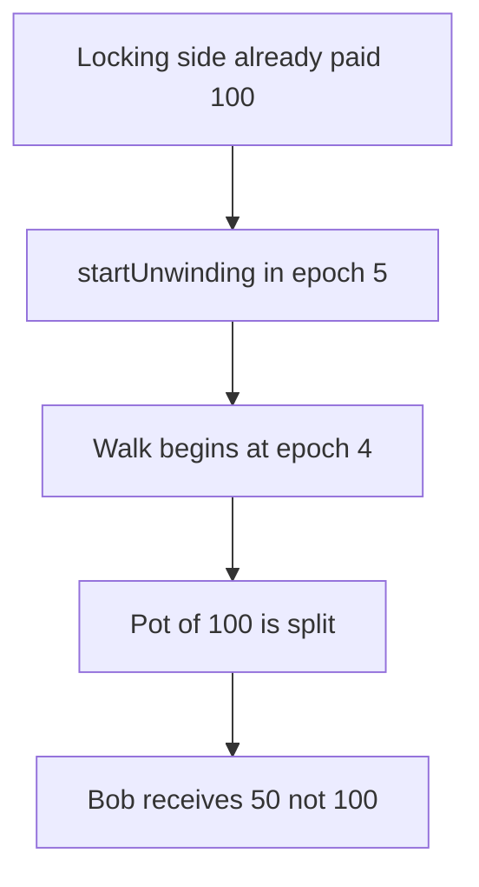

# infiniFi: unwinding in the same epoch takes 50 from Bob

> **Vulnerability classes:** vuln/logic/reward-calculation

<!-- non-defihacklabs -->
<!-- source-auditvault: https://github.com/Auditware/AuditVault/blob/main/findings/55050-double-claiming-of-accrued-rewards-via-unwinding-after-accru.md -->
<!-- date: 2025-03 -->

## Key info

| | |
|---|---|
| **Protocol** | infiniFi |
| **Finding** | Spearbit, AuditVault 55050 |
| **Vulnerable code** | `Unwinding.balanceOf` |
| **Harm** | After taking 100 on the locking side, the user is also paid 50 of the 100 unwinding pot. Bob receives 50 instead of 100. The fixed balanceOf pays Bob 100. |
| **Chain** | local synthetic |

## TL;DR

`balanceOf` starts at `fromEpoch - 1`. A user who already earned the locking reward for epoch 5 can `startUnwinding` in that epoch and still be counted. The 100 pot is split with Bob.

## The vulnerable code

```solidity
        // @> VULN: fromEpoch - 1 includes the arrival epoch
        if (epoch < p.fromEpoch - 1) return 0;
```

## Root cause

The arrival epoch is included because the loop begins one epoch before `fromEpoch`. The user was already paid for that epoch on the locking side.

## Preconditions

Bob has been unwinding since epoch 1 with 100 shares. The user was allocated 100 of locking rewards for epoch 5.

## Attack walkthrough

1. Record the 100 locking allocation. See [output.txt](output.txt).
2. Seed Bob at epoch 1 and start unwinding in epoch 5.
3. `balanceOf` for epoch 5 returns 100 shares.
4. The 100 pot is split 50 and 50.
5. The arriving user receives 50.
6. Bob receives 50. The fixed module excludes the arrival epoch and pays Bob 100.

## Diagrams



## Impact

Bob loses 50 of the epoch's unwinding rewards. Skipping the arrival epoch pays him the full 100.

## Remediation

Do not count a position for epochs at or before the epoch in which it started unwinding.

## How to reproduce

```bash
cd 55050-double-claiming-of-accrued-rewards-via-unwinding-after-accru_exp
forge test -vv
```
