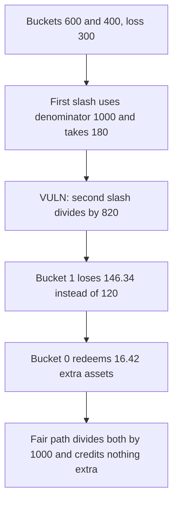

# infiniFi — applyLosses over-slashes later buckets by shrinking the denominator

> **Vulnerability classes:** vuln/arithmetic/rounding-direction · vuln/logic/state-update

<!-- non-defihacklabs -->
<!-- source-auditvault: https://github.com/Auditware/AuditVault/blob/main/findings/55051-incorrect-accounting-in-lockingcontrollerapplylosses-functio.md -->
<!-- date: 2025-03 -->

## Key info

| | |
|---|---|
| **Protocol** | infiniFi LockingController |
| **Finding** | Spearbit / R0bert, AuditVault 55051 |
| **Vulnerable code** | `applyLosses` — `mulDivUp` against a denominator that the loop itself decreases |
| **Harm** | Bucket 1 is short 26.341463414634146342 receipt tokens. Bucket 0 is credited 16.422881969587255612 extra assets. |
| **Chain** | local synthetic |

## TL;DR

`applyLosses` splits a loss across epoch buckets with `mulDivUp(bucket, loss, _globalReceiptToken)` and then subtracts the allocation from `_globalReceiptToken`. The next bucket divides by a smaller number, so the slashes sum to more than the loss. With buckets of 600 and 400 and a loss of 300, bucket 1 loses 146.341463414634146342 instead of 120. It is short 26.341463414634146342. Bucket 0 then redeems 16.422881969587255612 more of the remaining assets than a fair slash allows. Dividing by the stored `globalReceiptToken` on every iteration slashes 180 and 120 and credits nothing extra.

## The vulnerable code

```solidity
uint256 allocation = epochTotalReceiptToken.mulDivUp(_amount, _globalReceiptToken);
// @> VULN: the denominator is the shrinking local, so this bucket is slashed above its fair share.
_globalReceiptToken -= allocation;
```

The fix uses the state variable `globalReceiptToken`, which is not reduced inside the loop, as the denominator.

## Root cause

`_globalReceiptToken` is both the denominator and the running remainder. Decreasing it inside the loop changes the base of every later `mulDivUp`. The sum of the ceils exceeds `_amount`, and the value written back to `globalReceiptToken` is that remainder rather than `global - loss`.

## Preconditions

At least two buckets have receipt balances. A loss is applied. Here the buckets are 600 and 400 and the loss is 300. No privileged role beyond whoever is allowed to call `applyLosses` is required for the math to over-slash. The synthetic calls it directly so the accounting is the thing under test.

## Attack walkthrough

1. Bucket 1 starts at 400. Bucket 0 starts at 600. Assets are 1000.
2. The first slash is ceil(600 * 300 / 1000) = 180. The local denominator becomes 820.
3. The second slash is ceil(400 * 300 / 820) = 146.341463414634146342. Bucket 1 is left at 253.658536585365853658, short 26.341463414634146342 versus the fair 280.
4. Assets fall by the real loss only, to 700. Receipts left are 673.658536585365853658. Bucket 0's pro-rata claim is 436.422881969587255612, which is 16.422881969587255612 above the fair 420. That extra is paid to the bucket-0 holder.

The control divides both buckets by the original 1000. The slashes are 180 and 120. They sum to the loss. There is no extra credit.

## Diagrams



## Impact

The later bucket holder loses 26.341463414634146342 receipt tokens beyond a pro-rata slash. The earlier bucket holder is paid 16.422881969587255612 assets they would not receive if every bucket divided by the original total.

## Remediation

Divide every bucket by the pre-slash `globalReceiptToken`. Do not decrement the denominator inside the loop. Write `globalReceiptToken` from that original total minus the loss, not from the running local.

## Sources

- AuditVault finding: https://github.com/Auditware/AuditVault/blob/main/findings/55051-incorrect-accounting-in-lockingcontrollerapplylosses-functio.md
- Spearbit report (infiniFi, March 2025, R0bert): https://github.com/spearbit/portfolio/blob/master/pdfs/InfiniFi-Spearbit-Security-Review-March-2025.pdf
- Vulnerable function: `InfiniFi-Labs/infinifi-protocol` `src/locking/LockingController.sol` `applyLosses` (fixed in commit b9af8d). The blamed lines are the `mulDivUp` against `_globalReceiptToken` and the decrement of that local.
