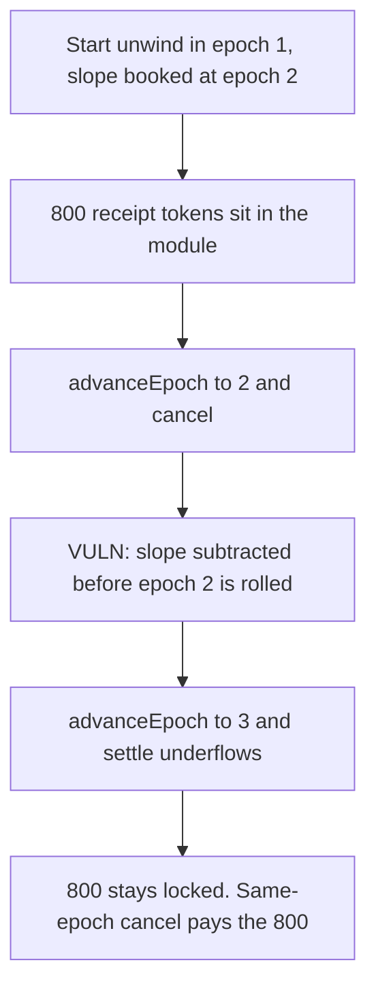

# infiniFi — cancelling an unwind one epoch later locks 800 receipt tokens

> **Vulnerability classes:** vuln/logic/state-update · vuln/logic/incorrect-state-transition · vuln/dos/frozen-funds

<!-- non-defihacklabs -->
<!-- source-auditvault: https://github.com/Auditware/AuditVault/blob/main/findings/55054-broken-accounting-when-cancelunwinding-is-called-one-epoch-a.md -->
<!-- date: 2025-03 -->

## Key info

| | |
|---|---|
| **Protocol** | infiniFi UnwindingModule |
| **Finding** | Spearbit / R0bert, AuditVault 55054 |
| **Vulnerable code** | `cancelUnwinding` subtracts `rewardWeightDecrease` when `currentEpoch == fromEpoch` |
| **Harm** | 800 receipt tokens stay in the module. The next epoch's settlement underflows. |
| **Chain** | local synthetic |

## TL;DR

`startUnwinding` stores the slope at `fromEpoch = next epoch`. `cancelUnwinding` allows the cancel once `currentEpoch >= fromEpoch`. On the epoch the slope was scheduled for, `_getLastGlobalPoint` stops before that epoch, and the function still subtracts `rewardWeightDecrease`. The stored decrease is now too small for a slope that ends at this epoch. One epoch later `_getLastGlobalPoint` underflows, `settle` reverts, and 800 receipt tokens cannot be paid out. Cancelling in the start epoch, before `fromEpoch`, clears the unapplied slope and `settle` pays the 800.

Epochs are an integer. `advanceEpoch()` adds one. Nothing in `run()` warps time.

## The vulnerable code

```solidity
GlobalPoint memory point = _getLastGlobalPoint();
// @> VULN: fromEpoch has not been rolled in, but its slope is subtracted anyway.
point.totalRewardWeightDecrease -= pos.rewardWeightDecrease;
point.totalRewardWeight -= userRewardWeight;
_updateGlobalPoint(point);
```

`_getLastGlobalPoint` loops `for (epoch = point.epoch; epoch < currentEpoch; epoch++)`, so the current epoch's `rewardWeightDecreases` entry is not applied. The fix is `require(currentEpoch > position.fromEpoch)`.

## Root cause

The slope is booked at a future epoch and removed from the global point as if that epoch had already been rolled. A later roll still sees the ending slope (`rewardWeightIncreases[2] = 150`) and subtracts it from a decrease that is only 100. The subtraction underflows. Settlement never completes.

## Preconditions

A position is started in epoch 1, so `fromEpoch` is 2. Another slope of 150 is scheduled to end at epoch 2, which the stored decrease of 200 can absorb. The module holds 800 receipt tokens. The user cancels in epoch 2 and someone settles in epoch 3.

## Attack walkthrough

1. Unwinding starts. The slope of 100 is stored at epoch 2. 800 receipt tokens are minted to the module.
2. `advanceEpoch` moves to 2. `cancelUnwinding` passes `currentEpoch >= fromEpoch` and subtracts 100 from `totalRewardWeightDecrease` before epoch 2 is rolled.
3. `advanceEpoch` moves to 3. `settle` calls `_getLastGlobalPoint`, which processes epoch 2: `100 - 150` underflows. The call reverts.
4. The module still holds 800. The caller holds 0.

The control calls `cancelSameEpoch` while the epoch is still 1. That drops the unapplied slope and does not subtract it from the global point. After two `advanceEpoch` calls, `settle` pays the 800.

## Diagrams



## Impact

800 receipt tokens cannot be settled. The module's balance stays 800 and the claimant receives 0. A cancel in the start epoch pays the same 800.

## Remediation

Require `currentEpoch > position.fromEpoch` before cancelling, so the slope has been rolled into the global point before it is removed. Do not subtract a slope the point has not absorbed.

## Sources

- AuditVault finding: https://github.com/Auditware/AuditVault/blob/main/findings/55054-broken-accounting-when-cancelunwinding-is-called-one-epoch-a.md
- Spearbit report (infiniFi, March 2025, R0bert): https://github.com/spearbit/portfolio/blob/master/pdfs/InfiniFi-Spearbit-Security-Review-March-2025.pdf
- Vulnerable function: `InfiniFi-Labs/infinifi-protocol` `src/locking/UnwindingModule.sol` `cancelUnwinding` (fixed in commit a765744). The blamed update is `point.totalRewardWeightDecrease -= position.rewardWeightDecrease` after `_getLastGlobalPoint`, which does not process `fromEpoch`.
