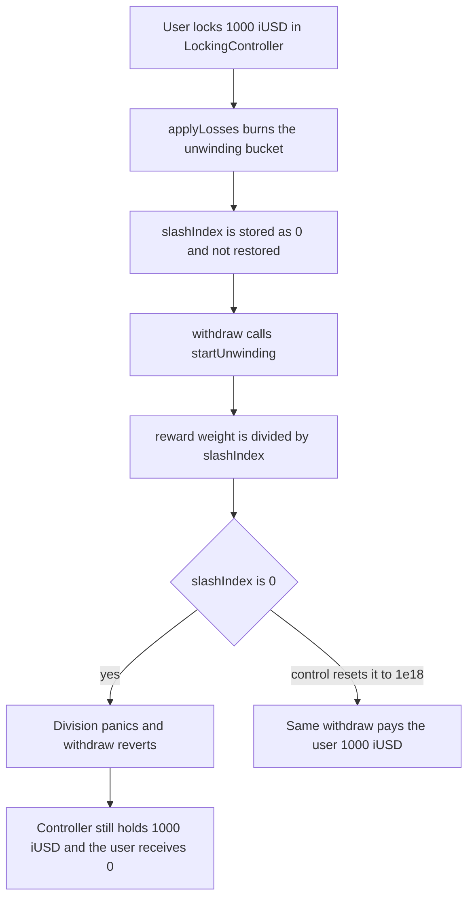

# InfiniFi — a wiped unwinding bucket stores `slashIndex = 0` and locks withdrawals

> **Vulnerability classes:** vuln/dos/frozen-funds · vuln/logic/state-update · vuln/dos/lockup
>
> **Reproduction:** self-contained Foundry PoC, no fork and no cheatcodes. Full trace: [output.txt](output.txt). Synthetic: [test/55055-lock-of-user-funds-due-to-zero-slashindex-update-spearbit-no.sol](test/55055-lock-of-user-funds-due-to-zero-slashindex-update-spearbit-no.sol).

<!-- non-defihacklabs -->
<!-- source-auditvault: https://github.com/Auditware/AuditVault/blob/main/findings/55055-lock-of-user-funds-due-to-zero-slashindex-update-spearbit-no.md -->
<!-- date: 2025-03 -->

## Key info

| | |
|---|---|
| **Impact** | **HIGH** — 1000 iUSD stays in `LockingController`; `withdraw` pays 0 |
| **Protocol** | InfiniFi |
| **Vulnerable contract** | `UnwindingModule.startUnwinding` / `applyLosses` |
| **Bug class** | Division by a slash index left at zero; locked funds cannot unwind |
| **Finding** | Spearbit (R0bert) — InfiniFi security review, March 2025 · #55055 |
| **Report** | [InfiniFi-Spearbit-Security-Review-March-2025.pdf](https://github.com/spearbit/portfolio/blob/master/pdfs/InfiniFi-Spearbit-Security-Review-March-2025.pdf) |
| **Source** | [AuditVault finding](https://github.com/Auditware/AuditVault/blob/main/findings/55055-lock-of-user-funds-due-to-zero-slashindex-update-spearbit-no.md) |
| **Audited code** | [InfiniFi-Labs/infinifi-protocol `UnwindingModule.sol`](https://github.com/InfiniFi-Labs/infinifi-protocol/blob/master/src/locking/UnwindingModule.sol) — `startUnwinding` divides by `slashIndex`; `applyLosses` does not restore it |
| **Compiler** | solc 0.8.27, Cancun, via IR |

This is an audit finding, not a historical exploit. The PoC deploys a reduced module locally. Numbers below are from [output.txt](output.txt).

## TL;DR

`slashIndex` starts at `1e18` and is scaled down by losses. A loss that burns every receipt in the unwinding bucket stores `slashIndex = 0` and does not put it back. The user's still-locked receipts sit in `LockingController` (they were never in that bucket). `withdraw` calls `startUnwinding`, which does `uint256 rewardWeight = _rewardWeight.divWadDown(slashIndex)` and panics. The user receives 0 while the controller still holds 1000 iUSD. Restoring `slashIndex` to `1e18` when the bucket hits zero makes the same withdraw pay 1000 iUSD.

## The vulnerable code

`applyLosses` is the audited scaling formula. The reset the report recommends is absent:

```solidity
function applyLosses(uint256 _amount) external {
    if (_amount == 0) return;
    uint256 _totalReceiptTokens = totalReceiptTokens;
    receipt.burn(_amount);
    slashIndex = slashIndex.mulDivDown(_totalReceiptTokens - _amount, _totalReceiptTokens);
    totalReceiptTokens = _totalReceiptTokens - _amount;
    // FIX: if (totalReceiptTokens == 0) slashIndex = 1e18;
}
```

`startUnwinding` keeps the blamed call from the Spearbit write-up. The live tree names the local `userRewardWeight`; the expression is the same WAD division by `slashIndex`. solc via IR inlines `divWadDown`, so the opcode that panics is the body below, not the call line:

```solidity
function divWadDown(uint256 x, uint256 y) pure returns (uint256) {
    // @> VULN: slashIndex stays 0 after a full burn, so this division panics and withdraw never pays
    return (x * 1e18) / y;
}

uint256 rewardWeight = _rewardWeight.divWadDown(slashIndex);
```

`LockingController.withdraw` only transfers the locked balance after that call returns. A panic rolls the transfer back.

## Root cause

`slashIndex` is a scaling factor, not a balance. Burning the last unwinding receipt makes the numerator zero, so the stored index becomes zero. Every later unwind divides a positive reward weight by that index. Solidity 0.8 panics on division by zero, and there is no other path that moves the locked receipts out.

## Preconditions

- A user has locked receipts in `LockingController` (here, 1000 iUSD).
- The unwinding module holds its own receipt bucket (here, 250 iUSD) with `slashIndex = 1e18`.
- A loss burns that entire bucket. The user's locked receipts are a different balance and are not burned.

## Attack walkthrough

1. Seed the module with 250 iUSD and set `totalReceiptTokens` to match.
2. The user locks 1000 iUSD. `LockingController` balance is 1000 iUSD.
3. `applyLosses(250)` burns the bucket. `slashIndex` becomes 0. The controller still holds 1000 iUSD.
4. `withdraw` calls `startUnwinding`. The division panics. `paidOut` stays 0.
5. After the revert, the controller balance is still `1000000000000000000000` and the user balance is 0. See [output.txt](output.txt): `HARM locked iUSD wei: 1000000000000000000000`, `HARM paid to user: 0`, `HARM slashIndex: 0`.

## Control

`UnwindingModuleFixed.applyLosses` runs the same scaling, then sets `slashIndex = 1e18` when `totalReceiptTokens == 0`. The same `withdraw` then succeeds.

[output.txt](output.txt): `CONTROL slashIndex: 1000000000000000000`, `CONTROL user received: 1000000000000000000000`. The user receives the full 1000 iUSD and the controller balance is 0.

## Diagrams



## Impact

A full slash of the unwinding bucket freezes every position that still has to call `startUnwinding`. In this reduction that is 1000 iUSD: the tokens are in the controller, the user cannot withdraw them, and no one else receives them. The report rates this high because the locked balance has no alternate exit.

## Remediation

When `applyLosses` leaves `totalReceiptTokens == 0`, set `slashIndex = 1e18` before any further unwind. The report also notes that `totalRewardWeight` slopes have to be cleared across the same boundary, or the restored index will disagree with historical reward weight. The control in this PoC only demonstrates the index reset that unblocks `withdraw`.

## How to reproduce

```bash
cd 55055-lock-of-user-funds-due-to-zero-slashindex-update-spearbit-no_exp
forge test -vv
```

Offline. No RPC.

## Sources

- [AuditVault finding 55055](https://github.com/Auditware/AuditVault/blob/main/findings/55055-lock-of-user-funds-due-to-zero-slashindex-update-spearbit-no.md)
- [Spearbit report PDF, March 2025](https://github.com/spearbit/portfolio/blob/master/pdfs/InfiniFi-Spearbit-Security-Review-March-2025.pdf)
- [InfiniFi `UnwindingModule.sol`](https://github.com/InfiniFi-Labs/infinifi-protocol/blob/master/src/locking/UnwindingModule.sol) — `startUnwinding` and `applyLosses`
- Finding text: fixed in commits `66182a3` and `06dca30`, fix verified by Spearbit
