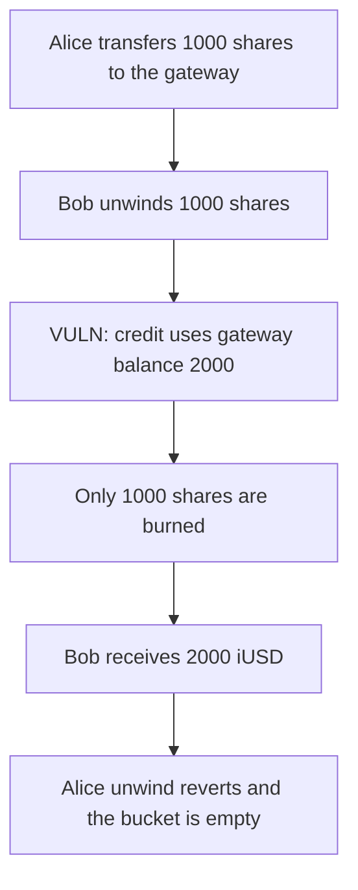

# InfiniFi: startUnwinding credits the gateway balance, so Bob receives Alice's 1000 iUSD

> **Vulnerability classes:** `vuln/logic/reward-calculation` · `vuln/arithmetic/precision-loss`

<!-- non-defihacklabs -->
<!-- source-auditvault: https://github.com/Auditware/AuditVault/blob/main/findings/55056-incorrect-calculation-of-user-shares-in-startunwinding-spear.md -->
<!-- date: 2025-03 -->

## Key info

| Field | Value |
|---|---|
| **Loss** | Bob unwinds 1000 liUSD and is paid 2000 iUSD. Alice's later unwind reverts and she holds 0 iUSD |
| **Vulnerable contract** | `LockingController.startUnwinding` |
| **Attacker EOA** | `0x1111111111111111111111111111111111111111` |
| **Attack contract** | `Exploit` |
| **Attack tx** | `Exploit.run()` |
| **Chain / block / date** | Ethereum model · block 0 · 2025-03 |
| **Compiler** | solc 0.8.27, cancun, optimizer 200 |
| **Bug class** | Receipt credit uses `balanceOf(gateway)` instead of `_shares` |

## TL;DR

Spearbit's March 2025 InfiniFi review: `startUnwinding` sizes `userReceiptToken` from the gateway's share balance, not from the `_shares` argument. Alice accidentally transfers 1000 liUSD to the gateway. Bob unwinds his own 1000. The gateway then holds 2000, so Bob is credited 2000 iUSD, while only his 1000 shares are burned. After Carol unwinds, the bucket is empty. Alice's `startUnwinding` reverts on a zero credit. She still has her shares and no iUSD.

## Background

The PoC in the report locks Bob, Carol, and Alice for 1000 each, has Alice transfer her liUSD to the gateway, and shows Bob "gets 2k of receipt token". The live `InfiniFi-Labs/infinifi-protocol` master uses `_shares` (fix `d8b0616`). This reduction keeps the pre-fix read. The epoch wait in the original test is only how long a user waits before converting the receipt. The receipt tokens themselves move at `startUnwinding`.

## The vulnerable code

```solidity
uint256 userShares = share.balanceOf(msg.sender); // @> VULN: gateway balance, not `_shares`
uint256 userReceiptToken = (userShares * totalReceiptTokens) / totalShares;
require(share.transferFrom(msg.sender, address(this), _shares), "pull");
```

```diff
- uint256 userShares = share.balanceOf(msg.sender);
- uint256 userReceiptToken = (userShares * totalReceiptTokens) / totalShares;
+ uint256 userReceiptToken = (_shares * totalReceiptTokens) / totalShares;
```

## Root cause

The credit and the pull use different amounts. `balanceOf(gateway)` includes residual shares. `transferFrom` and `burn` use `_shares`. The extra receipt is taken from the bucket that still backs the residual shares.

## Preconditions

- Three lockers, 1000 shares and 1000 iUSD of backing each. The bucket holds 3000 iUSD.
- Alice's shares sit on the gateway before Bob unwinds.
- Bob calls `startUnwinding` with his own balance, 1000.

## Attack walkthrough

1. Alice transfers 1000 liUSD to the gateway.
2. Bob unwinds 1000. The gateway balance is 2000. His credit is 2000 iUSD.
3. Only 1000 shares are burned. Alice's shares remain.
4. Carol unwinds and the remaining 1000 iUSD leaves the bucket.
5. The residual shares are returned to Alice. Her unwind reverts because the credit is 0.

## Diagrams



## Impact

Bob's iUSD balance is 2000e6. He locked 1000e6. The extra 1000e6 is Alice's backing. Alice holds 1000 liUSD and 0 iUSD, and `startUnwinding` reverts. Using `_shares` would have credited Bob 1000e6. The receipt token uses 6 decimals, matching the report's `1000e6` positions.

## Remediation

Compute `userReceiptToken` from `_shares`, which is the fix InfiniFi shipped in `d8b0616`.

## How to reproduce

```bash
cd 55056-incorrect-calculation-of-user-shares-in-startunwinding-spear_exp
forge test -vv
```

`test_bob_is_credited_alice_shares_and_alice_cannot_unwind` asserts Bob's 2000e6 iUSD, an empty bucket, Alice's revert, and Alice's 1000e6 shares. `test_control_shares_argument_credits_1000` asserts the `_shares` formula credits 1000e6.

## Sources

- AuditVault finding: https://github.com/Auditware/AuditVault/blob/main/findings/55056-incorrect-calculation-of-user-shares-in-startunwinding-spear.md
- Report: https://github.com/spearbit/portfolio/blob/master/pdfs/InfiniFi-Spearbit-Security-Review-March-2025.pdf
- Fixed controller on master: https://github.com/InfiniFi-Labs/infinifi-protocol/blob/master/src/locking/LockingController.sol
- Fix commit named in the report: `d8b0616`
