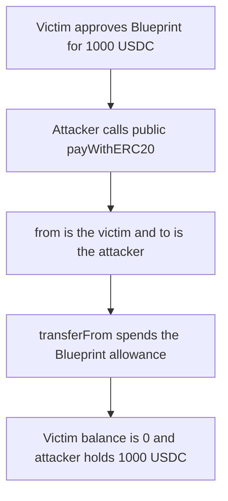

# Crestal Network: public payWithERC20 spends any Blueprint allowance

> **Vulnerability classes:** `vuln/access-control/missing-auth`

<!-- non-defihacklabs -->
<!-- source-auditvault: https://github.com/Auditware/AuditVault/blob/main/findings/55092-h-1-anyone-who-is-approving-blueprintv5-contract-to-spend-er.md -->
<!-- date: 2025-03 -->

## Key info

| Field | Value |
|---|---|
| **Loss** | 1000 USDC pulled from a user who approved Blueprint |
| **Vulnerable contract** | `Payment.payWithERC20` |
| **Attacker EOA** | `0x1111111111111111111111111111111111111111` |
| **Attack contract** | `Exploit` |
| **Attack tx** | `Exploit.run()` |
| **Chain / block / date** | Local synthetic · 2025-03 |
| **Compiler** | solc 0.8.27, cancun, via IR |
| **Bug class** | Public transferFrom with a caller-chosen payer |

## TL;DR

`payWithERC20` is `public`. It checks that `from` and `to` differ, that `to` is not zero, and that `amount` is positive, then `safeTransferFrom`s `amount` from `fromAddress` to `toAddress`. Anyone who approved Blueprint — the normal step before paying to create an agent — can be drained by a third party. The admin has enabled USDC. The victim approved 1000 USDC. The attacker names the victim as `from` and receives the 1000.

## The vulnerable code

```solidity
function payWithERC20(address erc20TokenAddress, uint256 amount, address fromAddress, address toAddress) public {
    require(fromAddress != toAddress, "Cannot transfer to self address");
    require(toAddress != address(0), "Invalid to address");
    require(amount > 0, "Amount must be greater than 0");
    IERC20 token = IERC20(erc20TokenAddress);
    token.safeTransferFrom(fromAddress, toAddress, amount); // @> VULN
}
```

The inlined pull is `transferFrom(from, to, amount)` inside `SafeERC20`. Crestal's fix makes `payWithERC20` internal. A caller-bound function that always pulls `msg.sender` cannot name the victim, and the attacker's own empty balance reverts.

## Root cause

The payment helper was left `public` with an arbitrary `fromAddress`. The token allowance is to the Blueprint contract, so any external caller of that contract spends it.

## Preconditions

- The admin has enabled the token with `addPaymentAddress`.
- The victim has approved Blueprint for at least the amount taken (1000 USDC here).

## Attack walkthrough

1. USDC is an enabled payment token. The victim's balance and allowance to Blueprint are both 1000.
2. The attacker calls `payWithERC20(usdc, 1000, victim, attacker)`.
3. `transferFrom` succeeds because the allowance names Blueprint, which is `msg.sender` of the token call.
4. The victim's balance is 0. The attacker holds 1000 USDC.

## Diagrams



## Impact

Every user who approved Blueprint for a payment token can lose the full allowance. This run takes the 1000 USDC the victim approved. The judging report fixed it by making the function internal (crestal-omni-contracts pull 16).

## How to reproduce

```bash
cd 55092-h-1-anyone-who-is-approving-blueprintv5-contract-to-spend-er_exp
forge test -vv
```

## Sources

- AuditVault finding: https://github.com/Auditware/AuditVault/blob/main/findings/55092-h-1-anyone-who-is-approving-blueprintv5-contract-to-spend-er.md
- Judging issue 260: https://github.com/sherlock-audit/2025-03-crestal-network-judging/issues/260
- Blamed lines: https://github.com/sherlock-audit/2025-03-crestal-network/blob/main/crestal-omni-contracts/src/Payment.sol#L25-L32
- Fix: https://github.com/crestalnetwork/crestal-omni-contracts/pull/16
