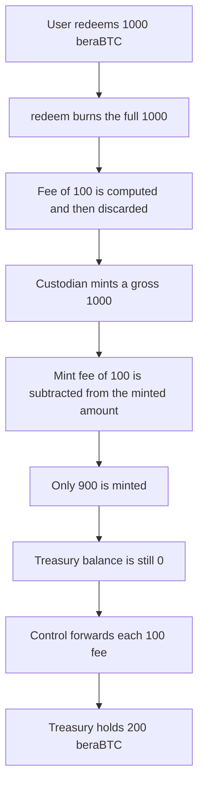

# beraBTC mint and redeem fees are burned or never minted — the treasury stays at 0

> **Vulnerability classes:** vuln/logic/fee-calculation · vuln/logic/state-update
>
> **Reproduction:** self-contained Foundry PoC, no fork and no cheatcodes. Full trace: [output.txt](output.txt). Synthetic: [test/55099-c-01-protocol-loses-mintredeem-fees-due-to-missing-treasury.sol](test/55099-c-01-protocol-loses-mintredeem-fees-due-to-missing-treasury.sol).

<!-- non-defihacklabs -->
<!-- source-auditvault: https://github.com/Auditware/AuditVault/blob/main/findings/55099-c-01-protocol-loses-mintredeem-fees-due-to-missing-treasury.md -->
<!-- date: 2025-04 -->

## Key info

| | |
|---|---|
| **Impact** | **HIGH** — 200 beraBTC of fees never reach the treasury (100 burned, 100 never minted) |
| **Protocol** | Terplayer beraBTC |
| **Vulnerable contract** | `BeraBitcoin.custodianMint` / `BeraBitcoin.redeem` |
| **Bug class** | Fee is calculated and then dropped; no treasury credit |
| **Finding** | Shieldify — Terplayer beraBTC security review · C-01 · #55099 |
| **Report** | [Terplayer-BeraBTC-Security-Review.md](https://github.com/shieldify-security/audits-portfolio-md/blob/main/Terplayer-BeraBTC-Security-Review.md) |
| **Source** | [AuditVault finding](https://github.com/Auditware/AuditVault/blob/main/findings/55099-c-01-protocol-loses-mintredeem-fees-due-to-missing-treasury.md) |
| **Audited code** | [batoshidao/bera-bitcoin @ 19d5099 `BeraBitcoin.sol`](https://github.com/batoshidao/bera-bitcoin/blob/19d509911de64a062dfaeef33f14e26f08b23c10/src/BeraBitcoin.sol) |
| **Compiler** | solc 0.8.27, Cancun, via IR |

Audit finding, not an on-chain incident. `BASE_RATE` is `10_000` and both fee rates are `1_000`, so each fee on a 1,000 beraBTC action is exactly 100 beraBTC. The report's formulas are unchanged.

## TL;DR

`custodianMint` subtracts the fee from the amount it mints and does not mint the difference to anyone. `redeem` burns the full amount, then shrinks the reported payout by the fee, and does not keep that difference. A treasury address is never credited. On one mint and one redeem, 200 beraBTC of fees are lost and the treasury balance is 0. The control forwards each fee, and the treasury ends at 200 beraBTC.

## The vulnerable code

```solidity
function custodianMint(address to, uint256 value) public {
    if (mintFeeRate > 0) {
        // @> VULN: mint fee is removed from the minted amount and never forwarded to a treasury
        value -= (value * mintFeeRate) / BASE_RATE;
    }
    _mint(to, value);
    emit CustodianMinted(to, value);
}

function redeem(uint256 value, string memory recipient) public {
    uint256 burned = value;
    // @> VULN: the full redeem amount, fee included, is burned and nothing is forwarded to a treasury
    _burn(msg.sender, burned);
    if (redeemFeeRate > 0) {
        value -= (burned * redeemFeeRate) / BASE_RATE;
    }
    emit Redeemed(msg.sender, burned, value, recipient);
}
```

`onlyRole` and `nonReentrant` are omitted. They do not move the fee.

## Root cause

The fee is a local subtraction. Mint destroys the fee by never creating it. Redeem destroys it by burning the gross amount before the subtraction. There is no `treasury` balance update on either path, which is what the report asks for.

## Preconditions

- `mintFeeRate` and `redeemFeeRate` are non-zero. Here both are 10% (`1_000 / 10_000`).
- A user holds 1,000 beraBTC to redeem.
- A custodian calls `custodianMint` for another 1,000 gross.

## Attack walkthrough

1. Seed the user with 1,000 beraBTC.
2. `redeem(1000)`. `_burn` destroys all 1,000. The net payout stored afterwards is 900. The 100 fee was inside the burn. Treasury balance is still 0.
3. `custodianMint(1000)`. The fee line reduces `value` to 900 and `_mint` creates only 900. Another 100 never exists. Treasury balance is still 0. The token contract's own balance is 0, so the fee is not sitting there either.
4. [output.txt](output.txt): `HARM redeem fee burned: 100000000000000000000`, `HARM mint fee never minted: 100000000000000000000`, `HARM treasury balance: 0`.

## Control

`BeraBitcoinFixed` keeps the same rates. On mint it mints the fee to `treasury`. On redeem it transfers the fee to `treasury` and burns only the net.

[output.txt](output.txt): `CONTROL treasury balance: 200000000000000000000`. The treasury holds both 100 beraBTC fees.

## Diagrams



## Impact

Every mint and every redeem at a non-zero fee rate drops protocol revenue. In this reduction that is 200 beraBTC: 100 burned, 100 never minted, treasury balance 0. The report rates the missing collection critical.

## Remediation

Keep a treasury address. On mint, mint the fee to it. On redeem, transfer the fee to it and burn only the net the user is redeeming. That is what the control does.

## How to reproduce

```bash
cd 55099-c-01-protocol-loses-mintredeem-fees-due-to-missing-treasury_exp
forge test -vv
```

## Sources

- [AuditVault finding 55099](https://github.com/Auditware/AuditVault/blob/main/findings/55099-c-01-protocol-loses-mintredeem-fees-due-to-missing-treasury.md)
- [Shieldify Terplayer beraBTC review](https://github.com/shieldify-security/audits-portfolio-md/blob/main/Terplayer-BeraBTC-Security-Review.md) — published 2025-04-03
- [bera-bitcoin @ 19d509911de64a062dfaeef33f14e26f08b23c10](https://github.com/batoshidao/bera-bitcoin/blob/19d509911de64a062dfaeef33f14e26f08b23c10/src/BeraBitcoin.sol) — `custodianMint`, `redeem`
- Team response in the report: Fixed
