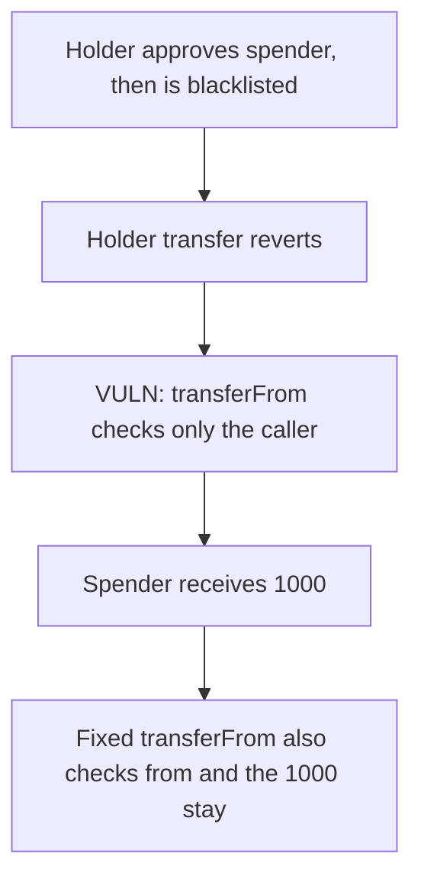

# beraBTC — a blacklisted holder still moves 1000 tokens through an approval

> **Vulnerability classes:** vuln/access-control/missing-auth · vuln/logic/missing-check

<!-- non-defihacklabs -->
<!-- source-auditvault: https://github.com/Auditware/AuditVault/blob/main/findings/55100-h-01-blacklisted-user-can-transfer-tokens-via-approved-addre.md -->
<!-- date: 2025-04 -->

## Key info

| | |
|---|---|
| **Protocol** | Terplayer beraBTC |
| **Finding** | Shieldify H-01, AuditVault 55100 |
| **Vulnerable code** | `notBlacklisted` on `transferFrom` checks only `msg.sender` |
| **Harm** | 1000 tokens move from a blacklisted holder to an approved spender |
| **Chain** | local synthetic |

## TL;DR

`notBlacklisted` reverts when `isBlacklisted[msg.sender]` is true. `transfer` and `transferFrom` both use it. The holder's own transfer reverts after they are blacklisted. `transferFrom` does not look at `from`, so a spender they approved beforehand moves the 1000. The fixed `transferFrom` also rejects a blacklisted `from`, and the 1000 stay.

## The vulnerable code

```solidity
modifier notBlacklisted() {
    // @> VULN: only the caller is checked. transferFrom never looks at `from`.
    if (isBlacklisted[msg.sender]) revert AccountIsBlacklisted();
    _;
}

function transferFrom(address from, address to, uint256 amount) public notBlacklisted returns (bool) {
    // spends `from`, who was never checked
}
```

## Root cause

The blacklist is applied to the caller of the token function. `transferFrom`'s caller is the spender, not the owner. An approval created before the blacklist is still a valid allowance, and the modifier never reads `from`.

## Preconditions

The holder has 1000 tokens and has approved the spender for 1000. The holder is then blacklisted. The spender is not blacklisted.

## Attack walkthrough

1. The holder is minted 1000 and approves the spender.
2. The holder is blacklisted. Their own `transfer` reverts.
3. The spender calls `transferFrom`. The modifier sees a non-blacklisted caller and the 1000 move.

The control uses a `transferFrom` that reverts when `from` is blacklisted. The same call reverts and the holder keeps 1000.

## Diagrams



## Impact

A blacklisted holder moves 1000 tokens through a pre-existing approval. The blacklist does not freeze that balance.

## Remediation

In `transferFrom`, reject the call when `from` is blacklisted as well as when `msg.sender` is blacklisted.

## Sources

- AuditVault finding: https://github.com/Auditware/AuditVault/blob/main/findings/55100-h-01-blacklisted-user-can-transfer-tokens-via-approved-addre.md
- Shieldify report (Terplayer beraBTC, upgradeable ERC20, April 2025): https://github.com/shieldify-security/audits-portfolio-md/blob/main/Terplayer-BeraBTC-Security-Review.md
- Vulnerable code: `batoshidao/bera-bitcoin` `src/BeraBitcoin.sol` at `19d509911de64a062dfaeef33f14e26f08b23c10` (`notBlacklisted` and `transferFrom`).
