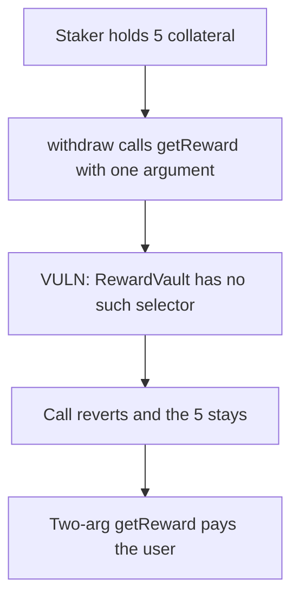

# Roots Staker — the wrong getReward selector leaves 5 collateral stuck

> **Vulnerability classes:** vuln/dependency/unsafe-external-call · vuln/dos/frozen-funds

<!-- non-defihacklabs -->
<!-- source-auditvault: https://github.com/Auditware/AuditVault/blob/main/findings/55110-c-01-incorrect-interface-used-for-gauge-contract-in-staker-p.md -->
<!-- date: 2025-02 -->

## Key info

| | |
|---|---|
| **Protocol** | Roots Staker |
| **Finding** | Pashov C-01, AuditVault 55110 |
| **Vulnerable code** | `gauge.getReward(address(this))` against a vault whose function is `getReward(address, address)` |
| **Harm** | 5 collateral stays in the staker. Withdraw reverts. |
| **Chain** | local synthetic |

## TL;DR

`_fetchRewards` calls `IGauge.getReward(address)`. The reward vault implements `getReward(address account, address recipient)`. The selector does not match, so the call reverts. `withdraw` fetches rewards before it transfers the stake, so the user's 5 collateral cannot leave the staker. Calling `getReward(account, recipient)` succeeds, and the fixed withdraw pays the user the 5 stake plus the 5 reward.

## The vulnerable code

```solidity
function _fetchRewards() internal {
    // @> VULN: RewardVault.getReward takes (account, recipient). This selector does not exist.
    gauge.getReward(address(this));
}
```

The fix is `gauge.getReward(address(this), address(this))`.

## Root cause

The interface was copied from a gauge. The deployed reward vault is Bera's RewardVault, whose `getReward` takes the account and the recipient. A one-argument call hits no function and reverts. Every action that updates rewards, including withdraw, reverts with it.

## Preconditions

The staker holds 5 of the user's collateral. The gauge address is a RewardVault that only implements the two-argument `getReward`. The user calls withdraw.

## Attack walkthrough

1. 5 collateral is minted to the staker and recorded as locked.
2. `withdraw` calls `_fetchRewards`.
3. `getReward(address)` reverts. The stake is not transferred.
4. The staker still holds 5. The user holds 0.

The control calls `getReward(account, recipient)` and then transfers the stake. The user receives 10: the 5 stake and the 5 reward.

## Diagrams



## Impact

The user cannot withdraw. 5 collateral remains in the staker.

## Remediation

Call `getReward(address account, address recipient)` with the staker as both account and recipient.

## Sources

- AuditVault finding: https://github.com/Auditware/AuditVault/blob/main/findings/55110-c-01-incorrect-interface-used-for-gauge-contract-in-staker-p.md
- Pashov report (Roots, 2025-02-09): https://github.com/pashov/audits/blob/master/team/md/Roots-security-review_2025-02-09.md
- RewardVault selector: https://docs.berachain.com/developers/contracts/reward-vault (`getReward(address account, address recipient)`).
