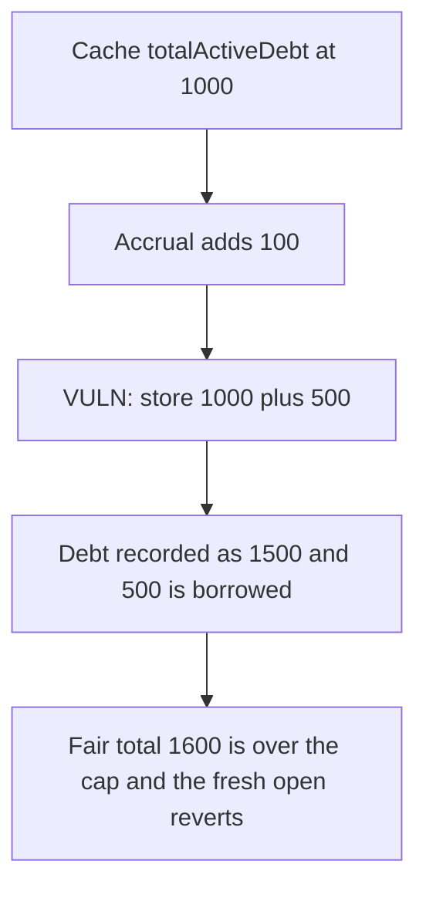

# Roots TroveManager — openTrove writes stale totalActiveDebt

> **Vulnerability classes:** vuln/logic/state-update · vuln/logic/incorrect-order-of-operations

<!-- non-defihacklabs -->
<!-- source-auditvault: https://github.com/Auditware/AuditVault/blob/main/findings/55112-h-02-stale-totalactivedebt-used-in-opentrove-causing-incorre.md -->
<!-- date: 2025-02 -->

## Key info

| | |
|---|---|
| **Protocol** | Roots TroveManager |
| **Finding** | Pashov Audit Group H-02, AuditVault 55112 |
| **Vulnerable code** | `TroveManager.openTrove` |
| **Harm** | Recorded debt 1500 and 500 borrowed. Fair debt is 1600, which the fresh path rejects. |
| **Chain** | local synthetic |

## TL;DR

`openTrove` copies `totalActiveDebt` into `supply`, then accrues interest, then stores `supply + newDebt`. The interest written by the accrual is thrown away. Starting from 1000 with 100 of pending interest and a new composite debt of 500, the function records 1500 and mints 500 debt tokens. The fair total is 1600. The system cap is 1599, so a write that uses the post-interest total reverts and mints nothing.

## The vulnerable code

```solidity
uint256 supply = totalActiveDebt;
_accrueActiveInterests();
uint256 base = useFreshSupply ? totalActiveDebt : supply;
// @> VULN: base is the pre-interest cache, so this sum drops the 100 interest
uint256 _newTotalDebt = base + compositeDebt;
require(_newTotalDebt + defaultedDebt <= maxSystemDebt, "Collateral debt limit reached");
totalActiveDebt = _newTotalDebt;
```

Inside `_accrueActiveInterests`, `totalActiveDebt = currentDebt + activeInterests` runs, and the assignment above replaces it.

## Root cause

The cache is taken before the accrual and used after it. The cap check and the stored total both miss the interest that the same transaction just added, so a trove that should hit `maxSystemDebt` still opens.

## Preconditions

`totalActiveDebt` is 1000, pending interest is 100, `maxSystemDebt` is 1599, and the new composite debt is 500. No price or collateral ratio is involved. The debt token balance of the manager is what gets transferred.

## Attack walkthrough

1. `openTrove(500)` caches supply 1000.
2. Accrual adds 100, so the live total is 1100.
3. The function stores `1000 + 500 = 1500` and transfers 500 debt tokens.
4. Fair debt is `1000 + 100 + 500 = 1600`, which is above the cap.
5. The fresh manager reverts. Its `totalActiveDebt` rolls back to 1000 and it pays nothing.

## Diagrams



## Impact

The system undercounts debt by the 100 of interest and still mints 500 new debt that the cap should have refused. The recorded number is 1500 against a fair 1600. Using the post-interest total blocks the open.

## Remediation

Set `totalActiveDebt` from the value after `_accrueActiveInterests()`, not from the cached `supply`.

## How to reproduce

```bash
cd 55112-h-02-stale-totalactivedebt-used-in-opentrove-causing-incorre_exp
forge test -vv
```

## Sources

- AuditVault finding: https://github.com/Auditware/AuditVault/blob/main/findings/55112-h-02-stale-totalactivedebt-used-in-opentrove-causing-incorre.md
- Pashov report: https://github.com/pashov/audits/blob/master/team/md/Roots-security-review_2025-02-09.md
