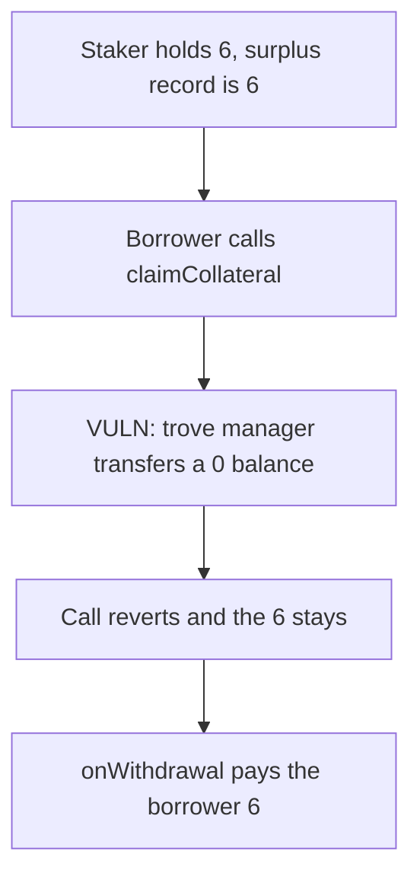

# Roots — surplus collateral claim reverts and 6 stays in the staker

> **Vulnerability classes:** vuln/logic/liquidation-logic · vuln/dos/frozen-funds

<!-- non-defihacklabs -->
<!-- source-auditvault: https://github.com/Auditware/AuditVault/blob/main/findings/55114-h-04-borrowers-fail-to-claim-their-surplus-collateral-pashov.md -->
<!-- date: 2025-02 -->

## Key info

| | |
|---|---|
| **Protocol** | Roots TroveManager |
| **Finding** | Pashov H-04, AuditVault 55114 |
| **Vulnerable code** | `claimCollateral` transfers the collateral token from the trove manager |
| **Harm** | 6 surplus collateral stays in the staker. The borrower receives 0. |
| **Chain** | local synthetic |

## TL;DR

A partial liquidation records `surplusBalances[borrower] = 6` but the collateral itself is staked. `claimCollateral` zeroes the record and then `transfer`s from the trove manager. The trove manager's balance is 0, so the transfer reverts and the whole claim rolls back. The 6 stays in the staker and the borrower receives nothing. Releasing the tokens with `staker.onWithdrawal` pays the borrower 6.

## The vulnerable code

```solidity
function claimCollateral(address receiver) external {
    uint256 claimableColl = surplusBalances[msg.sender];
    require(claimableColl > 0, "No collateral available to claim");
    surplusBalances[msg.sender] = 0;
    // @> VULN: the collateral is staked, so this transfer pulls from the TroveManager and reverts.
    collateralToken.transfer(receiver, claimableColl);
}
```

## Root cause

The surplus number is stored on the trove manager. The tokens are not. They were deposited into the staker. A plain ERC-20 transfer uses the caller's balance, which is the trove manager's, and that balance is 0.

## Preconditions

The borrower has a recorded surplus of 6. The staker holds those 6 tokens. The trove manager holds 0.

## Attack walkthrough

1. 6 collateral is minted to the staker. `addCollateralSurplus` records 6 for the borrower.
2. The borrower calls `claimCollateral`.
3. `transfer` from the trove manager reverts. The surplus record rolls back.
4. The staker still holds 6. The borrower holds 0.

The control calls `staker.onWithdrawal`, which transfers the 6 from the staker to the borrower.

## Diagrams



## Impact

The liquidated borrower cannot collect surplus collateral. 6 tokens remain in the staker.

## Remediation

Withdraw the surplus from the staker, then send it to the borrower. Do not transfer it from the trove manager.

## Sources

- AuditVault finding: https://github.com/Auditware/AuditVault/blob/main/findings/55114-h-04-borrowers-fail-to-claim-their-surplus-collateral-pashov.md
- Pashov report (Roots, 2025-02-09): https://github.com/pashov/audits/blob/master/team/md/Roots-security-review_2025-02-09.md
- Blamed function: TroveManager `claimCollateral`, which `transfer`s collateral the finding says is held by the Staker.
