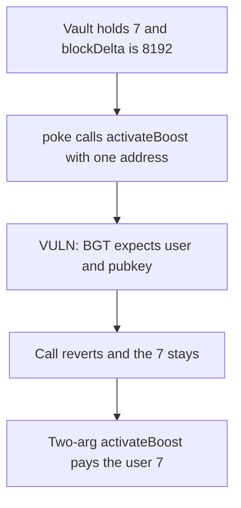

# Roots Staker — the wrong activateBoost selector leaves a 7 reward unpaid

> **Vulnerability classes:** vuln/logic/wrong-condition · vuln/logic/reward-calculation

<!-- non-defihacklabs -->
<!-- source-auditvault: https://github.com/Auditware/AuditVault/blob/main/findings/55115-h-05-incorrect-activateboost-interface-is-used-pashov-audit.md -->
<!-- date: 2025-02 -->

## Key info

| | |
|---|---|
| **Protocol** | Roots Staker / BGT |
| **Finding** | Pashov H-05, AuditVault 55115 |
| **Vulnerable code** | `rewardCache.activateBoost(validator)` |
| **Harm** | 7 boost reward stays in the vault. The user receives 0. |
| **Chain** | local synthetic |

## TL;DR

When `queued > 0` and `blockDelta > 8191`, `_tryToBoost` calls `activateBoost(address)`. BGT implements `activateBoost(address user, bytes pubkey)` and pays the user. The one-argument selector reverts. The 7 reward stays in the vault and the user receives 0. The two-argument call pays the 7. `blockDelta` is an integer stored in the same transaction. `run()` does not warp time.

## The vulnerable code

```solidity
function _tryToBoost(address user) internal {
    if (queued > 0 && blockDelta > 8191) {
        // @> VULN: BGT.activateBoost takes (address user, bytes pubkey), not a single address.
        rewardCache.activateBoost(validator);
    }
}
```

## Root cause

The interface has one address argument. The BGT function has two: the user and the validator pubkey. The call cannot succeed, so a queued boost is never activated and the reward is never transferred.

## Preconditions

`queued` is 7 and `blockDelta` is 8192. The vault holds 7 reward tokens. The user pokes the staker.

## Attack walkthrough

1. 7 reward tokens are minted to the vault. `setBoost(7, 8192)` stores the queue and the delta.
2. `poke` enters `_tryToBoost` because 8192 > 8191.
3. `activateBoost(validator)` reverts. The user receives nothing.
4. The vault still holds 7.

The control calls `activateBoost(user, pubkey)`. The vault transfers the 7 to the user.

## Diagrams



## Impact

The user loses the 7 boost reward. It remains in the vault.

## Remediation

Call `activateBoost(address user, bytes pubkey)` with the staker as the user and the validator pubkey as the second argument.

## Sources

- AuditVault finding: https://github.com/Auditware/AuditVault/blob/main/findings/55115-h-05-incorrect-activateboost-interface-is-used-pashov-audit.md
- Pashov report (Roots, 2025-02-09): https://github.com/pashov/audits/blob/master/team/md/Roots-security-review_2025-02-09.md
- Blamed call: Staker `_tryToBoost` `rewardCache.activateBoost(validator)` against BGT `activateBoost(address user, bytes pubkey)`.
