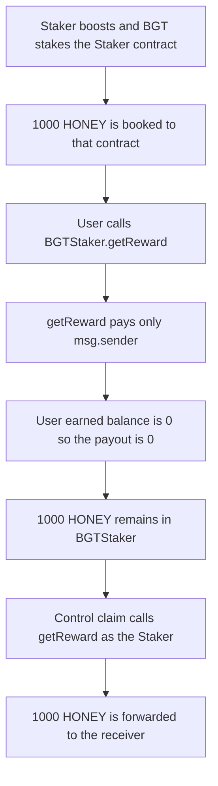

# Roots Staker stakes BGT into BGTStaker and then cannot claim the HONEY

> **Vulnerability classes:** vuln/dos/frozen-funds · vuln/logic/reward-calculation · vuln/dos/lockup
>
> **Reproduction:** self-contained Foundry PoC, no fork and no cheatcodes. Full trace: [output.txt](output.txt). Synthetic: [test/55116-h-06-bgt-stake-rewards-are-locked-pashov-audit-group-none-ro.sol](test/55116-h-06-bgt-stake-rewards-are-locked-pashov-audit-group-none-ro.sol).

<!-- non-defihacklabs -->
<!-- source-auditvault: https://github.com/Auditware/AuditVault/blob/main/findings/55116-h-06-bgt-stake-rewards-are-locked-pashov-audit-group-none-ro.md -->
<!-- date: 2025-02 -->

## Key info

| | |
|---|---|
| **Impact** | **HIGH** — 1000 HONEY sits in BGTStaker and the user's claim pays 0 |
| **Protocol** | Roots |
| **Vulnerable contract** | `BGTStaker.getReward`, reached by a boost from `RootsStaker` that has no claim |
| **Bug class** | Rewards booked to a contract that never calls `getReward` |
| **Finding** | Pashov Audit Group — Roots security review, 2025-02-09 · H-06 · #55116 |
| **Report** | [Roots-security-review_2025-02-09.md](https://github.com/pashov/audits/blob/master/team/md/Roots-security-review_2025-02-09.md) |
| **Source** | [AuditVault finding](https://github.com/Auditware/AuditVault/blob/main/findings/55116-h-06-bgt-stake-rewards-are-locked-pashov-audit-group-none-ro.md) |
| **Audited code** | [roots-fi/roots-core @ c5dfa1e](https://github.com/roots-fi/roots-core/tree/c5dfa1eb74bf368e231203d33d7099c682fbe712) `Staker` |
| **External stake** | [BGTStaker 0x44F07Ce5AfeCbCC406e6beFD40cc2998eEb8c7C6](https://berascan.com/address/0x44F07Ce5AfeCbCC406e6beFD40cc2998eEb8c7C6) |
| **Compiler** | solc 0.8.27, Cancun, via IR |

Audit finding, not an on-chain incident. `blockDelta` is a stored value already above 8191, so the boost gate opens in the same block. No `warp`.

## TL;DR

A boost stakes the Roots `Staker` contract into `BGTStaker`. HONEY rewards are credited to that contract. `getReward` pays `msg.sender` only. `Staker` never calls it, and a user calling it directly is paid 0. 1000 HONEY stays in the vault. A claim function on `Staker` that calls `getReward` and forwards the tokens pays the 1000 HONEY out.

## The vulnerable code

The boost gate and the stake, from the report:

```solidity
function _tryToBoost() internal {
    if (queued > 0 && blockDelta > 8191) {
        rewardCache.activateBoost(address(this), pubkey);
    }
}

function activateBoost(address user, bytes calldata pubkey) external returns (bool) {
    IBGTStaker(staker).stake(user, amount);
    return true;
}
```

`user` here is the Staker contract. `BGTStaker.getReward` is the only claim, and it ignores every account except the caller:

```solidity
function getReward() external returns (uint256) {
    // @> VULN: HONEY is paid only to msg.sender, and Roots Staker never calls this, so its rewards stay locked
    return _getReward(msg.sender, msg.sender);
}
```

Roots `Staker` has `queueBoost` and `pokeBoost`. It does not have `claimBoostRewards`.

## Root cause

The staking account and the account allowed to pull HONEY are the same address, and that address is a contract with no call to `getReward`. Users cannot pass themselves as `msg.sender` of a call the Staker never makes. The balance sits in `BGTStaker` until something in the Staker's code asks for it.

## Preconditions

- A queued boost with `blockDelta > 8191` (stored, not a timestamp).
- `activateBoost` stakes `address(Staker)`.
- HONEY is funded to that same account. Here, 1000 HONEY.

## Attack walkthrough

1. Queue the boost and poke it. `stake` records the Staker contract.
2. Fund 1000 HONEY to `earned[Staker]`. The tokens are now in `BGTStaker`.
3. The user calls `getReward`. `msg.sender` is the user, `earned[user]` is 0, so the call returns 0.
4. The vault still holds 1000 HONEY. [output.txt](output.txt): `HARM honey stuck: 1000000000000000000000`, `HARM paid to user: 0`.

## Control

`RootsStakerFixed.claimBoostRewards` calls `getReward` (so `msg.sender` is the Staker) and transfers the HONEY onward.

[output.txt](output.txt): `CONTROL honey paid: 1000000000000000000000`. The vault balance is 0.

## Diagrams



## Impact

Boost rewards denominated in HONEY cannot be withdrawn by users or by the protocol. In this reduction that is 1000 HONEY: the vault holds it, the user's claim pays 0, and there is no other function on `Staker` that pulls it.

## Remediation

Add a Staker function that calls `BGTStaker.getReward` and forwards the HONEY. That is `claimBoostRewards` in the control.

## How to reproduce

```bash
cd 55116-h-06-bgt-stake-rewards-are-locked-pashov-audit-group-none-ro_exp
forge test -vv
```

## Sources

- [AuditVault finding 55116](https://github.com/Auditware/AuditVault/blob/main/findings/55116-h-06-bgt-stake-rewards-are-locked-pashov-audit-group-none-ro.md)
- [Pashov Roots review, 2025-02-09](https://github.com/pashov/audits/blob/master/team/md/Roots-security-review_2025-02-09.md) — H-06
- [roots-fi/roots-core @ c5dfa1eb74bf368e231203d33d7099c682fbe712](https://github.com/roots-fi/roots-core/tree/c5dfa1eb74bf368e231203d33d7099c682fbe712)
- [BGTStaker](https://berascan.com/address/0x44F07Ce5AfeCbCC406e6beFD40cc2998eEb8c7C6) — `getReward`
