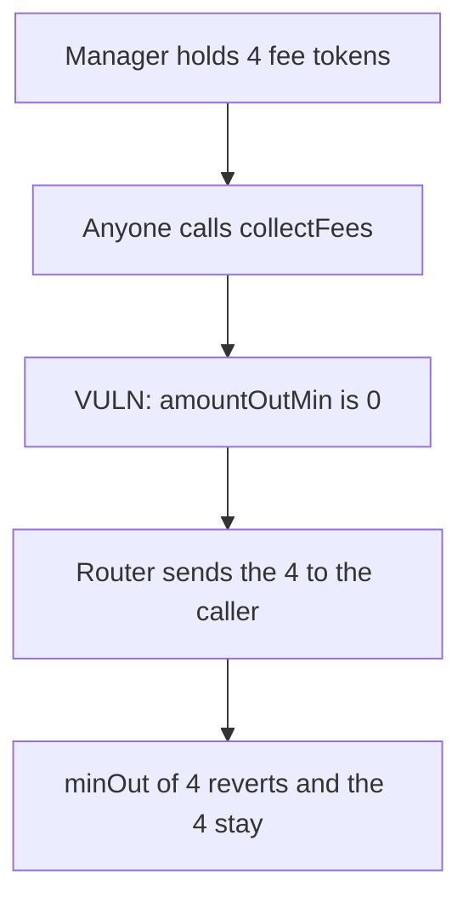

# Surge — public collectFees with amountOutMin 0 lets the caller take 4 fee tokens

> **Vulnerability classes:** vuln/defi/slippage · vuln/access-control/missing-auth · vuln/defi/sandwich-attack

<!-- non-defihacklabs -->
<!-- source-auditvault: https://github.com/Auditware/AuditVault/blob/main/findings/55140-h-01-lack-of-slippage-and-access-control-in-positionmanagers.md -->
<!-- date: 2024-12 -->

## Key info

| | |
|---|---|
| **Protocol** | Surge PositionManager |
| **Finding** | Shieldify H-01, AuditVault 55140 |
| **Vulnerable code** | `collectFees` calls `_swapToVolt`, which sets `amountOutMin = 0` |
| **Harm** | 4 accrued fee tokens are sent to the caller. The manager receives 1 wei of VOLT. |
| **Chain** | local synthetic |

## TL;DR

`collectFees` has no access check. `_swapToVolt` hardcodes `amountOutMin` to 0 and swaps the manager's whole fee balance. A router that honors that minimum sends the 4 fee tokens to the caller and returns 1 wei of VOLT. Setting the minimum to the input amount makes the same router revert, and the 4 stay in the manager.

## The vulnerable code

```solidity
function collectFees() external {
    uint256 amount = fee.balanceOf(address(this));
    _swapToVolt(address(fee), amount);
}

// There is no slippage control
// @> VULN: amountOutMin is hardcoded to 0, and collectFees is callable by anyone.
uint256 amountOutMin = 0;
```

## Root cause

The swap's floor is a constant 0, and the function that triggers the swap is permissionless. The caller chooses the moment and the router fills at the worst price the constant allows, which is any output at all.

## Preconditions

The manager holds 4 fee tokens. The router will fill a swap whose minimum is 0 and will reject a minimum equal to the input. Anyone can call `collectFees`.

## Attack walkthrough

1. 4 fee tokens are minted to the manager.
2. The caller calls `collectFees`. There is no admin check.
3. `amountOutMin` is set to 0. The router accepts it, pulls the 4 from the manager, and sends them to the caller. The manager is minted 1 wei of VOLT.
4. The caller holds 4. The manager holds 0 of the fee token.

The control calls the swap with `minOut` equal to 4. The router reverts and the manager still holds 4.

## Diagrams



## Impact

The caller extracts 4 fee tokens that were accrued to the manager. The manager is left with 1 wei of VOLT.

## Remediation

Restrict `collectFees` to an admin, or pass a caller-supplied `amountOutMin` into `_swapToVolt` and revert when the router returns less.

## Sources

- AuditVault finding: https://github.com/Auditware/AuditVault/blob/main/findings/55140-h-01-lack-of-slippage-and-access-control-in-positionmanagers.md
- Shieldify report (Surge, Buy and Burn, December 2024): https://github.com/shieldify-security/audits-portfolio-md/blob/main/Surge-Security-Review.md
- Blamed function: `PositionManager._swapToVolt`, `uint256 amountOutMin = 0`, reached from public `collectFees`.
