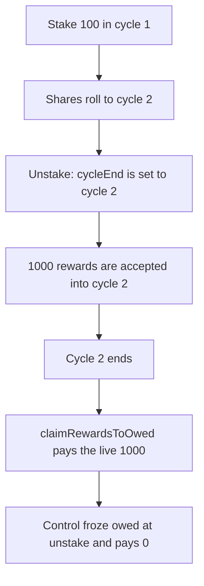

# Surge — a claimant takes rewards funded after they unstaked

> **Vulnerability classes:** vuln/logic/reward-calculation · vuln/logic/missing-check

<!-- non-defihacklabs -->
<!-- source-auditvault: https://github.com/Auditware/AuditVault/blob/main/findings/55143-h-04-users-can-take-their-share-of-rewards-in-cycles-they-st.md -->
<!-- date: 2024-12 -->

## Key info

| | |
|---|---|
| **Protocol** | Surge (StakingVault) |
| **Finding** | Shieldify H-04, AuditVault 55143 |
| **Vulnerable code** | `unstake` sets `r.cycleEnd = cycleId` |
| **Harm** | The claimant takes 1000 reward tokens that were accepted after the unstake. The control pays 0. |
| **Chain** | local synthetic |

## TL;DR

`stake` records `cycleStart` as the current cycle and `unstake` records `cycleEnd` as the current cycle, whatever fraction of that cycle the user actually spent staked. `claimRewardsToOwed` then pays every cycle in that closed window from the live `_rewardPoolRewards` balance. A user who stakes in cycle 1, rolls into cycle 2, and unstakes before any reward is accepted still has cycle 2 inside the window. The next `acceptPositionManagerRewards(1000)` lands in cycle 2. Once cycle 2 ends, the claim pays all 1000. Freezing the owed amount at unstake pays 0, and the 1000 stays in the cycle.

## The vulnerable code

```solidity
require(r.cycleStart != 0, "No claimable reward");
require(r.cycleEnd == 0, "Claimable reward is not active");
require(r.cycleStart <= cycleId, "Claimable reward is start cycle invalid");
// @> VULN: cycleEnd is the in-progress cycle, so rewards funded after this unstake stay inside the claim window.
r.cycleEnd = cycleId;
```

The reward deposit is the report's line:

```solidity
_rewardPoolRewards[poolId][cycleId] += amountPerPool;
```

`claimRewardsToOwed` then does `reward * r.shares / shares` for every cycle from `cycleStart` through `cycleEnd`, with no snapshot of the reward balance at unstake.

```diff
- r.cycleEnd = cycleId;
- // later claim reads the live cycle reward
+ uint256 owed = _rewardPoolRewards[poolId][cycleId] * r.shares / _rewardPoolShares[poolId][cycleId];
+ r.cycleEnd = cycleId;
+ // claim pays `owed` only, so a later acceptPositionManagerRewards is not included
```

## Root cause

The claim window is a pair of cycle indexes, not a record of rewards that accrued while the user was staked. Setting `cycleEnd` to the in-progress cycle keeps that cycle claimable after the user has left. Rewards accepted into it afterwards are paid in full on the next cycle boundary. The report's example is the same shape: a user who leaves during pool 4's cycle 3 comes back when cycle 4 starts and takes that cycle's rewards, including deposits made after the unstake.

## Preconditions

One reward pool. The user stakes 100 shares in cycle 1. The cycle rolls forward, copying those shares onto cycle 2, and the user unstakes immediately. No reward has been accepted yet, so a fair freeze is 0. `acceptPositionManagerRewards` then mints 1000 into cycle 2. The cycle index advances once more so the claim is allowed. No `block.timestamp` change is required.

## Attack walkthrough

1. Stake 100. `cycleStart` is 1 and the pool records 100 shares on cycle 1.
2. End cycle 1. The 100 shares are copied onto cycle 2.
3. Unstake. `r.cycleEnd` becomes 2, the cycle that is still open.
4. Accept 1000 rewards. They are added to cycle 2, after the user has left.
5. End cycle 2. `currentCycleId` is 3, so cycle 2 is claimable.
6. `claimRewardsToOwed` pays `1000 * 100 / 100`. The claimant receives 1000 and cycle 2's reward balance is 0.

The control vault computes the owed amount inside `unstake`, before the 1000 is accepted. That amount is 0. The later claim transfers nothing and leaves the 1000 in cycle 2.

## Diagrams



## Impact

The claimant receives 1000 reward tokens for cycle 2 even though every one of those tokens was accepted after `unstake`. A staker who was actually in the pool for that deposit is paid nothing from it, because the balance is zeroed by this claim. The fixed path pays 0 to the departed user and leaves the 1000 in the cycle for whoever was staked when it arrived.

## Remediation

Snapshot the user's share of `_rewardPoolRewards` at unstake and pay only that snapshot. Do not pay the live balance of a cycle the user has already left.

## How to reproduce

```bash
cd 55143-h-04-users-can-take-their-share-of-rewards-in-cycles-they-st_exp
forge test -vv
```

## Sources

- AuditVault finding: https://github.com/Auditware/AuditVault/blob/main/findings/55143-h-04-users-can-take-their-share-of-rewards-in-cycles-they-st.md
- Shieldify report: https://github.com/shieldify-security/audits-portfolio-md/blob/main/Surge-Security-Review.md
- Reduced from `StakingVault.sol` as quoted in that review (`r.cycleEnd = cycleId`, `_rewardPoolRewards[poolId][cycleId] += amountPerPool`, `claimRewardsToOwed`). The report lists the repository as `surge-contracts` with commit N/A.
