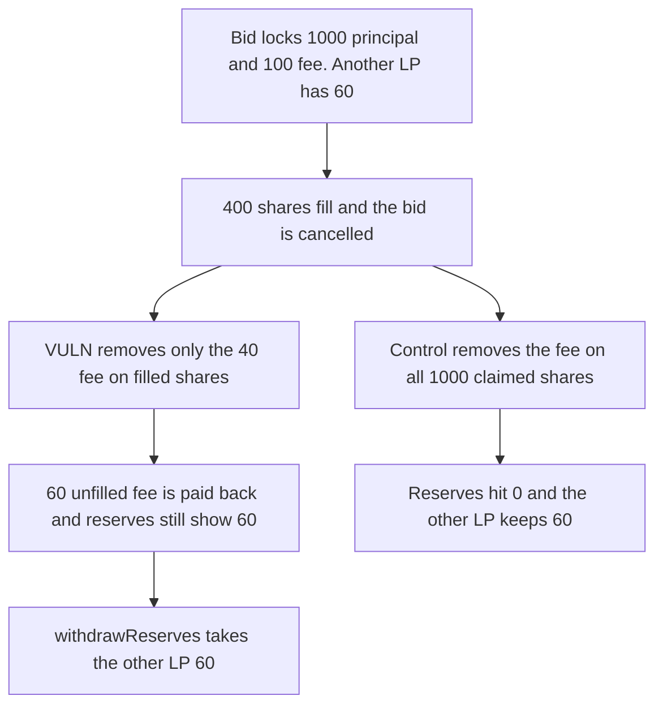

# Hanji: a partial bid claim returns the unfilled fee and still counts it

> **Vulnerability classes:** vuln/logic/fee-calculation · vuln/logic/state-update

<!-- non-defihacklabs -->
<!-- source-auditvault: https://github.com/Auditware/AuditVault/blob/main/findings/55151-double-counted-fees-in-partial-bid-claims-mixbytes-none-hanj.md -->
<!-- date: 2025-06 -->

## Key info

| Field | Value |
|---|---|
| **Loss** | 60 quote tokens withdrawn from another LP. The returned unfilled fee stayed in reserves |
| **Vulnerable contract** | `ProxyLOB._claimOrder` |
| **Attacker EOA** | `0x1111111111111111111111111111111111111111` |
| **Attack contract** | `Exploit` |
| **Attack tx** | `Exploit.run()` |
| **Chain / block / date** | Ethereum model · block 0 · 2025-06 |
| **Compiler** | solc 0.8.27, cancun, via IR |
| **Bug class** | Reserve decrease uses the filled notional while the unfilled fee is paid back |

## TL;DR

A bid locks `quantity * price` plus the passive fee in `lobReservesByTokenId`. On a partial fill with `only_claim = false`, the unfilled fee is transferred back to the LP manager, but the reserve decrease uses `executedShares * price`. A 1,000-share bid at 1 token with a 10% fee locks 100 of fee. Filling 400 removes 40 of fee and returns 60. Reserves still show that 60, and withdrawing them takes 60 from another LP. Removing the fee on all claimed shares leaves reserves at 0 and that 60 untouched.

## Background

MixBytes' Hanji Liquidity Vault review, section 4. The same wording was published again for XPress. The recommended change replaces `executedShares * price` with `totalClaimedShares * price` before `mulWadUp(passiveCommissionRate)`.

## The vulnerable code

```solidity
uint256 executedValue = executedShares * price;
// @> VULN: the fee removed from lobReservesByTokenId uses executed shares, not the shares whose fee is returned
uint256 passiveFee = _mulWadUp(executedValue, passiveCommissionRate);
```

`_mulWadUp` is `(x * y + 1e18 - 1) / 1e18`. On 400 tokens at 10% the fee is 40. On the full 1,000 it is 100. The 60 difference leaves the contract and stays in the reserve figure.

## Root cause

The cash movement on cancel uses every share whose fee is being released. The reserve movement uses only the filled shares. After the claim, reserves exceed the cash that still belongs to this order by exactly the returned fee, and the next reserve withdrawal spends someone else's balance.

## Preconditions

- Passive commission is 10%. Price is 1 quote token per share.
- The bid is 1,000 shares. 400 fill. `claimOrder` is called with `only_claim = false`.
- Another LP has 60 quote tokens sitting in the book.

## Attack walkthrough

1. The other LP's 60 is already in the book.
2. The bid transfers 1,100 and records 1,100 of reserves.
3. The claim returns the 600 unfilled principal and the 60 unfilled fee to the manager.
4. Reserves drop by 400 + 40 + 600 and still show 60.
5. `withdrawReserves` pays that 60 to the caller. The book is empty.
6. The control subtracts the 100 fee on all 1,000 shares. Reserves end at 0 and the other LP keeps 60.

## Diagrams



## Impact

The caller receives 60 quote tokens that belonged to the other LP. Those 60 were already paid back as the unfilled fee, then withdrawn again because `lobReservesByTokenId` still counted them. The book balance is 0. The control leaves the other LP's 60 in the contract.

## Remediation

Compute the passive fee on `totalClaimedShares * price`, and subtract that fee from `lobReservesByTokenId` when the unfilled fee is returned.

## How to reproduce

```bash
cd 55151-double-counted-fees-in-partial-bid-claims-mixbytes-none-hanj_exp
forge test -vv
```

`test_exploit_unfilled_fee_taken_from_other_lp` asserts a 40 fee removed, a 60 fee returned, a 60 withdrawal, and an empty book. `test_control_full_fee_leaves_reserves` asserts reserves of 0 and 60 left for the other LP. Captured output is `output.txt`.

## Sources

- AuditVault finding: https://github.com/Auditware/AuditVault/blob/main/findings/55151-double-counted-fees-in-partial-bid-claims-mixbytes-none-hanj.md
- MixBytes Hanji Liquidity Vault: https://github.com/mixbytes/audits_public/blob/master/Hanji/Liquidity%20Vault/README.md#4-double-counted-fees-in-partial-bid-claims
