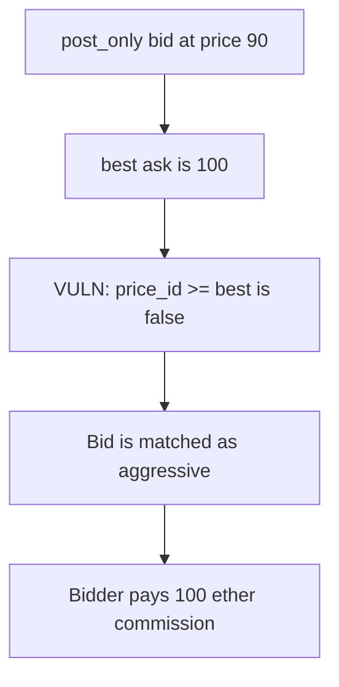

# Hanji: post_only bids pay a 100 ether aggressive commission

> **Vulnerability classes:** vuln/logic · vuln/defi

> **Reproduction:** a self-contained Foundry PoC that compiles and runs offline
> with only `forge-std` - no fork and no RPC.
> PoC: [test/55168-incorrect-condition-for-post-only-orders-mixbytes-none-hanji_exp.sol](test/55168-incorrect-condition-for-post-only-orders-mixbytes-none-hanji_exp.sol).

<!-- non-defihacklabs -->
<!-- source-auditvault: https://github.com/Auditware/AuditVault/blob/main/findings/55168-incorrect-condition-for-post-only-orders-mixbytes-none-hanji.md -->
<!-- date: 2024-05 -->

## Key info

| Field | Value |
|---|---|
| **Loss** | 100 ether of quote paid as an aggressive commission on a passive post_only bid |
| **Protocol** | Hanji |
| **Bug class** | Inverted post_only comparison in placeOrder |
| **Source** | [AuditVault finding](https://github.com/Auditware/AuditVault/blob/main/findings/55168-incorrect-condition-for-post-only-orders-mixbytes-none-hanji.md) |
| **Report** | [MixBytes, Hanji OnchainCLOB](https://github.com/mixbytes/audits_public/blob/master/Hanji/OnchainCLOB/README.md#2-incorrect-condition-for-post_only-orders) |
| **Chain / block / date** | Ethereum model · block 0 · 2024-05 |
| **Compiler** | solc 0.8.27, cancun, via IR |

## TL;DR

`placeOrder` is supposed to return 0 when a post_only bid has `price_id <= askTree.best_offer()`. The sign is flipped to `>=`. A passive bid at price 90 against a best ask of 100 is therefore matched, and the bidder pays the aggressive commission: 1% of a 10,000 ether notional, which is 100 ether. The corrected comparison charges 0.

## The vulnerable code

```solidity
uint256 best = askTree.best_offer();
// @> VULN: inverted. Auditors require `if (price_id <= best) return 0`.
bool reject = price_id >= best;
if (post_only && reject) {
    return 0;
}
uint256 fee = notional * AGGRESSIVE_FEE_BPS / 10_000;
```

## Root cause

The reject flag is `price_id >= best`. For every passive bid priced below the best ask that expression is false, so the function falls through into the aggressive fill and charges `AGGRESSIVE_FEE_BPS`. Flipping the sign, as the auditors wrote (`price_id <= best`), returns 0 before any commission is taken.

## Preconditions

- Any trader can call `placeOrder`. No role is required.
- An ask is resting at price id 100.
- The bidder submits `post_only = true` at price id 90 with quantity 10,000.
- Aggressive commission is 100 bps. Passive orders are not meant to pay it.

## Attack walkthrough

1. Read best ask = 100.
2. Evaluate `price_id >= best` for a bid at 90. The flag is false.
3. Skip the early return that should have rejected the post_only order.
4. Price the fill at quantity * 1 ether = 10,000 ether.
5. Charge 1% = 100 ether and pull it from the bidder.
6. Return order id 1, i.e. the bid matched.

## Diagrams



## Impact

The bidder pays 100 ether that a passive post_only order is not supposed to pay. Every post_only bid priced below the touch takes this path. The control, using `price_id <= best`, returns 0 and pulls nothing.

## Remediation

Return 0 when `post_only` and `price_id <= askTree.best_offer()`, before the aggressive fee is computed.

## How to reproduce

```bash
cd 55168-incorrect-condition-for-post-only-orders-mixbytes-none-hanji_exp
forge test -vv
```

`run()` is the harm path. The control test uses the corrected comparison or guard and does not produce the loss number.
