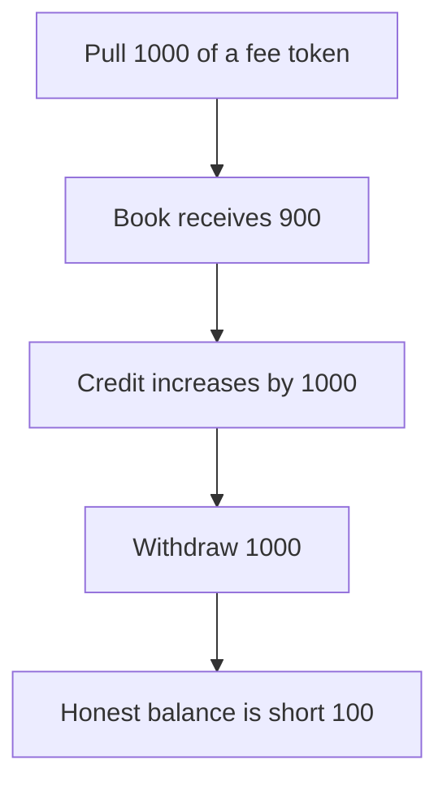

# Hanji: nominal credit takes 100 from the honest balance

> **Vulnerability classes:** vuln/logic/fee-calculation · vuln/input-validation/missing

<!-- non-defihacklabs -->
<!-- source-auditvault: https://github.com/Auditware/AuditVault/blob/main/findings/55171-incorrect-handling-of-fee-on-transfer-tokens-mixbytes-none-h.md -->
<!-- date: 2025-04 -->

## Key info

| | |
|---|---|
| **Protocol** | Hanji |
| **Finding** | MixBytes, AuditVault 55171 |
| **Vulnerable code** | `LOB.receiveTokens` |
| **Harm** | A 1000 deposit of a 10 percent fee-on-transfer token delivers 900 and is credited as 1000. The attacker withdraws 1000 and is up 100. The book has 900 left against the honest trader's 1000 credit. The fixed path credits 900 and the attacker is flat. |
| **Chain** | local synthetic |

## TL;DR

`receiveTokens` does not measure the balance increase after `transferFrom`. The fee token keeps 100, the book receives 900, and the credit increases by 1000. Withdrawing the credit pulls 100 of the honest trader's tokens.

## The vulnerable code

```solidity
            // @> VULN: credit increases by `amount`, not by the tokens that arrived
            credit[from] += amount;
```

## Root cause

The credit uses the requested amount. A fee-on-transfer token delivers less than that amount.

## Preconditions

The book already holds 1000 backing an honest credit of 1000. The attacker's token takes a 10 percent fee on `transferFrom` and pays that fee to the attacker.

## Attack walkthrough

1. Approve a 1000 pull. See [output.txt](output.txt).
2. `receiveTokens` pulls 1000. The book receives 900.
3. Credit increases by 1000.
4. The attacker withdraws 1000.
5. Attacker profit is 100.
6. The honest credit of 1000 is backed by 900. The fixed path credits 900 and profit is 0.

## Diagrams



## Impact

The honest trader's 1000 credit is backed by 900. The attacker nets 100. Crediting the measured balance delta removes the profit.

## Remediation

Credit `balanceAfter - balanceBefore` from the `transferFrom`, and revert if that delta is not the expected amount.

## How to reproduce

```bash
cd 55171-incorrect-handling-of-fee-on-transfer-tokens-mixbytes-none-h_exp
forge test -vv
```
