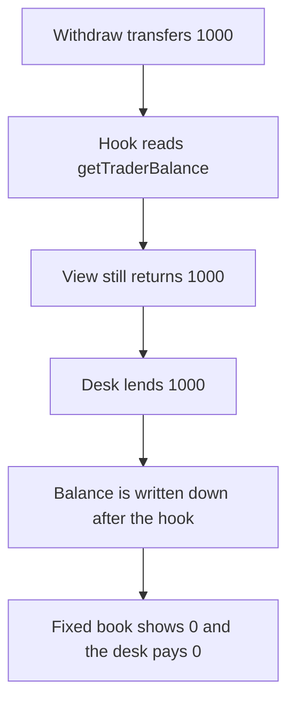

# Hanji OnchainLOB — a transfer hook still sees the old trader balance

> **Vulnerability classes:** vuln/reentrancy/read-only

<!-- non-defihacklabs -->
<!-- source-auditvault: https://github.com/Auditware/AuditVault/blob/main/findings/55173-potential-read-only-reentrancy-mixbytes-none-hanji-markdown.md -->
<!-- date: 2025-04 -->

## Key info

| | |
|---|---|
| **Protocol** | Hanji OnchainLOB |
| **Finding** | MixBytes, AuditVault 55173 |
| **Vulnerable code** | `withdraw` writes the trader balance after the token transfer |
| **Harm** | A desk that trusts `getTraderBalance` during the hook lends 1000. The book that updates first lends 0. |
| **Chain** | local synthetic |

## TL;DR

`withdraw` transfers the tokens and only then subtracts `balances[trader]`. A token hook runs in between. `getTraderBalance` still returns 1000, and a lender that borrows against that view pays 1000. The trader already has the withdrawn tokens. The same withdrawal on a book that subtracts first shows a balance of 0, and the lender pays 0.

## The vulnerable code

```solidity
require(token.transfer(msg.sender, amount), "transfer");
if (!cei) {
    // @> VULN: trader balance is written after the external token transfer
    balances[msg.sender] -= amount;
}
```

`getTraderBalance` returns `balances[trader]`. The report says that view is stale for any integration that reads it from a transfer hook, and that the balance must be updated before the transfer.

## Root cause

The storage write is on the other side of an external call. The view is correct only after `withdraw` returns. Callers inside the token hook observe the pre-transfer balance.

## Preconditions

The trader has deposited 1000. A desk holds 1000 and lends the amount `getTraderBalance` reports. The token notifies the recipient when the book is the sender. No admin action is required.

## Attack walkthrough

1. Deposit 1000. The stored balance is 1000.
2. Withdraw 1000. The token moves first.
3. In the hook, `getTraderBalance` returns 1000.
4. The desk transfers 1000 to the trader.
5. The book then writes the balance down to 0.
6. On the checks-effects book the hook reads 0 and the desk transfers 0.

## Diagrams



## Impact

The trader finishes with the withdrawn 1000 plus 1000 taken from the desk. Depositors of the desk lose that 1000. The book that writes the balance first does not create a balance the desk will lend against.

## Remediation

Subtract `balances[msg.sender]` before the token transfer.

## How to reproduce

```bash
cd 55173-potential-read-only-reentrancy-mixbytes-none-hanji-markdown_exp
forge test -vv
```

## Sources

- AuditVault finding: https://github.com/Auditware/AuditVault/blob/main/findings/55173-potential-read-only-reentrancy-mixbytes-none-hanji-markdown.md
- MixBytes report: https://github.com/mixbytes/audits_public/blob/master/Hanji/OnchainCLOB/README.md#3-potential-read-only-reentrancy
- Hanji contracts: https://github.com/longgammalabs/hanji-contracts/blob/09b6188e028650b9c1758010846080c5f8c80f8e/src/OnchainLOB.sol
