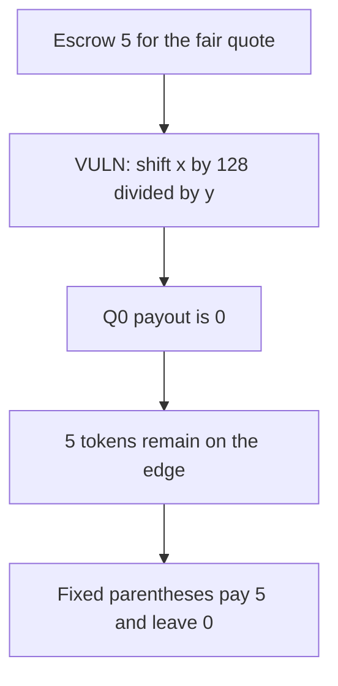

# Burve Edge — the below-range ratio pays 0 instead of 5

> **Vulnerability classes:** vuln/arithmetic/precision-loss · vuln/logic/price-calculation

<!-- non-defihacklabs -->
<!-- source-auditvault: https://github.com/Auditware/AuditVault/blob/main/findings/55208-c-01-incorrect-parenthesis-usage-results-in-a-completely-wro.md -->
<!-- date: 2025-01 -->

## Key info

| | |
|---|---|
| **Protocol** | Burve |
| **Finding** | Pashov Audit Group, AuditVault 55208 |
| **Vulnerable code** | `Edge.calcLowerImplied` |
| **Harm** | For x=1000 and y=200 the quote pays 0 and 5 escrowed tokens stay in the edge. The corrected parentheses pay 5. |
| **Chain** | local synthetic |

## TL;DR

The code writes `(x << (128 / y)) << 64` where it meant `((x << 128) / y) << 64`. With y=200 the inner division is 0, so the stored value is `x << 64`. Interpreted as a Q192 number that pays 0. The reserve escrowed 5 tokens for the fair quote. They remain on the edge. The fixed expression pays all 5.

## The vulnerable code

```solidity
// @> VULN: parentheses shift x by (128 / y) instead of (x << 128) / y
uint256 xyX192 = (x << (128 / y)) << 64;
```

The report's fix is `uint256 xyX192 = ((x << 128) / y) << 64`.

## Root cause

The shift amount is `128 / y` rather than a shift of 128 followed by division by y. For any y above 128 the shift amount rounds to 0 and the ratio collapses to `x << 64`.

## Preconditions

The quote is the below-range branch the report names. x is 1000 and y is 200, both small enough that `(x << 128)` fits in a uint256. A reserve has escrowed the 5 tokens the corrected quote is worth. Anyone can request the quote.

## Attack walkthrough

1. Escrow 5 tokens onto the edge.
2. `payQuote(1000, 200)` evaluates the broken shift. `128 / 200` is 0.
3. `xyX192 >> 192` is 0, so the LP is paid nothing.
4. The edge still holds 5.
5. The same inputs with `((x << 128) / y) << 64` produce `5 << 192`, and the payout is 5.
6. That edge ends empty.

## Diagrams



## Impact

The LP who is owed 5 settlement tokens receives 0. Those 5 stay in the edge and are not available as the quote. The corrected formula pays the 5 and leaves no residue.

## Remediation

Parenthesize the shift and the division as `((x << 128) / y) << 64`.

## How to reproduce

```bash
cd 55208-c-01-incorrect-parenthesis-usage-results-in-a-completely-wro_exp
forge test -vv
```

## Sources

- AuditVault finding: https://github.com/Auditware/AuditVault/blob/main/findings/55208-c-01-incorrect-parenthesis-usage-results-in-a-completely-wro.md
- Pashov report: https://github.com/pashov/audits/blob/master/team/md/Burve-security-review_2025-01-29.md
