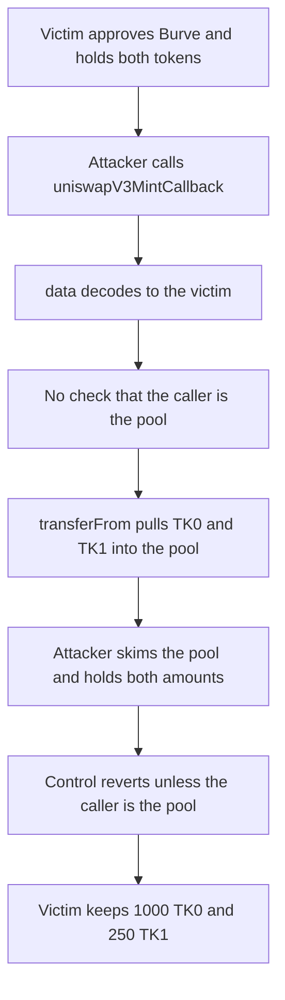

# Burve's mint callback pulls any approved balance into the pool

> **Vulnerability classes:** vuln/access-control/missing-auth · vuln/access-control/missing-modifier
>
> **Reproduction:** self-contained Foundry PoC, no fork and no cheatcodes. Full trace: [output.txt](output.txt). Synthetic: [test/55211-c-04-draining-approved-tokens-by-unrestricted-uniswapv3mintc.sol](test/55211-c-04-draining-approved-tokens-by-unrestricted-uniswapv3mintc.sol).

<!-- non-defihacklabs -->
<!-- source-auditvault: https://github.com/Auditware/AuditVault/blob/main/findings/55211-c-04-draining-approved-tokens-by-unrestricted-uniswapv3mintc.md -->
<!-- date: 2025-01 -->

## Key info

| | |
|---|---|
| **Impact** | **HIGH** — attacker receives the victim's 1000 TK0 and 250 TK1 |
| **Protocol** | Burve |
| **Vulnerable contract** | `Burve.uniswapV3MintCallback` |
| **Bug class** | Callback with no caller check spends a third party's approval |
| **Finding** | Pashov Audit Group — Burve security review, 2025-01-29 · C-04 · #55211 |
| **Report** | [Burve-security-review_2025-01-29.md](https://github.com/pashov/audits/blob/master/team/md/Burve-security-review_2025-01-29.md) |
| **Source** | [AuditVault finding](https://github.com/Auditware/AuditVault/blob/main/findings/55211-c-04-draining-approved-tokens-by-unrestricted-uniswapv3mintc.md) |
| **Audited code** | [itos-finance/Burve @ f059776](https://github.com/itos-finance/Burve/tree/f0597768fee2d00c17429941f4721475e1ca5723) |
| **Compiler** | solc 0.8.27, Cancun, via IR |

Audit finding, not an on-chain incident. The callback body is the report's function. The pool skim only collects a payment that was not tied to a minted position.

## TL;DR

`uniswapV3MintCallback` decodes `source` from caller data and `transferFrom`s both tokens from that address into the pool. It never checks `msg.sender == pool`. Anyone can pass a victim who has approved Burve. Here that moves 1000 TK0 and 250 TK1 from the victim to the pool, and the attacker withdraws them. If only the pool may call, the same call reverts and the victim keeps both balances.

## The vulnerable code

```solidity
function uniswapV3MintCallback(uint256 amount0Owed, uint256 amount1Owed, bytes calldata data) external {
    address source = abi.decode(data, (address));
    // @> VULN: no check that msg.sender is the pool, so any caller pulls `source`'s approved tokens
    TransferHelper.safeTransferFrom(token0, source, address(pool), amount0Owed);
    TransferHelper.safeTransferFrom(token1, source, address(pool), amount1Owed);
}
```

The control adds `if (msg.sender != address(pool)) revert NotPool();` before the decode.

## Root cause

Uniswap calls this callback on the minting contract, and the pool is the only caller that should be able to name `amount0Owed` and `amount1Owed`. Without that check, `source` and the amounts are attacker-controlled, and the victim's existing approval is the only permission the transfer needs.

## Preconditions

- The victim has approved Burve for token0 and token1 (a hanging approval).
- The victim holds 1000 TK0 and 250 TK1.
- The attacker is not the pool.

## Attack walkthrough

1. Fund the victim and have them approve Burve.
2. The attacker calls `uniswapV3MintCallback(1000e18, 250e18, abi.encode(victim))`.
3. Both `safeTransferFrom` lines pull the victim's tokens into the pool.
4. No position was minted, so `pool.skim` sends that balance to the attacker.
5. [output.txt](output.txt): `HARM attacker token0: 1000000000000000000000`, `HARM attacker token1: 250000000000000000000`, `HARM victim token0: 0`.

## Control

The same call from a non-pool account reverts. [output.txt](output.txt): `CONTROL victim token0: 1000000000000000000000`, `CONTROL victim token1: 250000000000000000000`. The caller receives nothing.

## Diagrams



## Impact

Any account that has approved Burve can be drained up to that approval, into the pool, by an arbitrary caller. In this reduction the victim loses 1000 TK0 and 250 TK1, and the attacker receives both. The report rates that a direct loss of funds.

## Remediation

Revert unless `msg.sender` is the pool. That is the control.

## How to reproduce

```bash
cd 55211-c-04-draining-approved-tokens-by-unrestricted-uniswapv3mintc_exp
forge test -vv
```

## Sources

- [AuditVault finding 55211](https://github.com/Auditware/AuditVault/blob/main/findings/55211-c-04-draining-approved-tokens-by-unrestricted-uniswapv3mintc.md)
- [Pashov Burve review, 2025-01-29](https://github.com/pashov/audits/blob/master/team/md/Burve-security-review_2025-01-29.md) — C-04
- [itos-finance/Burve @ f0597768fee2d00c17429941f4721475e1ca5723](https://github.com/itos-finance/Burve/tree/f0597768fee2d00c17429941f4721475e1ca5723)
