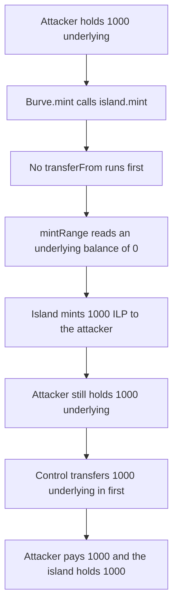

# Burve mints island LP without taking the underlying

> **Vulnerability classes:** vuln/logic/incorrect-order-of-operations · vuln/logic/missing-validation
>
> **Reproduction:** self-contained Foundry PoC, no fork and no cheatcodes. Full trace: [output.txt](output.txt). Synthetic: [test/55212-h-01-missing-transfer-of-tokens-before-islandmint-pashov-aud.sol](test/55212-h-01-missing-transfer-of-tokens-before-islandmint-pashov-aud.sol).

<!-- non-defihacklabs -->
<!-- source-auditvault: https://github.com/Auditware/AuditVault/blob/main/findings/55212-h-01-missing-transfer-of-tokens-before-islandmint-pashov-aud.md -->
<!-- date: 2025-01 -->

## Key info

| | |
|---|---|
| **Impact** | **HIGH** — 1000 ILP minted while the attacker pays 0 and the island holds 0 underlying |
| **Protocol** | Burve |
| **Vulnerable contract** | `Burve.mint` calling `Island.mint` |
| **Bug class** | Shares minted before the token transfer that should fund them |
| **Finding** | Pashov Audit Group — Burve security review, 2025-01-29 · H-01 · #55212 |
| **Report** | [Burve-security-review_2025-01-29.md](https://github.com/pashov/audits/blob/master/team/md/Burve-security-review_2025-01-29.md) |
| **Source** | [AuditVault finding](https://github.com/Auditware/AuditVault/blob/main/findings/55212-h-01-missing-transfer-of-tokens-before-islandmint-pashov-aud.md) |
| **Audited code** | [itos-finance/Burve @ f059776](https://github.com/itos-finance/Burve/tree/f0597768fee2d00c17429941f4721475e1ca5723) |
| **Compiler** | solc 0.8.27, Cancun, via IR |

Audit finding, not an on-chain incident. `Island.mint` keeps the report's loop and `_mint(recipient, liq)`. It does not pull tokens itself. Burve is supposed to transfer them in first and does not.

## TL;DR

`Burve.mint` calls `island.mint` and never transfers underlying. The island still runs `mintRange` against a 0 balance and then mints `liq` shares to the recipient. The attacker receives 1000 ILP, keeps 1000 underlying, and the island holds 0. The control `transferFrom`s 1000 underlying into the island first. The same mint then leaves the attacker with 0 underlying and the island with 1000.

## The vulnerable code

Island side, from the report:

```solidity
function mint(address recipient, uint128 liq) external {
    for (uint256 i = 0; i < distX96.length; ++i) {
        uint128 liqAmount = uint128(shift96(liq * distX96[i], true));
        mintRange(ranges[i], recipient, liqAmount);
    }
    _mint(recipient, liq);
}
```

Burve side. The transfer the report asks for is missing:

```solidity
function mint(address recipient, uint128 liq) external {
    // @> VULN: island.mint is called with no token transfer, so shares are minted against an empty balance
    island.mint(recipient, liq);
}
```

The control inserts `underlying.transferFrom(msg.sender, address(island), uint256(liq));` above that call.

## Root cause

Share issuance and funding are different steps. `Island.mint` trusts that the caller has already delivered underlying. `Burve.mint` is that caller and skips the delivery, so the share credit is not backed.

## Preconditions

- An island with one distribution entry, so the loop runs once.
- The attacker holds 1000 underlying and does not need to approve Burve, because Burve never pulls.
- `liq` is 1000 (1 share per underlying unit in the control).

## Attack walkthrough

1. Mint 1000 underlying to the attacker.
2. Call `Burve.mint(attacker, 1000)`. No transfer runs.
3. `mintRange` reads the island's underlying balance and stores 0.
4. `_mint` credits 1000 ILP to the attacker.
5. [output.txt](output.txt): `HARM free shares: 1000000000000000000000`, `HARM attacker underlying left: 1000000000000000000000`, `HARM island underlying: 0`.

## Control

The attacker approves and `BurveFixed.mint` pulls 1000 underlying before `island.mint`. [output.txt](output.txt): `CONTROL paid: 1000000000000000000000`, `CONTROL island underlying: 1000000000000000000000`. `mintRange` sees 1000, not 0. The attacker holds 0 underlying and 1000 ILP.

## Diagrams



## Impact

Liquidity shares are created with no assets behind them. In this reduction that is 1000 ILP for a payment of 0, against an island balance of 0. Anyone who later redeems those shares is claiming assets the minter never supplied. The report's own wording is that the missing transfer breaks providing liquidity through Burve; this PoC shows the mint that still succeeds and the empty balance it leaves.

## Remediation

Transfer and approve the underlying before `island.mint`, and size the transfer from the liquidity being minted. The control does the transfer. The caller must hold and approve the tokens, or the mint reverts.

## How to reproduce

```bash
cd 55212-h-01-missing-transfer-of-tokens-before-islandmint-pashov-aud_exp
forge test -vv
```

## Sources

- [AuditVault finding 55212](https://github.com/Auditware/AuditVault/blob/main/findings/55212-h-01-missing-transfer-of-tokens-before-islandmint-pashov-aud.md)
- [Pashov Burve review, 2025-01-29](https://github.com/pashov/audits/blob/master/team/md/Burve-security-review_2025-01-29.md) — H-01
- [itos-finance/Burve @ f0597768fee2d00c17429941f4721475e1ca5723](https://github.com/itos-finance/Burve/tree/f0597768fee2d00c17429941f4721475e1ca5723)
