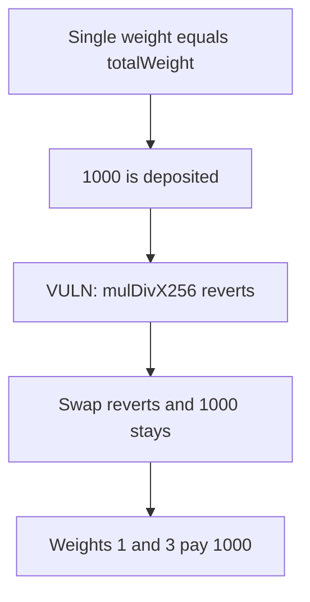

# Burve — normalizing a single weight reverts the swap

> **Vulnerability classes:** `vuln/dos/frozen-funds` · `vuln/logic/wrong-condition`

<!-- non-defihacklabs -->
<!-- source-auditvault: https://github.com/Auditware/AuditVault/blob/main/findings/55213-h-02-normalizing-token-weights-can-result-in-a-revert-pashov.md -->
<!-- date: 2025-01 -->

## Key info

| | |
|---|---|
| **Protocol** | Burve |
| **Finding** | Pashov Audit Group H-02, AuditVault 55213 |
| **Vulnerable code** | `mulDivX256` requires `denominator > num` |
| **Harm** | The swap reverts and 1000 stays in the pool. The two-weight pool pays the trader 1000. |
| **Chain** | local synthetic |

## TL;DR

Weight normalization turns an amount into a fraction with `mulDivX256(weight, totalWeight)`. That helper requires the denominator to be strictly greater than the numerator. A one-element weight array has `weight == totalWeight`, so the require reverts, the swap reverts with it, and the 1000 underlying deposited into the pool stays there. Weights 1 and 3 of a total of 4 pass the check, and that pool pays the trader 1000.

## The vulnerable code

```solidity
self.weights[i] = FullMath.mulDivX256(
    self.weights[i],
    self.totalWeight
);
```

```solidity
require(denominator > num, "0");
```

The report says to set the element to `type(uint256).max` when the two values are equal.

## Root cause

A single weight is the whole total. The fixed-point helper rejects that equality, so normalization cannot finish and every swap that normalizes first reverts.

## Preconditions

The pool's only weight is 100 and `totalWeight` is 100. The swap calls `normalize` before paying. The trader has deposited 1000 underlying into the pool in the same transaction.

## Attack walkthrough

1. `weights(0)` equals `totalWeight`.
2. 1000 underlying is transferred into the pool.
3. `swap` calls `normalize`, which calls `mulDivX256(100, 100)`.
4. `require(denominator > num)` reverts. The swap frame reverts with it.
5. The pool still holds 1000 and the trader has received nothing.
6. The control pool has weights 1 and 3. Both are below 4, normalization succeeds, and the trader is paid 1000.

## Diagrams



## Impact

The swap cannot complete, so the 1000 underlying that entered the pool in this call does not come back out. A pool whose weights are not equal to the total pays the trader that 1000.

## Remediation

When `weight == totalWeight`, store the full-scale value, `type(uint256).max`, instead of calling `mulDivX256`.

## How to reproduce

```bash
cd 55213-h-02-normalizing-token-weights-can-result-in-a-revert-pashov_exp
forge test -vv
```

## Sources

- AuditVault finding: https://github.com/Auditware/AuditVault/blob/main/findings/55213-h-02-normalizing-token-weights-can-result-in-a-revert-pashov.md
- Pashov report: https://github.com/pashov/audits/blob/master/team/md/Burve-security-review_2025-01-29.md
- Reviewed tree: https://github.com/itos-finance/Burve/tree/f0597768fee2d00c17429941f4721475e1ca5723
