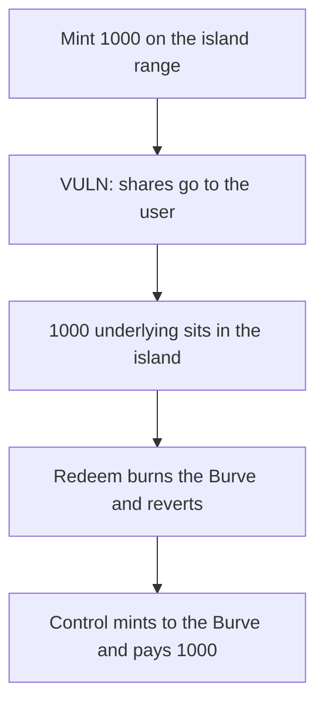

# Burve — island shares are minted to the user, so redeem cannot burn them

> **Vulnerability classes:** vuln/logic/incorrect-state-transition · vuln/dos/frozen-funds

<!-- non-defihacklabs -->
<!-- source-auditvault: https://github.com/Auditware/AuditVault/blob/main/findings/55214-h-03-incorrect-recipient-results-in-the-inability-to-properl.md -->
<!-- date: 2025-01 -->

## Key info

| | |
|---|---|
| **Protocol** | Burve |
| **Finding** | Pashov Audit Group H-03, AuditVault 55214 |
| **Vulnerable code** | island `mint` recipient on the zero tick range |
| **Harm** | 1000 underlying stuck in the island. Burve redeem reverts. Minting to the Burve pays 1000. |
| **Chain** | local synthetic |

## TL;DR

The zero tick range is the island range. `mint` sends island shares to `recipient`. Uniswap V3 ranges correctly mint to `address(this)`. `redeem` burns shares from the Burve, which holds none, so the burn reverts and the 1000 underlying stays in the island. The user holds the island shares but cannot withdraw through Burve. A Burve that mints to itself holds the shares, and `redeem` pays the 1000 underlying back.

## The vulnerable code

```solidity
if (range.lower == 0 && range.upper == 0) {
    uint256 mintShares = liq;
    address shareTo = mintToSelf ? address(this) : recipient;
    // @> VULN: island shares are minted to the user; redeem burns this contract, which has none
    island.mint(mintShares, shareTo);
} else {
    island.mint(liq, address(this));
}
```

The recommended change is `island.mint(mintShares, address(this))`.

## Root cause

The island branch uses the user as the share recipient, while every later burn assumes the Burve is the holder. The shares and the burn target disagree, so the underlying cannot move back out through `redeem`.

## Preconditions

The minted range is `(0, 0)`. The user transfers 1000 underlying in. Redeem burns `address(this)` on the island, not the user.

## Attack walkthrough

1. `mint` on range `(0, 0)` for 1000 pulls the underlying into the island and credits the shares to the user.
2. The Burve's island balance is 0.
3. `redeem(1000)` calls `island.burn(burve, 1000)` and reverts.
4. The island still holds 1000.
5. The control Burve mints to itself and `redeem` pays 1000 underlying to the user.

## Diagrams



## Impact

The 1000 underlying cannot be withdrawn by the Burve redeem path. The shares sit on the user, so a direct island burn would return the assets but would leave the Burve position outstanding. Minting the shares to the Burve makes redeem pay the 1000.

## Remediation

Mint island shares to `address(this)`, matching the Uniswap V3 branch.

## How to reproduce

```bash
cd 55214-h-03-incorrect-recipient-results-in-the-inability-to-properl_exp
forge test -vv
```

## Sources

- AuditVault finding: https://github.com/Auditware/AuditVault/blob/main/findings/55214-h-03-incorrect-recipient-results-in-the-inability-to-properl.md
- Pashov report: https://github.com/pashov/audits/blob/master/team/md/Burve-security-review_2025-01-29.md
