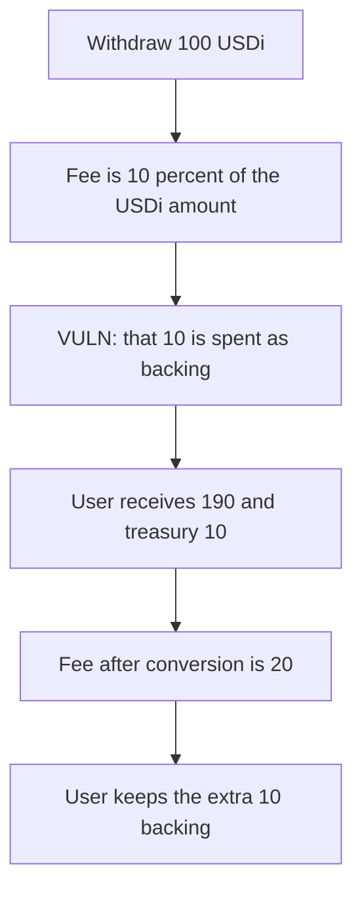

# USDi — a withdrawal fee priced in USDi is paid in backing

> **Vulnerability classes:** vuln/logic/fee-calculation · vuln/arithmetic/decimal-mismatch

<!-- non-defihacklabs -->
<!-- source-auditvault: https://github.com/Auditware/AuditVault/blob/main/findings/55383-incorrect-fee-handling-during-withdrawals-fixed-consensys-no.md -->
<!-- date: 2025-04 -->

## Key info

| | |
|---|---|
| **Protocol** | USDi |
| **Finding** | ConsenSys Diligence, George Kobakhidze, AuditVault 55383 |
| **Vulnerable code** | `USDiCoin.withdraw` |
| **Harm** | Withdrawing 100 USDi at 2 backing per USDi pays the user 190 backing and the treasury 10. The fee after conversion is 20, so the user keeps 10 that belongs to the treasury. |
| **Chain** | local synthetic |

## TL;DR

`withdraw` calls `getFee` on the USDi amount and then transfers that fee as `backingToken`. At a rate of 2, 100 USDi is 200 backing. Ten percent of the USDi amount is 10, so the user receives 190 and the treasury 10. Ten percent of the backing amount is 20, so the user should receive 180. The difference is 10 backing taken from the fee.

## The vulnerable code

```solidity
fee = getFee(amount, false);
if (fee < minimumFee) {
    fee = minimumFee;
}
uint256 netAmount = amount - fee;
// @> VULN: fee is still a USDi quantity but it is taken in backingToken
feePaid = fee;
userOut = backingAmount - feePaid;
```

The report says the fee has to be computed after `amount` is converted into backing.

## Root cause

`getFee` runs on the USDi quantity. The later `backingToken` transfer and the subtraction from the converted amount both treat that quantity as backing. The two units match only when the rate is 1.

## Preconditions

The caller holds 100 USDi. The coin holds 200 backing. The rate is 2 backing per 1 USDi and the fee is 10 percent. `minimumFee` is 0. Withdrawing is open to the holder. It is not an admin action.

## Attack walkthrough

1. Withdraw 100 USDi.
2. The fee is `100 * 10% = 10` USDi units.
3. Gross backing is 200. The user is assigned `200 - 10 = 190`.
4. The treasury receives 10 backing.
5. The converted net of the post-fee USDi is 180. The user is 10 ahead of that.
6. The coin that applies the 10 percent fee to the 200 backing pays the user 180 and the treasury 20.

## Diagrams



## Impact

The withdrawer keeps 10 backing that the fee schedule assigns to the treasury. The path that converts first pays the treasury 20 and the user 180, so the 10 does not stay with the user.

## Remediation

Convert the USDi amount into backing, then call `getFee` on that backing amount.

## How to reproduce

```bash
cd 55383-incorrect-fee-handling-during-withdrawals-fixed-consensys-no_exp
forge test -vv
```

## Sources

- AuditVault finding: https://github.com/Auditware/AuditVault/blob/main/findings/55383-incorrect-fee-handling-during-withdrawals-fixed-consensys-no.md
- ConsenSys Diligence: https://diligence.consensys.io/audits/2025/04/usdi/
