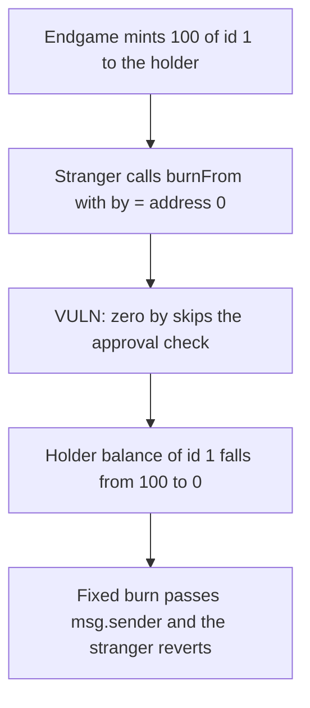

# GachaToken — anyone can burn another holder's Gotcha tokens

> **Vulnerability classes:** vuln/access-control/missing-auth · vuln/logic/missing-check

<!-- non-defihacklabs -->
<!-- source-auditvault: https://github.com/Auditware/AuditVault/blob/main/findings/55404-c-01-unauthorized-access-to-burn-gotcha-token-pashov-audit-g.md -->
<!-- date: 2025-01 -->

## Key info

| | |
|---|---|
| **Protocol** | Onchain Heroes (GachaToken) |
| **Finding** | Pashov Audit Group C-01, AuditVault 55404 |
| **Vulnerable code** | `GachaToken.burnFrom` / `GachaToken._burn(address by, ...)` |
| **Harm** | 100 Gotcha tokens of id 1 burned; the holder's balance goes from 100 to 0 |
| **Chain** | local synthetic |

## TL;DR

`GachaToken` exposes Solady ERC1155's internal `_burn(address by, address from, uint256 id, uint256 amount)`. That function skips the approval check when `by` is the zero address, because internal callers are trusted. `burnFrom` lets any external caller choose `by`. Passing `address(0)` burns 100 tokens of id 1 from a holder who never approved the caller. The balance is 0 afterwards. The fixed `burn` passes `msg.sender` as `by`, so a non-owner call reverts and the 100 tokens stay.

## The vulnerable code

```solidity
/// - If `by` is not the zero address, it must be either `from`,
///   or approved to manage the tokens of `from`.
function burnFrom(address by, address from, uint256 id, uint256 amount) external {
    _burn(by, from, id, amount);
}

function _burn(address from, uint256 id, uint256 amount) internal {
    _burn(address(0), from, id, amount);
}

function _burn(address by, address from, uint256 id, uint256 amount) internal {
    // @> VULN: by == address(0) skips this approval check, so the debit below hits any holder.
    if (by != address(0)) {
        if (by != from && !isApprovedForAll[from][by]) revert NotOwnerNorApproved();
    }
    balanceOf[from][id] = balanceOf[from][id] - amount;
}
```

`burn(from, id, amount)` reaches the same skip by calling the three-argument `_burn`, which hardcodes `by = address(0)`. The auditor's fix deletes `burnFrom` and changes `burn` to `_burn(msg.sender, from, id, amount)`.

## Root cause

The `by == address(0)` exception is an internal privilege: Solady uses it so `_burn(from, id, amount)` can burn without a second authorization check. Publishing that parameter on `burnFrom`, and calling the three-argument wrapper from the external `burn`, turns the privilege into a caller input. The caller does not need to be `from`, an operator, or Endgame.

## Preconditions

The holder has a non-zero Gotcha balance. No approval, signature, or minter role is required to burn it. Endgame is the only minter; that role is not the attacker.

## Attack walkthrough

1. The holder starts at 0 of id 1.
2. Endgame mints 100 of id 1 to the holder. The balance is 100.
3. A stranger calls `burnFrom(address(0), holder, 1, 100)`.
4. `by` is the zero address, so `NotOwnerNorApproved` is not evaluated.
5. The holder's balance is written to 0 and `burned` is 100.

The control uses the recommended `burn`: `by` is `msg.sender`. The same stranger reverts with `NotOwnerNorApproved` and the balance stays 100. The holder can still burn their own tokens.

## Diagrams



## Impact

Anyone can destroy another user's Gotcha tokens. In this run the holder loses all 100 of id 1. The tokens are burned, not stolen, so the attacker has no token balance to show; the harm is the holder's balance going to 0.

## Remediation

Delete `burnFrom`. Change `burn` so it calls `_burn(msg.sender, from, id, amount)`.

## How to reproduce

```bash
cd 55404-c-01-unauthorized-access-to-burn-gotcha-token-pashov-audit-g_exp
forge test -vv
```

## Sources

- AuditVault finding: https://github.com/Auditware/AuditVault/blob/main/findings/55404-c-01-unauthorized-access-to-burn-gotcha-token-pashov-audit-g.md
- Pashov report: https://github.com/pashov/audits/blob/master/team/md/OnchainHeroes-security-review_2025-01-13.md
- Solady ERC1155 `_burn(address by, ...)` (the zero-`by` skip this wrapper exposes): https://github.com/Vectorized/solady/blob/main/src/tokens/ERC1155.sol
- Fixed `burn` on the deployed GachaToken passes `msg.sender`: https://abscan.org/address/0xb5ec907d0e80f9a1ca9c1942d69fb558e01140d4
