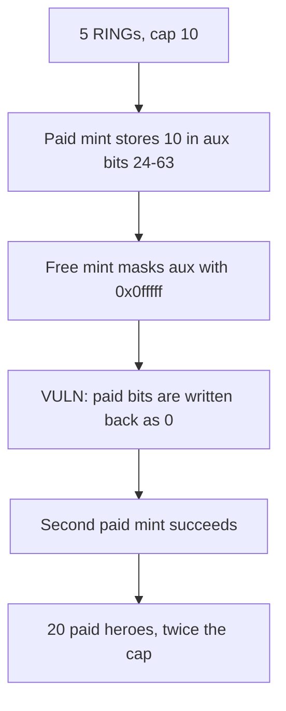

# HeroERC721A — free mint wipes the paid counter and doubles the RING cap

> **Vulnerability classes:** vuln/logic/missing-check · vuln/logic/state-update

<!-- non-defihacklabs -->
<!-- source-auditvault: https://github.com/Auditware/AuditVault/blob/main/findings/55405-c-02-malicious-users-can-mint-the-double-guaranteed-mints-pe.md -->
<!-- date: 2025-01 -->

## Key info

| | |
|---|---|
| **Protocol** | Onchain Heroes (HeroERC721A) |
| **Finding** | Pashov Audit Group C-02, AuditVault 55405 |
| **Vulnerable code** | `HeroERC721A._ogMint` |
| **Harm** | 20 paid heroes minted against a cap of 10 (2 per RING, 5 RINGs). Balance is 25 including the 5 free mints. |
| **Chain** | local synthetic |

## TL;DR

OG holders get 2 guaranteed mints per RING plus one free mint. The paid count lives in aux bits 24-63. `_ogMint` rebuilds aux from `(_getAux(to) >> 3) & 0x0fffff`, which keeps only the free-mint field, then writes that word back. A holder with 5 RINGs mints the cap of 10, takes the free mint (5 more heroes, and the paid bits are now 0), then mints 10 again. Paid mints are 20, twice the cap. Preserving the full aux word makes the second batch revert at 10.

## The vulnerable code

```solidity
function _ogMint(address to, uint64 numOfRings) internal {
    // @> VULN: mask keeps only the free-mint field, so the write below deletes paid mints in bits 24-63.
    uint64 aux = (_getAux(to) >> 3) & 0x0fffff;
    if (aux == numOfRings) revert AlreadyMinted();
    _setAux(to, uint64(aux | (numOfRings << 3))); // Set OG free mint flag
    _safeMint(to, numOfRings);
}
```

The report's fix reads the full word once and ORs the flag into it:

```solidity
uint64 _aux = _getAux(to);
uint64 aux = (_aux >> 3) & 0x0fffff;
if (aux == numOfRings) revert AlreadyMinted();
_setAux(to, uint64(_aux | (numOfRings << 3)));
_safeMint(to, numOfRings);
```

Aux layout from the report: bits 0-2 other flags, bits 3-23 the free-mint field, bits 24-63 the paid-mint count. `0x0fffff` is 20 bits, so everything from bit 24 up is discarded.

## Root cause

The free-mint path treats aux as if it only stored the free-mint field. The paid path stores its counter in the same word, above bit 23. Masking before the write deletes that counter. The cap check `already + qty > rings * 2` then sees `already == 0` and allows another full batch.

## Preconditions

The caller is the snapshotted holder of 5 RINGs. The cap is `5 * 2 = 10`. No second whitelist entry is required. The three `ogMint` calls fit in one transaction; nothing depends on a later block.

## Attack walkthrough

1. `ogMint(free=false, qty=10, rings=5)` stores 10 in bits 24-63 and mints 10. `paidMinted` is 10.
2. `ogMint(free=true, qty=0, rings=5)` runs `_ogMint`. The masked word does not contain the 10. Aux becomes `5 << 3` and 5 free heroes are minted. `aux >> 24` is 0.
3. `ogMint(free=false, qty=10, rings=5)` reads a paid count of 0, so `10 <= 10`, and mints 10 more.
4. `paidMinted` is 20. `balanceOf` is 25.

The control keeps the high bits. After the free mint the paid count is still 10, and the second batch reverts with `CapReached`. Paid stays 10. Balance stays 15.

## Diagrams



## Impact

A 5-RING holder mints 20 guaranteed heroes instead of 10, plus the 5 free heroes the free-mint path is supposed to mint. The extra 10 heroes are the cap minted a second time. The fixed path stops the second batch at the cap.

## Remediation

When setting the free-mint flag, OR it into the existing aux word. Do not rebuild the word from the masked free-mint field alone.

## How to reproduce

```bash
cd 55405-c-02-malicious-users-can-mint-the-double-guaranteed-mints-pe_exp
forge test -vv
```

## Sources

- AuditVault finding: https://github.com/Auditware/AuditVault/blob/main/findings/55405-c-02-malicious-users-can-mint-the-double-guaranteed-mints-pe.md
- Pashov report: https://github.com/pashov/audits/blob/master/team/md/OnchainHeroes-security-review_2025-01-13.md
