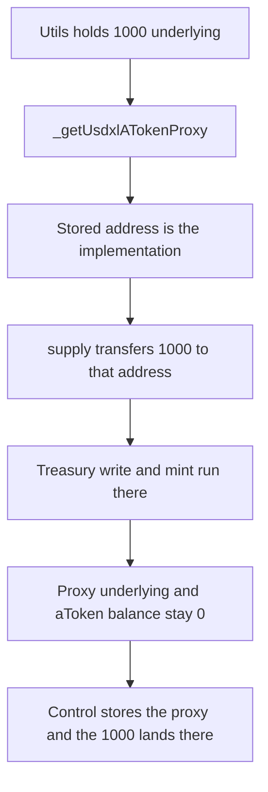

# HypurrFi — the aToken proxy getter returns the implementation

> **Vulnerability classes:** vuln/logic/state-update · vuln/dependency/upgradeable-contract

<!-- non-defihacklabs -->
<!-- source-auditvault: https://github.com/Auditware/AuditVault/blob/main/findings/55467-h-03-incorrect-proxy-address-tracking-misconfigures-usdxl-po.md -->
<!-- date: 2025-02 -->

## Key info

| | |
|---|---|
| **Protocol** | HypurrFi |
| **Finding** | Pashov H-03, AuditVault 55467 |
| **Vulnerable code** | `DeployUsdxlUtils._getUsdxlATokenProxy` |
| **Harm** | A later supply sends 1000 underlying to the implementation and mints 1000 aTokens there. The proxy stays at 0. |
| **Chain** | local synthetic |

## TL;DR

`_getUsdxlATokenProxy` returns `address(usdxlAToken)`, the implementation that was deployed with `new`, not the proxy the pool keeps as the reserve aToken. `supply` uses that address. It transfers 1000 underlying onto the implementation, writes the treasury there, and mints 1000 aTokens there. The proxy's underlying balance, treasury, and aToken balance all stay 0. Returning `address(usdxlATokenProxy)` puts the same 1000 on the proxy and mints nothing on the implementation.

## The vulnerable code

```solidity
function _getUsdxlATokenProxy() public virtual returns (address) {
    // @> VULN: returns the implementation. Callers treat this as the aToken proxy.
    trackedProxy = address(usdxlAToken);
    return trackedProxy;
}
```

The report's getter is the same return, without the tracking write:

```solidity
function _getUsdxlATokenProxy() internal view returns (address) {
    return address(usdxlAToken); // Returns implementation instead of proxy
}
```

`_getUsdxlVariableDebtTokenProxy` has the same shape. This reduction shows the aToken path, which is the one `supply` and `updateUsdxlTreasury` use.

```diff
- trackedProxy = address(usdxlAToken);
+ trackedProxy = address(usdxlATokenProxy);
```

## Root cause

The deploy script keeps the implementation in `usdxlAToken` and a separate proxy in `usdxlATokenProxy`, then the getter that every later configuration call uses returns the implementation. Treasury updates, facilitator wiring, and mints all hit a contract the pool does not call. The proxy the reserve actually holds is left unconfigured.

## Preconditions

An implementation and a proxy exist as two contracts. The utils contract holds 1000 underlying, the amount a supplier is depositing. No admin key is required beyond the deploy helper's own `supply`, which is the post-deploy call the report says is aimed at the wrong address.

## Attack walkthrough

1. Mint 1000 underlying to the deploy utils.
2. Call `_getUsdxlATokenProxy`. It stores `address(usdxlAToken)`.
3. `supply` transfers that 1000 to the stored address.
4. `updateUsdxlTreasury` and `mint` run on that same address.
5. The implementation holds 1000 underlying, its treasury is the supplier, and the supplier's aToken balance there is 1000.
6. The proxy holds 0 underlying, treasury `address(0)`, and an aToken balance of 0.

The control getter stores `address(usdxlATokenProxy)`. The same `supply` leaves the implementation at 0 and credits the proxy with 1000 underlying and 1000 aTokens.

## Diagrams



## Impact

The depositor's 1000 underlying sits on the implementation, which the pool does not use, and the 1000 aTokens credited to them are not the proxy balance the reserve would redeem. The live proxy records nothing. The same call with the proxy stored delivers the 1000 underlying and the 1000 aTokens to the proxy and leaves the implementation at 0.

## Remediation

Track the proxy addresses taken from the pool's reserve data after `initReserves`, and make both getters return those proxies. Point `updateUsdxlTreasury`, `setVariableDebtToken`, and `setAToken` at the proxies.

## How to reproduce

```bash
cd 55467-h-03-incorrect-proxy-address-tracking-misconfigures-usdxl-po_exp
forge test -vv
```

## Sources

- AuditVault finding: https://github.com/Auditware/AuditVault/blob/main/findings/55467-h-03-incorrect-proxy-address-tracking-misconfigures-usdxl-po.md
- Pashov report: https://github.com/pashov/audits/blob/master/team/md/HypurrFi-security-review_2025-02-12.md
- Reduced from `src/deployments/utils/DeployUsdxlUtils.sol` as quoted in that review (`_getUsdxlATokenProxy` returns `address(usdxlAToken)`).
